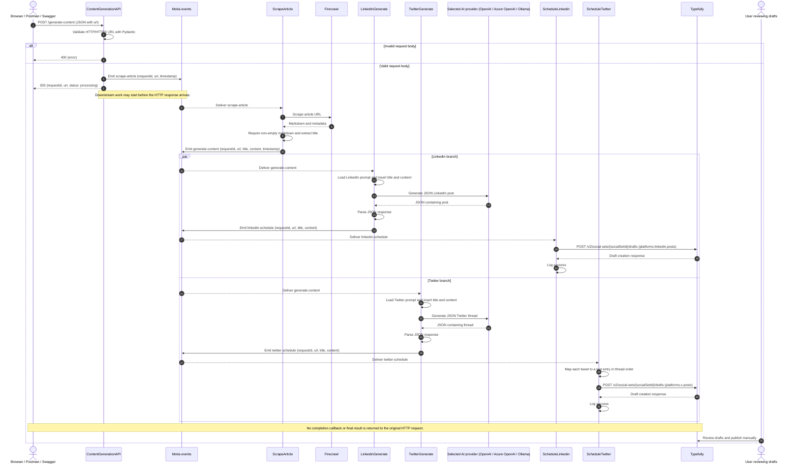

* Build an Agentic workflow that turns any URL into social media posts and auto-schedules them via Typefully. 
* Tech stack: 
  * Motia as the unified backend framework 
  * Firecrawl to scrape web content 
  * Ollama to locally serve Deepseek-R1 LLM 
* Workflow: 
  * User submits URL to scrape 
  * Firecrawl scrapes content and converts it to markdown 
  * Twitter and LinkedIn agents run in parallel to generate content 
  * Generated content gets scheduled via Typefully
 
* Workflow - Our workflow consists of 4 main steps:- API → Scrape → Generate → Schedule
  * API: Receives article URL via POST request
  * Scrape: Extracts content using Firecrawl in markdown format
  * Generate: Creates Twitter & LinkedIn content using Deepseek-R1
  * Schedule: Saves content as drafts in Typefully for review
 

* [Motia](https://www.motia.dev/), an open-source modern backend framework that brings together: Multi-agent orchestration, APIs, Event handling, and background jobs - everything under one unified system.
  * https://typefully.com/docs/api#tag/drafts/POST/v2/social-sets/{social_set_id}/drafts
  * Just like React streamlines frontend development, Motia simplifies the AI backend, where you only need one solution instead of a dozen tools.
  * Key features:
    * You can have Python, JS & TypeScript in the same workflow.
    * You can deploy from your laptop to prod in one click.
    * It has built-in observability & state management.
    * It provides automatic retries & fault tolerance.
    * It supports streaming response.

* Steps are the fundamental building blocks of Motia. They consist of two main components: 
  * The Config object: It instructs Motia on how to interact with a step. 
  * The handler function: It defines the main logic of a step. 
  
  
* With that understanding in mind, let's start building our content creation workflow.
* #1) Entry point (API) (api.step.py) - We start our content generation workflow by defining an API step that takes in a URL from the user via a POST request.
  
* #2) Web scraping - This step scrapes the article content using Firecrawl and emits the next step in  the workflow. Steps can be connected together in a sequence, where the output of one step becomes the input for another.
  
* #3) Content generation - The scraped content gets fed to the X and LinkedIn agents that run in parallel and generate curated posts. We define all our prompting and AI logic in the handler that runs automatically when a step is triggered.
  
* #4) Scheduling - After the content is generated we draft it in Typefully where we can easily review our social media posts. Motia also allows us to mix and match different languages within the same 
workflow providing great flexibility. Check this typescript code:
  
* After defining our steps, we install required dependencies using `npm install` and run the Motia workbench using `npm run dev` commands. 
* Motia workbench provides an interactive UI to help build, monitor and debug our flows. 
  

