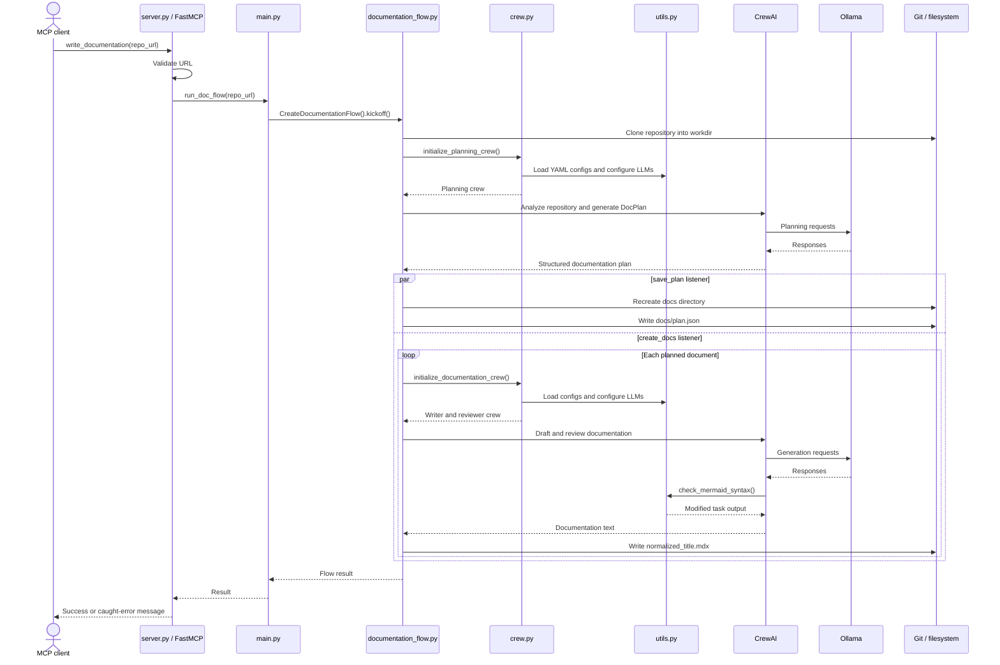

* Build an Agentic workflow that generates full project documentation from just a GitHub repo URL. 
* Tech stack: 
  * CrewAI for multi-agent orchestration 
  * Ollama to locally serve DeepSeek-R1 LLM 
* Workflow: 
  * User specifies GitHub repo 
  * Planning crew creates documentation plan 
  * Documentation crew writes documentation according to plan 
  * Generated docs get saved to local directory
 


* #2) Define Pydantic schema - for robust structured outputs. This ensures data validation and integrity before generating the documentation files.
#3) Planning Crew - This crew oversees strategy for the outline via: 
  * Code explorer agent -> Analyzes codebase for key components, patterns and relationships. 
  * Doc planner agent -> Creates outline based on codebase analysis as pydantic output. 
* #4) Documentation Crew - This crew writes and reviews the documentation via: 
  * Doc writer agent -> Generates a high-level draft based on the planned 
  * Doc reviewer agent -> Reviews the draft for consistency, accuracy and completeness. 
* #5) Create Documentation Flow. After setting up our crews, we create the main workflow that: 
  * Clones the GitHub repo 
  * Plans and saves the outline 
  * Generates documentation based on the outline 
  * Saves final docs to local directory 
* #6) Kickoff the flow - Finally, when we have everything ready, we kick off our documentation flow with the GitHub repo URL.

``` pip install crewai crewai-tools ollama mcp ```


```
.mcp.json
{
	"mcpServers": {
		"my-mcp-server-7219d355": {
			"url": "http://127.0.0.1:8000/sse",
			"type": "sse"
		}
	}
}
```




