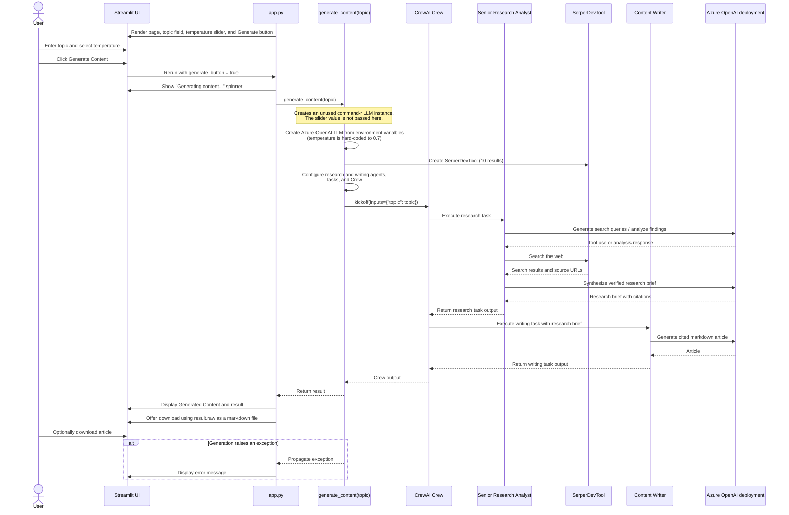

* The app takes a user query, searches the web for it, and turns it into a well-crafted news article, with citations. 
* Tech stack: 
  * Cohere ultra-fast Command R 7B as LLM 
  * CrewAI for multi-agent orchestration 
* Workflow:  
  * We’ll have two agents in this multi-agent app: 
    * Research analyst agent: 
      * Accepts a user query. 
    * Uses the Serper web search tool to fetch results from the internet. 
    * Consolidates the results. 
      * Content writer agent: 
    * Uses the curated results to prepare a polished, publication-ready article.
   
  

* #2) Senior Research Analyst Agent 
  * The web-search agent takes a user query and then uses the Serper web search tool to fetch results from the internet and consolidate them.
   * This is the research task that we assign to our senior research analyst agent, with description and expected output. 
* #3) Content writer agent 
  * The role of content writer is to use the curated results and turn them into a polished, publication-ready news article . 
  * This is how we describe the writing task with all the details and expected output:



```
import os
import streamlit as st
from crewai import Agent, Task, Crew, LLM
from crewai_tools import SerperDevTool
from dotenv import load_dotenv

# Load environment variables
load_dotenv()

# Streamlit page config
st.set_page_config(page_title="AI News Generator", page_icon="📰", layout="wide")

# Title and description
st.title("🤖 AI News Generator, powered by CrewAI and Cohere's Command R7B")
st.markdown("Generate comprehensive blog posts about any topic using AI agents.")

# Sidebar
with st.sidebar:
    st.header("Content Settings")
    
    # Make the text input take up more space
    topic = st.text_area(
        "Enter your topic",
        height=100,
        placeholder="Enter the topic you want to generate content about..."
    )
    
    # Add more sidebar controls if needed
    st.markdown("### Advanced Settings")
    temperature = st.slider("Temperature", 0.0, 1.0, 0.7)
    
    # Add some spacing
    st.markdown("---")
    
    # Make the generate button more prominent in the sidebar
    generate_button = st.button("Generate Content", type="primary", use_container_width=True)
    
    # Add some helpful information
    with st.expander("ℹ️ How to use"):
        st.markdown("""
        1. Enter your desired topic in the text area above
        2. Adjust the temperature if needed (higher = more creative)
        3. Click 'Generate Content' to start
        4. Wait for the AI to generate your article
        5. Download the result as a markdown file
        """)

def generate_content(topic):
 
    llm_local = LLM(
        model="command-r",
        temperature=0.7
    )
    
    llm = LLM(
        model=os.getenv("AZURE_OPENAI_DEPLOYMENT_NAME_LLM"),
        api_key=os.getenv("AZURE_OPENAI_API_KEY"),
        temperature=0.7,
        base_url=os.getenv("AZURE_OPENAI_ENDPOINT_LLM")
    )
    search_tool = SerperDevTool(n_results=10)

    # First Agent: Senior Research Analyst
    senior_research_analyst = Agent(
        role="Senior Research Analyst",
        goal=f"Research, analyze, and synthesize comprehensive information on {topic} from reliable web sources",
        backstory="You're an expert research analyst with advanced web research skills. "
                "You excel at finding, analyzing, and synthesizing information from "
                "across the internet using search tools. You're skilled at "
                "distinguishing reliable sources from unreliable ones, "
                "fact-checking, cross-referencing information, and "
                "identifying key patterns and insights. You provide "
                "well-organized research briefs with proper citations "
                "and source verification. Your analysis includes both "
                "raw data and interpreted insights, making complex "
                "information accessible and actionable.",
        allow_delegation=False,
        verbose=True,
        tools=[search_tool],
        llm=llm
    )

    # Second Agent: Content Writer
    content_writer = Agent(
        role="Content Writer",
        goal="Transform research findings into engaging blog posts while maintaining accuracy",
        backstory="You're a skilled content writer specialized in creating "
                "engaging, accessible content from technical research. "
                "You work closely with the Senior Research Analyst and excel at maintaining the perfect "
                "balance between informative and entertaining writing, "
                "while ensuring all facts and citations from the research "
                "are properly incorporated. You have a talent for making "
                "complex topics approachable without oversimplifying them.",
        allow_delegation=False,
        verbose=True,
        llm=llm
    )

    # Research Task
    research_task = Task(
        description=("""
            1. Conduct comprehensive research on {topic} including:
                - Recent developments and news
                - Key industry trends and innovations
                - Expert opinions and analyses
                - Statistical data and market insights
            2. Evaluate source credibility and fact-check all information
            3. Organize findings into a structured research brief
            4. Include all relevant citations and sources
        """),
        expected_output="""A detailed research report containing:
            - Executive summary of key findings
            - Comprehensive analysis of current trends and developments
            - List of verified facts and statistics
            - All citations and links to original sources
            - Clear categorization of main themes and patterns
            Please format with clear sections and bullet points for easy reference.""",
        agent=senior_research_analyst
    )

    # Writing Task
    writing_task = Task(
        description=("""
            Using the research brief provided, create an engaging blog post that:
            1. Transforms technical information into accessible content
            2. Maintains all factual accuracy and citations from the research
            3. Includes:
                - Attention-grabbing introduction
                - Well-structured body sections with clear headings
                - Compelling conclusion
            4. Preserves all source citations in [Source: URL] format
            5. Includes a References section at the end
        """),
        expected_output="""A polished blog post in markdown format that:
            - Engages readers while maintaining accuracy
            - Contains properly structured sections
            - Includes Inline citations hyperlinked to the original source url
            - Presents information in an accessible yet informative way
            - Follows proper markdown formatting, use H1 for the title and H3 for the sub-sections""",
        agent=content_writer
    )

    # Create Crew
    crew = Crew(
        agents=[senior_research_analyst, content_writer],
        tasks=[research_task, writing_task],
        verbose=True
    )

    return crew.kickoff(inputs={"topic": topic})

# Main content area
if generate_button:
    with st.spinner('Generating content... This may take a moment.'):
        try:
            result = generate_content(topic)
            st.markdown("### Generated Content")
            st.markdown(result)
            
            # Add download button
            st.download_button(
                label="Download Content",
                data=result.raw,
                file_name=f"{topic.lower().replace(' ', '_')}_article.md",
                mime="text/markdown"
            )
        except Exception as e:
            st.error(f"An error occurred: {str(e)}")

# Footer
st.markdown("---")
st.markdown("Built with CrewAI, Streamlit and powered by Cohere's Command R7B")
```

```  python -m streamlit run app.py --server.address 127.0.0.1 --server.port 8501 --server.headless true --browser.gatherUsageStats false ```


