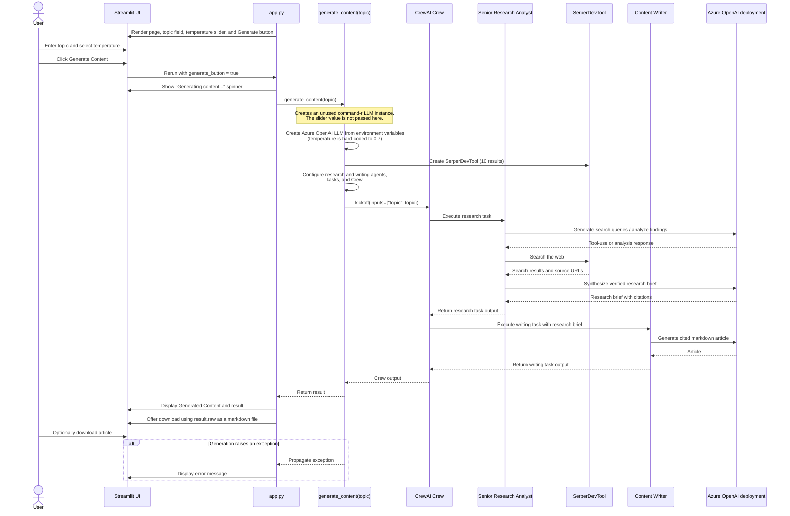

* The app takes a user query, searches the web for it, and turns it into a well-crafted news article, with citations. 
* Tech stack: 
  * Cohere ultra-fast Command R 7B as LLM 
  * CrewAI for multi-agent orchestration 
* Workflow:  
  * We’ll have two agents in this multi-agent app: 
    * Research analyst agent: 
      * Accepts a user query. 
    * Uses the Serper web search tool to fetch results from the internet. 
    * Consolidates the results. 
      * Content writer agent: 
    * Uses the curated results to prepare a polished, publication-ready article.
   
  

* #2) Senior Research Analyst Agent 
  * The web-search agent takes a user query and then uses the Serper web search tool to fetch results from the internet and consolidate them.
   * This is the research task that we assign to our senior research analyst agent, with description and expected output. 
* #3) Content writer agent 
  * The role of content writer is to use the curated results and turn them into a polished, publication-ready news article . 
  * This is how we describe the writing task with all the details and expected output:

```  python -m streamlit run app.py --server.address 127.0.0.1 --server.port 8501 --server.headless true --browser.gatherUsageStats false ```



