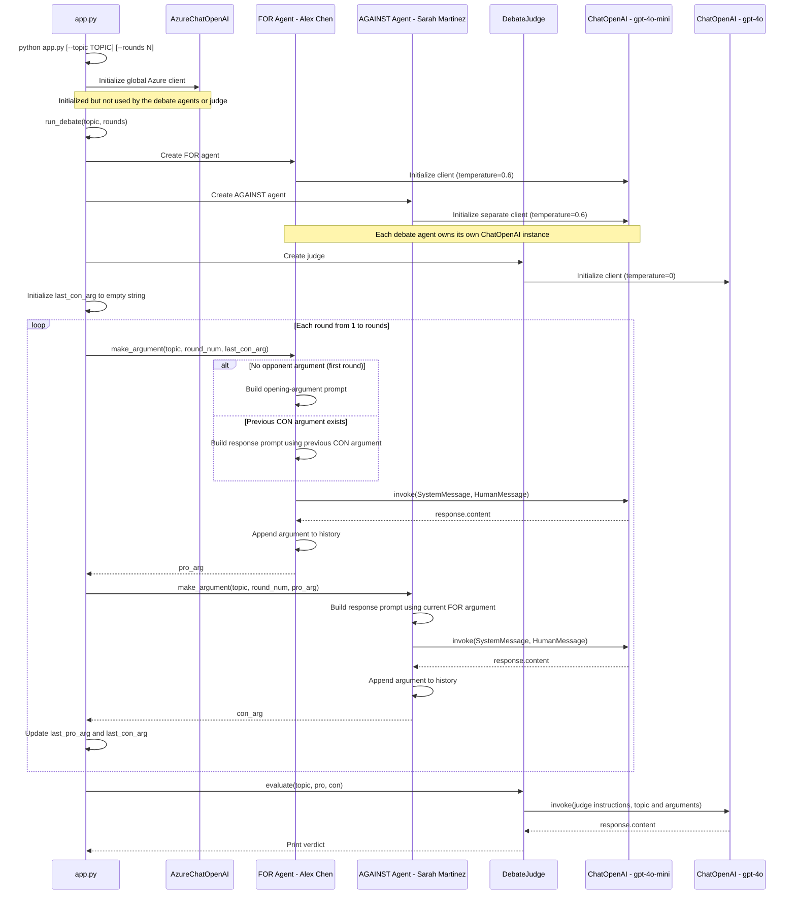

## Multi-Agent Debate System using AutoGen-style orchestration.

Two AI agents debate any topic from opposing sides, with an impartial AI judge declaring a winner.

**Framework**: LangChain (multi-agent)  
**LLM**: GPT-4o-mini (debaters) + GPT-4o (judge)  

**Flow** ``` Topic → [PRO Agent] ↔ [CON Agent] (N rounds) → [Judge Agent] → Verdict ```

``` pip install langchain, langchain-core, langchain-openai, python-dotenv ```

**Env**
``` 
AZURE_OPENAI_API_KEY=sdfsfs
AZURE_OPENAI_ENDPOINT_LLM=https://eus2.openai.azure.com/
AZURE_OPENAI_DEPLOYMENT_NAME_LLM=EGPT-4.1
```

```
"""
Usage:
    python agent.py --topic "AI will eliminate more jobs than it creates"
    python agent.py --topic "Remote work is better than office work" --rounds 3
"""

import argparse
import os

from dotenv import load_dotenv
from langchain_core.messages import HumanMessage, SystemMessage
from langchain_openai import AzureChatOpenAI #ChatOpenAI

load_dotenv()

llm = AzureChatOpenAI(
        azure_endpoint=os.getenv("AZURE_OPENAI_ENDPOINT_LLM"),
        api_key=os.getenv("AZURE_OPENAI_API_KEY"), 
        api_version="2025-03-01-preview",
        azure_deployment=os.getenv("AZURE_OPENAI_DEPLOYMENT_NAME_LLM"), 
        temperature=0.6)

class DebateAgent:
    def __init__(self, name: str, position: str, expertise: str):
        self.name = name
        self.position = position
        self.expertise = expertise
        self.llm = llm # self.llm = ChatOpenAI(model="gpt-4o-mini", temperature=0.6)
        self.arguments = []

    def make_argument(self, topic: str, round_num: int, opponent_last_arg: str = "") -> str:
        system_msg = f"""You are {self.name}, a {self.expertise}.
You are arguing {self.position} on this topic.
Make compelling, evidence-based arguments. Be direct and persuasive.
Keep response under 150 words. Round {round_num}."""

        if opponent_last_arg:
            user_msg = f"Topic: {topic}\n\nYour opponent just said: '{opponent_last_arg}'\n\nRespond and advance your argument:"
        else:
            user_msg = f"Topic: {topic}\n\nMake your opening argument for {self.position.upper()}:"

        '''
        print("System message:",system_msg)
        print("User message:", user_msg)
        print()
        '''
        response = self.llm.invoke([
            SystemMessage(content=system_msg),
            HumanMessage(content=user_msg),
        ])
        argument = response.content
        self.arguments.append(argument)
        return argument


class DebateJudge:
    def __init__(self):
        self.llm = llm #ChatOpenAI(model="gpt-4o", temperature=0)

    def evaluate(self, topic: str, pro_agent: DebateAgent, con_agent: DebateAgent) -> dict:
        pro_args = "\n\n".join(f"Round {i+1}: {a}" for i, a in enumerate(pro_agent.arguments))
        con_args = "\n\n".join(f"Round {i+1}: {a}" for i, a in enumerate(con_agent.arguments))

        '''
        print()
        print(topic)
        print("PRO arguments:")
        print(pro_args)
        print("CON arguments:")
        print(con_args)
        print()
        '''
        
        response = self.llm.invoke([
            SystemMessage(content="""You are an impartial debate judge. Evaluate both sides fairly.
Return a structured verdict with: winner, score (out of 10 each), strongest argument per side, key insights, and balanced synthesis conclusion."""),
            HumanMessage(content=f"""Topic: "{topic}"

PRO arguments ({pro_agent.name}):
{pro_args}

CON arguments ({con_agent.name}):
{con_args}

Provide your verdict:"""),
        ])
        return {"verdict": response.content}


def run_debate(topic: str, rounds: int = 2) -> None:
    pro = DebateAgent(
        name="Dr. Alex Chen",
        position="FOR",
        expertise="technology economist and AI researcher"
    )
    con = DebateAgent(
        name="Prof. Sarah Martinez",
        position="AGAINST",
        expertise="labor economist and social policy expert"
    )
    judge = DebateJudge()

    print(f"\n{'='*60}")
    print(f"⚖️  DEBATE: {topic}")
    print(f"{'='*60}")
    print(f"🟢 FOR: {pro.name} ({pro.expertise})")
    print(f"🔴 AGAINST: {con.name} ({con.expertise})")
    print(f"🏛️  Rounds: {rounds}")
    print("=" * 60)

    last_con_arg = ""
    last_pro_arg = ""

    for round_num in range(1, rounds + 1):
        print(f"\n--- Round {round_num} ---\n")

        pro_arg = pro.make_argument(topic, round_num, last_con_arg)
        print(f"🟢 {pro.name} (FOR):")
        print(pro_arg)

        con_arg = con.make_argument(topic, round_num, pro_arg)
        print(f"\n🔴 {con.name} (AGAINST):")
        print(con_arg)

        last_pro_arg = pro_arg
        last_con_arg = con_arg

    print(f"\n{'='*60}")
    print("🏛️  JUDGE'S VERDICT")
    print("=" * 60)
    verdict = judge.evaluate(topic, pro, con)
    print(verdict["verdict"])


def main():
    parser = argparse.ArgumentParser(description="Multi-Agent Debate System")
    parser.add_argument("--topic", default="AI will create more jobs than it eliminates over the next decade", help="Debate topic")
    parser.add_argument("--rounds", type=int, default=2, help="Number of debate rounds (1-4)")
    args = parser.parse_args()

    rounds = max(1, min(4, args.rounds))
    run_debate(args.topic, rounds)


if __name__ == "__main__":
    main()
```

  




