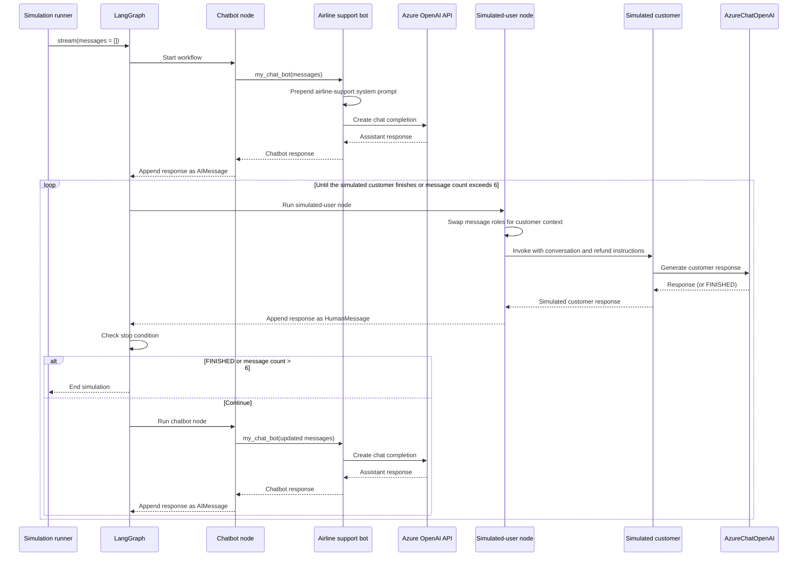

### Chat Bot Evaluation as Multi-agent Simulation

* When building a chat bot (customer support assistant), it can be hard to properly evaluate your bot's performance. It's time-consuming to have to manually interact with it intensively for each code change.
* Make the evaluation process easier and more reproducible is to simulate a user interaction.
* With LangGraph, Example of how to create a "virtual user" to simulate a conversation.


```
import getpass, os
from typing import List
from openai import OpenAI
from dotenv import load_dotenv

from langchain_core.prompts import ChatPromptTemplate, MessagesPlaceholder
from langchain_openai import AzureChatOpenAI, ChatOpenAI
from langchain_core.messages import HumanMessage
#from langchain_community.adapters.openai import convert_message_to_dict
from langchain_core.messages import AIMessage, convert_to_openai_messages
from langgraph.graph import END, StateGraph, START
from langgraph.graph.message import add_messages
from typing import Annotated
from typing_extensions import TypedDict

load_dotenv()

client = OpenAI(
    base_url=os.getenv("AZURE_OPENAI_ENDPOINT_V1"),
    api_key=os.getenv("AZURE_OPENAI_API_KEY"),
)

""" # 1. Define Chat Bot - the bot's API accepts a list of messages and responds with a message.  """
def my_chat_bot(messages: List[dict]) -> dict:
    system_message = {
        "role": "system",
        "content": "You are a customer support agent for an airline.",
    }
    messages = [system_message] + messages
    completion = client.chat.completions.create(
        messages=messages, 
        model=os.getenv("AZURE_OPENAI_DEPLOYMENT_NAME_LLM"),
    )
    return completion.choices[0].message.model_dump()

#response = my_chat_bot([{"role": "user", "content": "hi!"}])
#print(response)


""" # 2. Define Simulated User - build it as a LangChain bot. """
system_prompt_template = """You are a customer of an airline company. \
You are interacting with a user who is a customer support person. \

{instructions}

When you are finished with the conversation, respond with a single word 'FINISHED'"""

prompt = ChatPromptTemplate.from_messages(
    [
        ("system", system_prompt_template),
        MessagesPlaceholder(variable_name="messages"),
    ]
)
instructions = """Your name is Harrison. You are trying to get a refund for the trip you took to Alaska. \
You want them to give you ALL the money back. \
This trip happened 5 years ago."""

prompt = prompt.partial(name="Harrison", instructions=instructions)

model = AzureChatOpenAI(
    azure_deployment=os.environ["AZURE_OPENAI_DEPLOYMENT_NAME_LLM"],
    azure_endpoint=os.environ["AZURE_OPENAI_ENDPOINT_LLM"],
    api_key=os.environ["AZURE_OPENAI_API_KEY"],
    api_version="2025-03-01-preview",
    temperature=0.5,
)
#model = ChatOpenAI()

simulated_user = prompt | model

messages = [HumanMessage(content="Hi! How can I help you?")]
simulated_user.invoke({"messages": messages})

#print(simulated_user.invoke({"messages": messages}))

"""
3. Define the Agent Simulation
    Creates a LangGraph workflow to run the simulation. The main components are:
        2 nodes: 1 for the simulated user, 2 for the chat bot.
        The graph itself, with a conditional stopping criterion.

3.1 Define nodes
     It takes in a list of messages and returns a list of messages to ADD to the state. 
     These will be thin wrappers around the chat bot and simulated user we have above.

Note: Because both the chat & simulated user are LLMs, some logic that flips the AI and human roles. 
In this example, assume that HumanMessages are messages from the simulated user, need some logic in the simulated user node to swap AI and Human messages.

first let's define the chat bot node
"""
def chat_bot_node(state):
    messages = state["messages"]
    # Convert from LangChain format to the OpenAI format, which our chatbot function expects.
    messages = [convert_to_openai_messages(m) for m in messages]
    # Call the chat bot
    chat_bot_response = my_chat_bot(messages)
    # Respond with an AI Message
    return {"messages": [AIMessage(content=chat_bot_response["content"])]}

# next, define the node for our simulated user. This will involve a little logic to swap the roles of the messages.

def _swap_roles(messages):
    new_messages = []
    for m in messages:
        if isinstance(m, AIMessage):
            new_messages.append(HumanMessage(content=m.content))
        else:
            new_messages.append(AIMessage(content=m.content))
    return new_messages


def simulated_user_node(state):
    messages = state["messages"]
    # Swap roles of messages
    new_messages = _swap_roles(messages)
    # Call the simulated user
    response = simulated_user.invoke({"messages": new_messages})
    # This response is an AI message - we need to flip this to be a human message
    return {"messages": [HumanMessage(content=response.content)]}

"""
Define edges
define the logic for the edges. The main logic occurs after the simulated user goes, and it should lead to one of two outcomes:
    Either we continue and call the customer support bot
    Or we finish and the conversation is over
define that as either the Human chatbot responds with FINISHED (see the system prompt) OR 
the conversation is more than 6 messages long (this is an arbitrary number just to keep this example short).
"""
def should_continue(state):
    messages = state["messages"]
    if len(messages) > 6:
        return "end"
    elif messages[-1].content == "FINISHED":
        return "end"
    else:
        return "continue"

""" Define graph - the graph that sets up the simulation! """
class State(TypedDict):
    messages: Annotated[list, add_messages]

graph_builder = StateGraph(State)
graph_builder.add_node("user", simulated_user_node)
graph_builder.add_node("chat_bot", chat_bot_node)
# Every response from  your chat bot will automatically go to the simulated user
graph_builder.add_edge("chat_bot", "user")
graph_builder.add_conditional_edges(
    "user",
    should_continue,
    # If the finish criteria are met, we will stop the simulation,
    # otherwise, the virtual user's message will be sent to your chat bot
    {
        "end": END,
        "continue": "chat_bot",
    },
)
# The input will first go to your chat bot
graph_builder.add_edge(START, "chat_bot")
simulation = graph_builder.compile()

""" Run Simulation - evaluate our chat bot!, invoke it with empty messages """
for chunk in simulation.stream({"messages": []}):
    # Print out all events aside from the final end chunk
    if END not in chunk:
        print(chunk)
        print("----")
```



