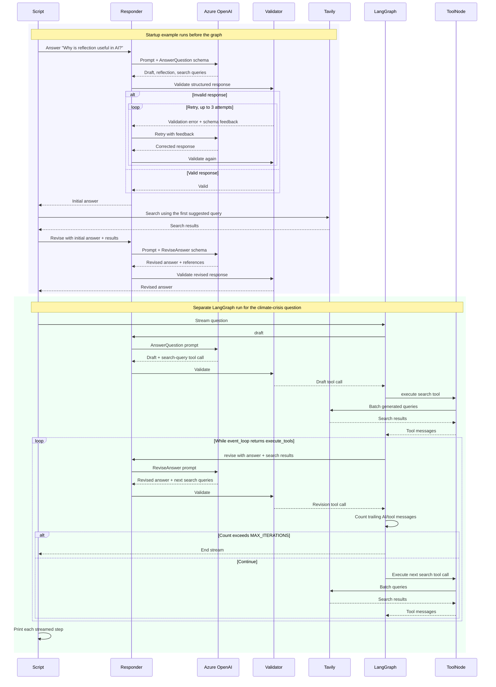

## Reflexion Agent

* It's a small Reflexion-style research agent: it drafts an answer, critiques it, searches for supporting information, and revises the answer.
* Answer schemas: ```Reflection``` captures what’s missing or unnecessary; ```AnswerQuestion``` defines the answer, reflection, and search queries.
* Prompt and retries: The prompt asks the model to answer and critique itself. ```ResponderWithRetries``` validates the model’s structured response and, on validation errors, sends the error and JSON schema back for up to three attempts.
* One-shot example: Before building the graph, the script answers “Why is reflection useful in AI?”, searches Tavily for the first suggested query, then revises the answer with citations.
* Graph tools: ```run_queries``` batches Tavily searches; ```ToolNode``` exposes it under both answer-schema names.
* Graph run: LangGraph runs a draft → search → revise flow for “How should we handle the climate crisis?”, potentially repeating the search/revision cycle.
* One detail to watch: ```event_loop``` compares the number of trailing AI/tool messages to MAX_ITERATIONS, rather than counting graph cycles. Since each cycle adds messages, this limit is not a direct “five revisions” cap.

Sequence diagram

```
'''
Reflexion

Reflexion is an architecture designed to learn through verbal feedback and self-reflection. 
The agent explicitly critiques its responses for tasks to generate a higher quality final response, at the expense of longer execution time.
'''
```


```
'''
The paper outlines 3 main components:

    1. Actor (agent) with self-reflection
    2. External evaluator (task-specific, e.g. code compilation steps)
    3. Episodic memory that stores the reflections from (1).

In their code, the last two components are very task-specific, so in this notebook, you will build the actor in LangGraph.

Define our LLM
'''

import os, datetime, json
from dotenv import load_dotenv
from langchain_tavily import TavilySearch
from langchain_openai import AzureChatOpenAI
from langchain_core.messages import HumanMessage, ToolMessage
from langchain_core.output_parsers.openai_tools import PydanticToolsParser
from langchain_core.prompts import ChatPromptTemplate, MessagesPlaceholder
from pydantic import ValidationError
from pydantic import BaseModel, Field
from langchain_core.tools import StructuredTool
from langgraph.prebuilt import ToolNode
from typing import Literal, Annotated
from langgraph.graph import END, StateGraph, START
from langgraph.graph.message import add_messages
from typing_extensions import TypedDict
   
load_dotenv()

#llm = ChatAnthropic(model="claude-3-5-sonnet-20240620")
# llm = ChatOpenAI(model="gpt-4-turbo-preview")
llm = AzureChatOpenAI(
    azure_deployment=os.environ["AZURE_OPENAI_DEPLOYMENT_NAME_LLM"],
    azure_endpoint=os.environ["AZURE_OPENAI_ENDPOINT_LLM"],
    api_key=os.environ["AZURE_OPENAI_API_KEY"],
    api_version="2025-03-01-preview"
)

'''
Actor (with reflection)

The main component of Reflexion is the "actor", which is an agent that reflects on its response 
and re-executes to improve based on self-critique. It's main sub-components include:

    1. Tools/tool execution
    2. Initial responder: generate an initial response (and self-reflection)
3. Revisor: re-respond (and reflec) based on previous reflections

We'll first define the tool execution context.

Construct tools
'''

tavily_tool = TavilySearch(max_results=5)

'''
Initial responder
'''

class Reflection(BaseModel):
    missing: str = Field(description="Critique of what is missing.")
    superfluous: str = Field(description="Critique of what is superfluous")

class AnswerQuestion(BaseModel):
    """Answer the question. Provide an answer, reflection, and then follow up with search queries to improve the answer."""

    answer: str = Field(description="~250 word detailed answer to the question.")
    reflection: Reflection = Field(description="Your reflection on the initial answer.")
    search_queries: list[str] = Field(
        description="1-3 search queries for researching improvements to address the critique of your current answer."
    )

class ResponderWithRetries:
    def __init__(self, runnable, validator):
        self.runnable = runnable
        self.validator = validator

    def respond(self, state: dict):
        response = []
        for attempt in range(3):
            response = self.runnable.invoke(
                {"messages": state["messages"]}, {"tags": [f"attempt:{attempt}"]}
            )
            try:
                self.validator.invoke(response)
                return {"messages": response}
            except ValidationError as e:
                state["messages"] = [
                    *state["messages"],
                    response,
                    ToolMessage(
                        content=(
                            f"{repr(e)}\n\nPay close attention to the function schema.\n\n"
                            f"{json.dumps(self.validator.model_json_schema(), indent=2)}"
                            " Respond by fixing all validation errors."
                        ),
                        tool_call_id=response.tool_calls[0]["id"],
                    ),
                ]
        return {"messages": response}

actor_prompt_template = ChatPromptTemplate.from_messages(
    [
        (
            "system",
            """You are expert researcher.
Current time: {time}

1. {first_instruction}
2. Reflect and critique your answer. Be severe to maximize improvement.
3. Recommend search queries to research information and improve your answer.""",
        ),
        MessagesPlaceholder(variable_name="messages"),
        (
            "user",
            "\n\n<system>Reflect on the user's original question and the"
            " actions taken thus far. Respond using the {function_name} function.</reminder>",
        ),
    ]
).partial(
    time=lambda: datetime.datetime.now().isoformat(),
)

initial_answer_chain = actor_prompt_template.partial(
    first_instruction="Provide a detailed ~250 word answer.",
    function_name=AnswerQuestion.__name__,
) | llm.bind_tools(tools=[AnswerQuestion])
validator = PydanticToolsParser(tools=[AnswerQuestion])

first_responder = ResponderWithRetries(
    runnable=initial_answer_chain, validator=validator
)
example_question = "Why is reflection useful in AI?"
initial = first_responder.respond(
    {"messages": [HumanMessage(content=example_question)]}
)

'''
Revision
The second part of the actor is a revision step.
'''

revise_instructions = """Revise your previous answer using the new information.
    - You should use the previous critique to add important information to your answer.
        - You MUST include numerical citations in your revised answer to ensure it can be verified.
        - Add a "References" section to the bottom of your answer (which does not count towards the word limit). In form of:
            - [1] https://example.com
            - [2] https://example.com
    - You should use the previous critique to remove superfluous information from your answer and make SURE it is not more than 250 words.
"""

# Extend the initial answer schema to include references.
# Forcing citation in the model encourages grounded responses
class ReviseAnswer(AnswerQuestion):
    """Revise your original answer to your question. Provide an answer, reflection,

    cite your reflection with references, and finally
    add search queries to improve the answer."""

    references: list[str] = Field(
        description="Citations motivating your updated answer."
    )

revision_chain = actor_prompt_template.partial(
    first_instruction=revise_instructions,
    function_name=ReviseAnswer.__name__,
) | llm.bind_tools(tools=[ReviseAnswer])
revision_validator = PydanticToolsParser(tools=[ReviseAnswer])

revisor = ResponderWithRetries(runnable=revision_chain, validator=revision_validator)

revised = revisor.respond(
    {
        "messages": [
            HumanMessage(content=example_question),
            initial["messages"],
            ToolMessage(
                tool_call_id=initial["messages"].tool_calls[0]["id"],
                content=json.dumps(
                    tavily_tool.invoke(
                        {
                            "query": initial["messages"].tool_calls[0]["args"][
                                "search_queries"
                            ][0]
                        }
                    )
                ),
            ),
        ]
    }
)

#revised["messages"]
#print (revised)

'''
Create Tool Node
Next, create a node to execute the tool calls. 
While we give the LLMs different schema names (and use those for validation), we want them both to route to the same tool.
'''

def run_queries(search_queries: list[str], **kwargs):
    """Run the generated queries."""
    return tavily_tool.batch([{"query": query} for query in search_queries])

tool_node = ToolNode(
    [
        StructuredTool.from_function(run_queries, name=AnswerQuestion.__name__),
        StructuredTool.from_function(run_queries, name=ReviseAnswer.__name__),
    ]
)

'''
Construct Graph
Now we can wire all our components together.
'''
class State(TypedDict):
    messages: Annotated[list, add_messages]

MAX_ITERATIONS = 5
builder = StateGraph(State)
builder.add_node("draft", first_responder.respond)

builder.add_node("execute_tools", tool_node)
builder.add_node("revise", revisor.respond)
# draft -> execute_tools
builder.add_edge("draft", "execute_tools")
# execute_tools -> revise
builder.add_edge("execute_tools", "revise")

# Define looping logic:

def _get_num_iterations(state: list):
    i = 0
    for m in state[::-1]:
        if m.type not in {"tool", "ai"}:
            break
        i += 1
    return i

def event_loop(state: list):
    # in our case, we'll just stop after N plans
    num_iterations = _get_num_iterations(state["messages"])
    if num_iterations > MAX_ITERATIONS:
        return END
    return "execute_tools"

# revise -> execute_tools OR end
builder.add_conditional_edges("revise", event_loop, ["execute_tools", END])
builder.add_edge(START, "draft")
graph = builder.compile()

'''
from IPython.display import Image, display

try:
    display(Image(graph.get_graph().draw_mermaid_png()))
except Exception:
    # This requires some extra dependencies and is optional
    pass
'''
```


```
events = graph.stream(
    {"messages": [("user", "How should we handle the climate crisis?")]},
    stream_mode="values",
)
for i, step in enumerate(events):
    print(f"Step {i}")
    step["messages"][-1].pretty_print()

'''
Step 0
================================ Human Message =================================

How should we handle the climate crisis?

Step 1
================================== Ai Message ==================================
Tool Calls:
  AnswerQuestion (toolu_01YLQUcc7yyo1WwJoV5WQC2E)
 Call ID: toolu_01YLQUcc7yyo1WwJoV5WQC2E
  Args:
    answer: The climate crisis poses an existential threat that requires urgent, far-reaching action on a global scale. ...
Step 2
================================= Tool Message =================================
Name: AnswerQuestion

[[{"url": "https://www.nytimes.com/interactive/2021/10/25/climate/world-climate-pledges-cop26.html", "content": "\u201cWe know there are t...

Step 3
================================== Ai Message ==================================
Tool Calls:
  ReviseAnswer (toolu_01RRRqi9gfJUS2KXsv7bFPgA)
 Call ID: toolu_01RRRqi9gfJUS2KXsv7bFPgA
  Args:
    answer: The climate crisis demands an all-hands-on-deck approach spanning policy measures, ...

Step 4
================================= Tool Message =================================
Name: ReviseAnswer

[[{"url": "https://www.nature.com/articles/s41893-023-01109-5", "content": "This is a preview of subscription content, access via your institution...

Step 5
================================== Ai Message ==================================
Tool Calls:
  ReviseAnswer (toolu_01A7zp1U45r1fbSFr3qdBfZC)
 Call ID: toolu_01A7zp1U45r1fbSFr3qdBfZC
  Args:
    answer: Tackling the climate crisis demands a multi-pronged global effort targeting policy reforms, technological innovation, ...

Step 6
================================= Tool Message =================================
Name: ReviseAnswer

[[{"url": "https://www.nature.com/articles/s41558-024-01963-x", "content": "This is a preview of subscription content, access via your ...

Step 7
================================== Ai Message ==================================
Tool Calls:
  ReviseAnswer (toolu_01LirQtruxA9Rp2UAiojegu9)
 Call ID: toolu_01LirQtruxA9Rp2UAiojegu9
  Args:
    answer: The climate crisis is an existential threat requiring a coordinated global response across multiple fronts - policy,...
'''
```

