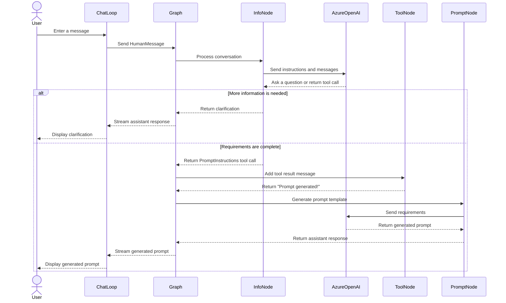

### Prompt Generation from User Requirements
* create a chat bot that helps a user generate a prompt.
* It will first collect requirements from the user, and then will generate the prompt (and refine it based on user input).
* These are split into two separate states, and the LLM decides when to transition between them.


### How it works

* agent.py implements a small prompt-template builder using LangChain and LangGraph. It asks for requirements, then uses them to generate a prompt template.

* Collects requirements
  * The template system message tells the model to find out the prompt’s objective, input variables, constraints, and requirements.
  * info_chain sends the conversation to the model.
  * If the requirements aren’t clear, the model can ask the user follow-up questions.

* Structures the requirements
  * PromptInstructions is a Pydantic model describing the expected fields.
  * It is bound to the model as a tool, so the model can return structured requirements when it’s ready to proceed.

* Generates the prompt
  * When the model makes that tool call, get_prompt_messages extracts its arguments.
  * prompt_gen_chain passes them to a second system message, which asks the model to write the prompt template.

* Routes the conversation through a graph
  * get_state checks the latest message:
    * A tool call routes to add_tool_message, then to the prompt-generation node.
    * A normal assistant response ends the current graph run, allowing the user to reply.
    * A user message routes to the requirements-gathering node.
  * The graph is compiled with InMemorySaver, which keeps conversation state in memory during the running process.

* Runs the chat loop
  * The bottom of the file repeatedly reads user input, streams graph updates, and prints messages.
  * Entering q or Q exits. If input() raises an exception, it uses the predefined cached responses instead.

* add_tool_message adds a “Prompt generated!” tool message to let the graph continue to the generation step; the actual prompt generation happens in prompt_gen_chain.

```
import os, uuid
from typing import List, Annotated
from dotenv import load_dotenv
from langchain_openai import ChatOpenAI, AzureChatOpenAI
from pydantic import BaseModel
from langchain_core.messages import AIMessage, HumanMessage, ToolMessage, SystemMessage
from langgraph.graph import END, StateGraph, START
from langgraph.checkpoint.memory import InMemorySaver
from langgraph.graph.message import add_messages
from typing_extensions import TypedDict
from IPython.display import Image, display

load_dotenv()

"""
Gather information
    Define the part of the graph that will gather user requirements. 
    This will be an LLM call with a specific system message. 
    It will have access to a tool that it can call when it is ready to generate the prompt.
"""
template = """Your job is to get information from a user about what type of prompt template they want to create.

You should get the following information from them:

- What the objective of the prompt is
- What variables will be passed into the prompt template
- Any constraints for what the output should NOT do
- Any requirements that the output MUST adhere to

If you are not able to discern this info, ask them to clarify! Do not attempt to wildly guess.

After you are able to discern all the information, call the relevant tool."""


def get_messages_info(messages):
    return [SystemMessage(content=template)] + messages


class PromptInstructions(BaseModel):
    """Instructions on how to prompt the LLM."""

    objective: str
    variables: List[str]
    constraints: List[str]
    requirements: List[str]


#llm = ChatOpenAI(temperature=0)
llm = AzureChatOpenAI(
    azure_deployment=os.environ["AZURE_OPENAI_DEPLOYMENT_NAME_LLM"],
    azure_endpoint=os.environ["AZURE_OPENAI_ENDPOINT_LLM"],
    api_key=os.environ["AZURE_OPENAI_API_KEY"],
    api_version="2025-03-01-preview",
    temperature=0,
)
llm_with_tool = llm.bind_tools([PromptInstructions])


def info_chain(state):
    messages = get_messages_info(state["messages"])
    response = llm_with_tool.invoke(messages)
    return {"messages": [response]}

"""
Generate Prompt
    set up the state that will generate the prompt. 
    This will require a separate system message, as well as a function to filter out all message PRIOR to the tool invocation 
    (as that is when the previous state decided it was time to generate the prompt
"""                                                                                                                                                                                
# New system prompt
prompt_system = """Based on the following requirements, write a good prompt template:

{reqs}"""


# Function to get the messages for the prompt
# Will only get messages AFTER the tool call
def get_prompt_messages(messages: list):
    tool_call = None
    other_msgs = []
    for m in messages:
        if isinstance(m, AIMessage) and m.tool_calls:
            tool_call = m.tool_calls[0]["args"]
        elif isinstance(m, ToolMessage):
            continue
        elif tool_call is not None:
            other_msgs.append(m)
    return [SystemMessage(content=prompt_system.format(reqs=tool_call))] + other_msgs


def prompt_gen_chain(state):
    messages = get_prompt_messages(state["messages"])
    response = llm.invoke(messages)
    return {"messages": [response]}

"""
Define the state logic
    This is the logic for what state the chatbot is in. 
    If the last message is a tool call, then we are in the state where the "prompt creator" (prompt) should respond. 
    Otherwise, if the last message is not a HumanMessage, then we know the human should respond next and so we are in the END state. 
    If the last message is a HumanMessage, then if there was a tool call previously we are in the prompt state. 
    Otherwise, we are in the "info gathering" (info) state.
"""
def get_state(state):
    messages = state["messages"]
    if isinstance(messages[-1], AIMessage) and messages[-1].tool_calls:
        return "add_tool_message"
    elif not isinstance(messages[-1], HumanMessage):
        return END
    return "info"

"""
Create the graph -  use a SqliteSaver to persist conversation history.
"""
class State(TypedDict):
    messages: Annotated[list, add_messages]

memory = InMemorySaver()
workflow = StateGraph(State)
workflow.add_node("info", info_chain)
workflow.add_node("prompt", prompt_gen_chain)


@workflow.add_node
def add_tool_message(state: State):
    return {
        "messages": [
            ToolMessage(
                content="Prompt generated!",
                tool_call_id=state["messages"][-1].tool_calls[0]["id"],
            )
        ]
    }


workflow.add_conditional_edges("info", get_state, ["add_tool_message", "info", END])
workflow.add_edge("add_tool_message", "prompt")
workflow.add_edge("prompt", END)
workflow.add_edge(START, "info")
graph = workflow.compile(checkpointer=memory)


display(Image(graph.get_graph().draw_mermaid_png()))
```


```
"""
Use the graph - now use the created chatbot.
"""
cached_human_responses = ["hi!", "rag prompt", "1 rag, 2 none, 3 no, 4 no", "red", "q"]
cached_response_index = 0
config = {"configurable": {"thread_id": str(uuid.uuid4())}}
while True:
    try:
        user = input("User (q/Q to quit): ")
    except:
        user = cached_human_responses[cached_response_index]
        cached_response_index += 1
    print(f"User (q/Q to quit): {user}")
    if user in {"q", "Q"}:
        print("AI: Byebye")
        break
    output = None
    for output in graph.stream(
        {"messages": [HumanMessage(content=user)]}, config=config, stream_mode="updates"
    ):
        last_message = next(iter(output.values()))["messages"][-1]
        last_message.pretty_print()

    if output and "prompt" in output:
        print("Done!")
```




