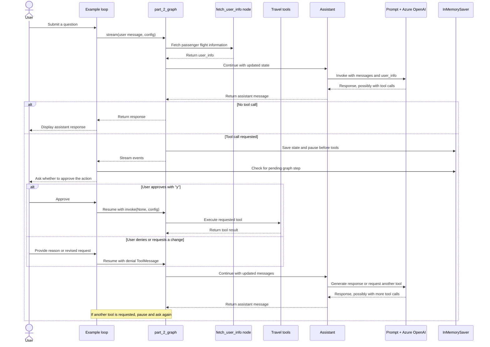

* agent_2.py
```
# Part 2: Add Confirmation
from agent_tools import *
from agent_tools import _print_event
"""
Part 2: Add Confirmation
When an assistant takes actions on behalf of the user, the user should (almost) always have the final say on whether to follow through with the actions. 
Otherwise, any small mistake the assistant makes (or any prompt injection it succombs to) can cause real damage to the user.

use interrupt_before to pause the graph and return control to the user before executing any of the tools.

Your graph will look something like the following:
"""
```


```
"""
Code Explanation

State and assistant
	State holds two pieces of graph data:
		messages: the conversation history. add_messages lets LangGraph append messages as the graph runs.
		user_info: flight information that the graph intends to make available to the assistant.
	Assistant calls the prompt-and-LLM chain using the current state. If the model returns neither a tool call nor usable text, it adds “Respond with a real output.” to the messages and tries again. Otherwise it returns the model’s response to the graph.

Graph flow
	The graph has three nodes:
		1. fetch_user_info calls fetch_user_flight_information.invoke({}) and puts the result in user_info.
		2. assistant generates a response, possibly requesting one or more tools.
		2. tools executes requested tools.

	The graph runs in this order:
		START → fetch_user_info → assistant
                           ├─ no tool call → END
                           └─ tool call → pause before tools

	After the pause is resumed and tools run, their results go back to the assistant, which can answer or request more tools.

How approval works
	interrupt_before=["tools"] tells LangGraph to pause immediately before executing the tools node. The example code checks the graph’s saved state; while there is a pending next step, it asks for user input:
		Typing y resumes the graph with invoke(None, config), allowing the pending tool execution to proceed.
		Any other input is sent back as a ToolMessage saying the action was denied and including the user’s explanation. The assistant can then respond or try a different action.
	The checkpointer (InMemorySaver) stores the paused graph state so it can be resumed with the same thread_id.
"""
```

```
"""
State & Assistant

Our graph state and LLM calling is nearly identical to Part 1 except Exception:
    * We've added a user_info field that will be eagerly populated by our graph
    * We can use the state directly in the Assistant object rather than using the configurable params
"""
class State(TypedDict):
    messages: Annotated[list[AnyMessage], add_messages]
    user_info: str

class Assistant:
    def __init__(self, runnable: Runnable):
        self.runnable = runnable

    def __call__(self, state: State, config: RunnableConfig):
        while True:
            result = self.runnable.invoke(state)
            # If the LLM happens to return an empty response, we will re-prompt it
            # for an actual response.
            if not result.tool_calls and (
                not result.content
                or isinstance(result.content, list)
                and not result.content[0].get("text")
            ):
                messages = state["messages"] + [("user", "Respond with a real output.")]
                state = {**state, "messages": messages}
            else:
                break
        return {"messages": result}

llm = AzureChatOpenAI(
    azure_deployment=os.environ["AZURE_OPENAI_DEPLOYMENT_NAME_LLM"],
    azure_endpoint=os.environ["AZURE_OPENAI_ENDPOINT_LLM"],
    api_key=os.environ["AZURE_OPENAI_API_KEY"],
    api_version="2025-03-01-preview",
    temperature=0,
)

assistant_prompt = ChatPromptTemplate.from_messages(
    [
        (
            "system",
            "You are a helpful customer support assistant for Swiss Airlines. "
            " Use the provided tools to search for flights, company policies, and other information to assist the user's queries. "
            " When searching, be persistent. Expand your query bounds if the first search returns no results. "
            " If a search comes up empty, expand your search before giving up."
            "\n\nCurrent user:\n<User>\n{user_info}\n</User>"
            "\nCurrent time: {time}.",
        ),
        ("placeholder", "{messages}"),
    ]
).partial(time=datetime.now)

part_2_tools = [
    TavilySearch(max_results=1),
    fetch_user_flight_information,
    search_flights,
    lookup_policy,
    update_ticket_to_new_flight,
    cancel_ticket,
    search_car_rentals,
    book_car_rental,
    update_car_rental,
    cancel_car_rental,
    search_hotels,
    book_hotel,
    update_hotel,
    cancel_hotel,
    search_trip_recommendations,
    book_excursion,
    update_excursion,
    cancel_excursion,
]
part_2_assistant_runnable = assistant_prompt | llm.bind_tools(part_2_tools)

"""
Define Graph - create the graph. Make 2 changes from part 1 to address our previous concerns.

    1. Add an interrupt before using a tool
    2. Explicitly populate the user state within the first node so the assistant doesn't have to use a tool just to learn about the user.
"""
builder = StateGraph(State)

def user_info(state: State):
    return {"user_info": fetch_user_flight_information.invoke({})}

# NEW: The fetch_user_info node runs first, meaning our assistant can see the user's flight information without
# having to take an action
builder.add_node("fetch_user_info", user_info)
builder.add_edge(START, "fetch_user_info")
builder.add_node("assistant", Assistant(part_2_assistant_runnable))
builder.add_node("tools", create_tool_node_with_fallback(part_2_tools))
builder.add_edge("fetch_user_info", "assistant")
builder.add_conditional_edges(
    "assistant",
    tools_condition,
)
builder.add_edge("tools", "assistant")

memory = InMemorySaver()
part_2_graph = builder.compile(
    checkpointer=memory,
    # NEW: The graph will always halt before executing the "tools" node.
    # The user can approve or reject (or even alter the request) before
    # the assistant continues
    interrupt_before=["tools"],
)
from IPython.display import Image, display

try:
    display(Image(part_2_graph.get_graph(xray=True).draw_mermaid_png()))
except Exception:
    # This requires some extra dependencies and is optional
    pass
```


```
"""
Example Conversation - try out our newly revised chatbot!
"""
tutorial_questions = [
    "Hi there, what time is my flight?",
    "Am i allowed to update my flight to something sooner? I want to leave later today.",
    "Update my flight to sometime next week then",
    "The next available option is great",
    "what about lodging and transportation?",
    "Yeah i think i'd like an affordable hotel for my week-long stay (7 days). And I'll want to rent a car.",
    "OK could you place a reservation for your recommended hotel? It sounds nice.",
    "yes go ahead and book anything that's moderate expense and has availability.",
    "Now for a car, what are my options?",
    "Awesome let's just get the cheapest option. Go ahead and book for 7 days",
    "Cool so now what recommendations do you have on excursions?",
    "Are they available while I'm there?",
    "interesting - i like the museums, what options are there? ",
    "OK great pick one and book it for my second day there.",
]

# Update with the backup file so we can restart from the original place in each section
db = update_dates(db)
thread_id = str(uuid.uuid4())

config = {
    "configurable": {
        # The passenger_id is used in our flight tools to
        # fetch the user's flight information
        "passenger_id": "3442 587242",
        # Checkpoints are accessed by thread_id
        "thread_id": thread_id,
    }
}

_printed = set()
# We can reuse the tutorial questions from part 1 to see how it does.
for question in tutorial_questions:
    events = part_2_graph.stream(
        {"messages": ("user", question)}, config, stream_mode="values"
    )
    for event in events:
        _print_event(event, _printed)
    snapshot = part_2_graph.get_state(config)
    while snapshot.next:
        # We have an interrupt! The agent is trying to use a tool, and the user can approve or deny it
        # Note: This code is all outside of your graph. Typically, you would stream the output to a UI.
        # Then, you would have the frontend trigger a new run via an API call when the user has provided input.
        try:
            user_input = input(
                "Do you approve of the above actions? Type 'y' to continue;"
                " otherwise, explain your requested changed.\n\n"
            )
        except:
            user_input = "y"
        if user_input.strip() == "y":
            # Just continue
            result = part_2_graph.invoke(
                None,
                config,
            )
        else:
            # Satisfy the tool invocation by
            # providing instructions on the requested changes / change of mind
            result = part_2_graph.invoke(
                {
                    "messages": [
                        ToolMessage(
                            tool_call_id=event["messages"][-1].tool_calls[0]["id"],
                            content=f"API call denied by user. Reasoning: '{user_input}'. Continue assisting, accounting for the user's input.",
                        )
                    ]
                },
                config,
            )
        snapshot = part_2_graph.get_state(config)
```


```
"""
Part 2 Review
Completely controlled which actions were performed. This all worked using LangGraph's interrupts and checkpointers. 
The interrupt pauses graph execution, its state safely persisted using your configured checkpointer. 
The user can then start it up at any time by running it with the right config.

In the next section, we will reorganize our graph so that we can interrupt only on the "sensitive" actions that actually write to the database.
"""
```
