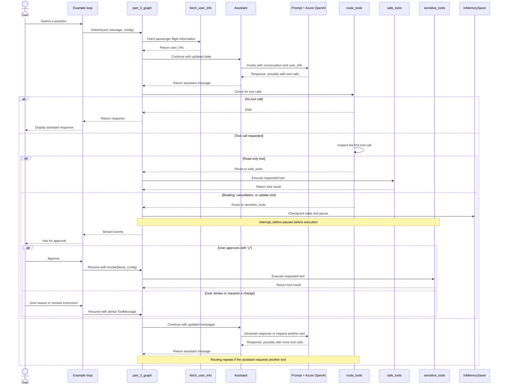

* agenet_3.py
```
# Part 3: Conditional Interrupt

from agent_tools import *
from agent_tools import _print_event

"""
Part 3: Conditional Interrupt
Refine our interrupt strategy by categorizing tools as safe (read-only) or sensitive (data-modifying). 
We'll apply interrupts to the sensitive tools only, allowing the bot to handle simple queries autonomously.

This balances user control and conversational flow, but as we add more tools, our single graph may grow too complex for this "flat" structure. 

Your graph for Part 3 will look something like the following diagram.
"""
```


```
"""
Code Explanation
Adding conditional approval: read-only tools can run without pausing, while tools that change bookings require user approval.

The tools are divided into two groups:
	part_3_safe_tools: searches and lookups, such as flight information, policies, hotels, and recommendations.
	part_3_sensitive_tools: booking, cancellation, and update actions that modify a reservation.

sensitive_tool_names stores the names of the sensitive tools so the graph can identify them. The LLM gets both groups through bind_tools, so it can request any of them.

Graph flow
	The graph starts by running user_info, which fetches flight information and places it in the state. Then the assistant responds and may request a tool.

	The route_tools function decides what happens next:
		1. It calls tools_condition to check whether the assistant requested a tool or finished responding.
		2. If there are no tool calls, it returns END.
		3. If there is a tool call, it checks the first requested tool’s name:
			Sensitive tool → sensitive_tools
			Otherwise → safe_tools

	Both tool nodes return to the assistant with their results. The graph is compiled with interrupt_before=["sensitive_tools"], so it pauses before running sensitive actions. Safe tools are not interrupted.
		START → fetch_user_info → assistant
	                              ├─ no tool call → END
	                              ├─ safe tool → safe_tools → assistant
	                              └─ sensitive tool → pause for approval
	                                                   └─ approved → sensitive_tools → assistant

Approval in the example loop
	After streaming the graph’s events, the demo checks whether there is a pending graph step:
		If the user types y, it resumes the graph, allowing the sensitive tool to execute.
		Otherwise, it sends a ToolMessage explaining that the action was denied and includes the user’s reason. The assistant can then respond to that feedback.

Important limitation
	route_tools routes based only on the first tool call. The code comment notes that it assumes single tool calls.
	If the model requests multiple tools at once, especially a mix of safe and sensitive tools, routing based on only the first one may not handle the rest as intended.
"""
```



```
class State(TypedDict):
    messages: Annotated[list[AnyMessage], add_messages]
    user_info: str

class Assistant:
    def __init__(self, runnable: Runnable):
        self.runnable = runnable

    def __call__(self, state: State, config: RunnableConfig):
        while True:
            result = self.runnable.invoke(state)
            # If the LLM happens to return an empty response, we will re-prompt it
            # for an actual response.
            if not result.tool_calls and (
                not result.content
                or isinstance(result.content, list)
                and not result.content[0].get("text")
            ):
                messages = state["messages"] + [("user", "Respond with a real output.")]
                state = {**state, "messages": messages}
            else:
                break
        return {"messages": result}

llm = AzureChatOpenAI(
    azure_deployment=os.environ["AZURE_OPENAI_DEPLOYMENT_NAME_LLM"],
    azure_endpoint=os.environ["AZURE_OPENAI_ENDPOINT_LLM"],
    api_key=os.environ["AZURE_OPENAI_API_KEY"],
    api_version="2025-03-01-preview",
    temperature=0,
)

assistant_prompt = ChatPromptTemplate.from_messages(
    [
        (
            "system",
            "You are a helpful customer support assistant for Swiss Airlines. "
            " Use the provided tools to search for flights, company policies, and other information to assist the user's queries. "
            " When searching, be persistent. Expand your query bounds if the first search returns no results. "
            " If a search comes up empty, expand your search before giving up."
            "\n\nCurrent user:\n<User>\n{user_info}\n</User>"
            "\nCurrent time: {time}.",
        ),
        ("placeholder", "{messages}"),
    ]
).partial(time=datetime.now)

# "Read"-only tools (such as retrievers) don't need a user confirmation to use
part_3_safe_tools = [
    TavilySearch(max_results=1),
    fetch_user_flight_information,
    search_flights,
    lookup_policy,
    search_car_rentals,
    search_hotels,
    search_trip_recommendations,
]

# These tools all change the user's reservations.
# The user has the right to control what decisions are made
part_3_sensitive_tools = [
    update_ticket_to_new_flight,
    cancel_ticket,
    book_car_rental,
    update_car_rental,
    cancel_car_rental,
    book_hotel,
    update_hotel,
    cancel_hotel,
    book_excursion,
    update_excursion,
    cancel_excursion,
]
sensitive_tool_names = {t.name for t in part_3_sensitive_tools}
# Our LLM doesn't have to know which nodes it has to route to. In its 'mind', it's just invoking functions.
part_3_assistant_runnable = assistant_prompt | llm.bind_tools(
    part_3_safe_tools + part_3_sensitive_tools
)

"""
Define Graph - almost identical to part 2 except we split out the tools into 2 separate nodes. 
We only interrupt before the tools that are actually making changes to the user's bookings.
"""

builder = StateGraph(State)

def user_info(state: State):
    return {"user_info": fetch_user_flight_information.invoke({})}

# NEW: The fetch_user_info node runs first, meaning our assistant can see the user's flight information without
# having to take an action
builder.add_node("fetch_user_info", user_info)
builder.add_edge(START, "fetch_user_info")
builder.add_node("assistant", Assistant(part_3_assistant_runnable))
builder.add_node("safe_tools", create_tool_node_with_fallback(part_3_safe_tools))
builder.add_node(
    "sensitive_tools", create_tool_node_with_fallback(part_3_sensitive_tools)
)
# Define logic
builder.add_edge("fetch_user_info", "assistant")

def route_tools(state: State):
    next_node = tools_condition(state)
    # If no tools are invoked, return to the user
    if next_node == END:
        return END
    ai_message = state["messages"][-1]
    # This assumes single tool calls. To handle parallel tool calling, you'd want to
    # use an ANY condition
    first_tool_call = ai_message.tool_calls[0]
    if first_tool_call["name"] in sensitive_tool_names:
        return "sensitive_tools"
    return "safe_tools"


builder.add_conditional_edges(
    "assistant", route_tools, ["safe_tools", "sensitive_tools", END]
)
builder.add_edge("safe_tools", "assistant")
builder.add_edge("sensitive_tools", "assistant")

memory = InMemorySaver()
part_3_graph = builder.compile(
    checkpointer=memory,
    # NEW: The graph will always halt before executing the "tools" node.
    # The user can approve or reject (or even alter the request) before
    # the assistant continues
    interrupt_before=["sensitive_tools"],
)
from IPython.display import Image, display

try:
    display(Image(part_3_graph.get_graph(xray=True).draw_mermaid_png()))
except Exception:
    # This requires some extra dependencies and is optional
    pass
```


```
"""
Example Conversation - try out our newly revised chatbot! This time, we'll have many fewer confirmations.
"""

# Update with the backup file so we can restart from the original place in each section
db = update_dates(db)
thread_id = str(uuid.uuid4())

config = {
    "configurable": {
        # The passenger_id is used in our flight tools to
        # fetch the user's flight information
        "passenger_id": "3442 587242",
        # Checkpoints are accessed by thread_id
        "thread_id": thread_id,
    }
}

tutorial_questions = [
    "Hi there, what time is my flight?",
    "Am i allowed to update my flight to something sooner? I want to leave later today.",
    "Update my flight to sometime next week then",
    "The next available option is great",
    "what about lodging and transportation?",
    "Yeah i think i'd like an affordable hotel for my week-long stay (7 days). And I'll want to rent a car.",
    "OK could you place a reservation for your recommended hotel? It sounds nice.",
    "yes go ahead and book anything that's moderate expense and has availability.",
    "Now for a car, what are my options?",
    "Awesome let's just get the cheapest option. Go ahead and book for 7 days",
    "Cool so now what recommendations do you have on excursions?",
    "Are they available while I'm there?",
    "interesting - i like the museums, what options are there? ",
    "OK great pick one and book it for my second day there.",
]

_printed = set()
# We can reuse the tutorial questions from part 1 to see how it does.
for question in tutorial_questions:
    events = part_3_graph.stream(
        {"messages": ("user", question)}, config, stream_mode="values"
    )
    for event in events:
        _print_event(event, _printed)
    snapshot = part_3_graph.get_state(config)
    while snapshot.next:
        # We have an interrupt! The agent is trying to use a tool, and the user can approve or deny it
        # Note: This code is all outside of your graph. Typically, you would stream the output to a UI.
        # Then, you would have the frontend trigger a new run via an API call when the user has provided input.
        try:
            user_input = input(
                "Do you approve of the above actions? Type 'y' to continue;"
                " otherwise, explain your requested changed.\n\n"
            )
        except:
            user_input = "y"
        if user_input.strip() == "y":
            # Just continue
            result = part_3_graph.invoke(
                None,
                config,
            )
        else:
            # Satisfy the tool invocation by
            # providing instructions on the requested changes / change of mind
            result = part_3_graph.invoke(
                {
                    "messages": [
                        ToolMessage(
                            tool_call_id=event["messages"][-1].tool_calls[0]["id"],
                            content=f"API call denied by user. Reasoning: '{user_input}'. Continue assisting, accounting for the user's input.",
                        )
                    ]
                },
                config,
            )
        snapshot = part_3_graph.get_state(config)
```


```
"""
Part 3 Review
Much better! Our agent is now working well

One problem with this design is that we're putting a lot of pressure on a single prompt. 
If we want to add more tools, or if each tool gets more complicated (more filters, more business logic constraining behavior, etc), 
it's likely the tool usage and overall behavior of the bot will start to suffer.

In the next section, we show how you can take more control over different user experiences by routing to specialist agents
 or sub-graphs based on the user's intent.
"""
```
