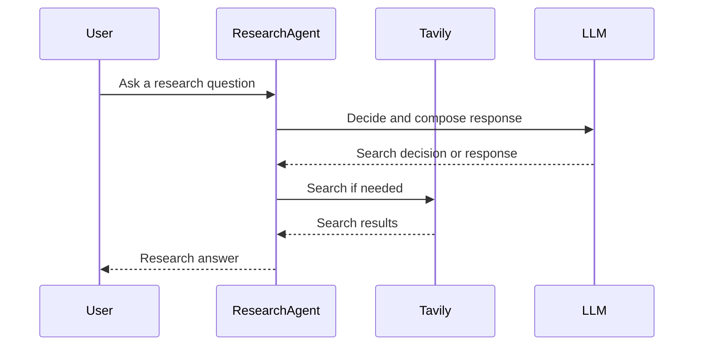
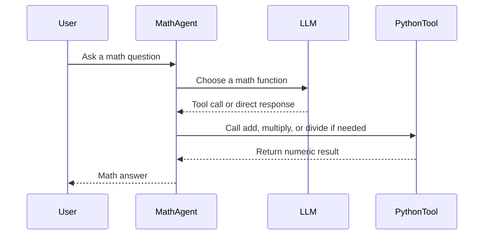
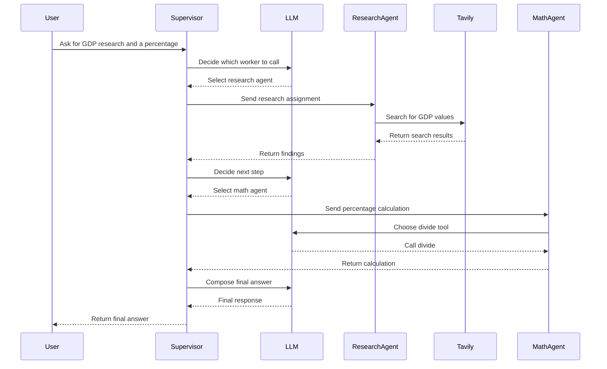
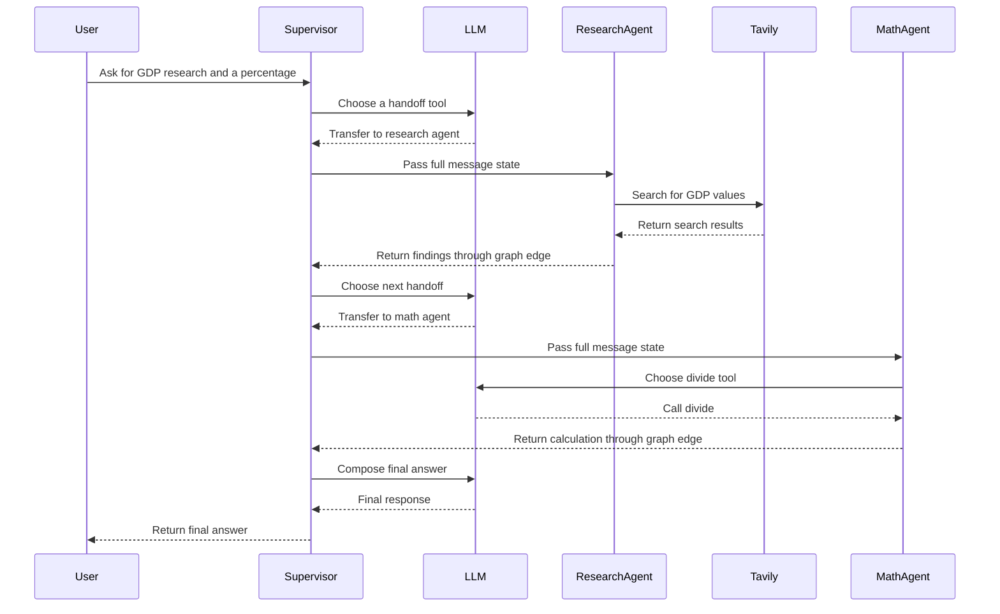
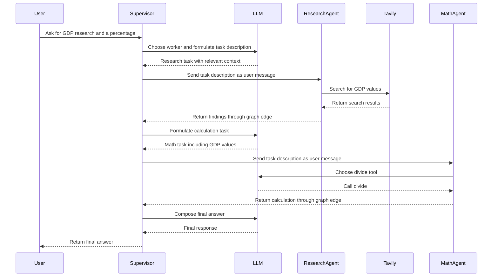

## Multi-agent supervisor

### Code Explanation

| Section	| What it does	| Main trade-off |
| - | - | - |
| 1. Worker agents (setup)	| Creates a research agent with web search and a math agent with calculator functions.	| These are the specialists; they don’t decide which agent to use. |
| 2. Prebuilt supervisor (setup)	| Uses create_supervisor(...) from langgraph-supervisor to coordinate the workers.	| Simplest and shortest; you have less control over the internal handoff behavior. |
| 3. Supervisor built from scratch (setup)	| Defines handoff tools and a StateGraph yourself. Workers return to the supervisor, which can decide what to do next.	| More customizable, but more code and more behavior to maintain. |
| 4. Explicit task delegation (setup)	| Extends the handoff so the supervisor sends a specific task description to a worker, rather than relying on the worker to interpret the conversation history.	| Gives workers a clearer task and more control over what context they receive. |

* Which is best?
    * For a straightforward system: Section 2 is the best starting point—less custom orchestration code.
    * When you need custom routing or control over the workflow: Section 3 gives you that flexibility.
    * When workers should receive clearly scoped tasks: Section 4 is the strongest approach shown here. It builds on the custom graph and gives the worker an explicit task message.
 
### Code Flow
1. Creates two worker agents (Research and Math):
2. Try the prebuilt supervisor - The supervisor (Section 2) uses LangGraph’s create_supervisor. You give it the workers and instructions, call .compile() to make it runnable. This is the most concise way to coordinate the agents. 
3. Build the supervisor yourself - Section 3 (handoff tool) shows what orchestration looks like when you implement it directly:
    * The supervisor gets tools such as transfer_to_research_agent.
    * When it calls one, the tool returns a Command that routes execution to that worker and passes along the conversation state.
    * The graph’s edges send the worker’s result back to the supervisor, which can decide what to do next.
    * The StateGraph connects the supervisor and workers; START begins the run, and the worker-to-supervisor edges provide the return path. This version gives you more control, but also more orchestration code to understand and maintain.
4. Send workers an explicit task
    * Section 4 (task-description handoff) changes the handoff: the supervisor supplies a task_description, and the tool sends that as the worker’s user message via Send.
    * That way, the worker gets a specific assignment instead of having to infer its task from the full conversation history. The state is still passed along, but the worker’s messages are replaced with the task-description message.

## Multi-agent supervisor
* [Supervisor](https://github.com/langchain-ai/langgraph/blob/23961cff61a42b52525f3b20b4094d8d2fba1744/docs/docs/concepts/multi_agent.md#supervisor) is a multi-agent architecture where specialized agents are coordinated by a central supervisor agent. 
* The supervisor agent controls all communication flow and task delegation, making decisions about which agent to invoke based on the current context and task requirements.

* Build a supervisor system with two agents — a research and a math expert. By the end of the tutorial you will:
    1. Build specialized research and math agents
    2. Build a supervisor for orchestrating them with the prebuilt [langgraph-supervisor](https://docs.langchain.com/oss/python/langchain/multi-agent#supervisor)
    3. Build a supervisor from scratch
    4. Implement advanced task delegation


```
import os
from dotenv import load_dotenv
from langchain_tavily import TavilySearch
from langchain_openai import AzureChatOpenAI
from langchain.agents import create_agent
from langchain_core.messages import convert_to_messages
from langgraph_supervisor import create_supervisor

load_dotenv()
```

1. Create worker agents - research agent and math agent:
    Research agent will have access to a web search tool using Tavily API
    Math agent will have access to simple math tools (add, multiply, divide)

Research agent

```
web_search = TavilySearch(max_results=3)

#web_search_results = web_search.invoke("who is the mayor of NYC?")
#print(web_search_results["results"][0]["content"])

llm = AzureChatOpenAI(
    azure_deployment=os.environ["AZURE_OPENAI_DEPLOYMENT_NAME_LLM"],
    azure_endpoint=os.environ["AZURE_OPENAI_ENDPOINT_LLM"],
    api_key=os.environ["AZURE_OPENAI_API_KEY"],
    api_version="2025-03-01-preview"
)

research_agent = create_agent(
    model=llm,
    tools=[web_search],
    system_prompt=(
        "You are a research agent.\n\n"
        "INSTRUCTIONS:\n"
        "- Assist ONLY with research-related tasks, DO NOT do any math\n"
        "- After you're done with your tasks, respond to the supervisor directly\n"
        "- Respond ONLY with the results of your work, do NOT include ANY other text."
    ),
    name="research_agent",
)
```

Run the agent. pretty_print_messages helper to render the streamed agent outputs nicely

```
def pretty_print_message(message, indent=False):
    pretty_message = message.pretty_repr(html=True)
    if not indent:
        print(pretty_message)
        return

    indented = "\n".join("\t" + c for c in pretty_message.split("\n"))
    print(indented)

def pretty_print_messages(update, last_message=False):
    is_subgraph = False
    if isinstance(update, tuple):
        ns, update = update
        # skip parent graph updates in the printouts
        if len(ns) == 0:
            return

        graph_id = ns[-1].split(":")[0]
        print(f"Update from subgraph {graph_id}:")
        print("\n")
        is_subgraph = True

    for node_name, node_update in update.items():
        update_label = f"Update from node {node_name}:"
        if is_subgraph:
            update_label = "\t" + update_label

        print(update_label)
        print("\n")

        messages = convert_to_messages(node_update["messages"])
        if last_message:
            messages = messages[-1:]

        for m in messages:
            pretty_print_message(m, indent=is_subgraph)
        print("\n")

#for chunk in research_agent.stream(
#    {"messages": [{"role": "user", "content": "who is the mayor of NYC?"}]}
#):
#    pretty_print_messages(chunk)
```

Math agent - use vanilla Python functions:

```
def add(a: float, b: float):
    """Add two numbers."""
    return a + b

def multiply(a: float, b: float):
    """Multiply two numbers."""
    return a * b

def divide(a: float, b: float):
    """Divide two numbers."""
    return a / b

math_agent = create_agent(
    model=llm,
    tools=[add, multiply, divide],
    system_prompt=(
        "You are a math agent.\n\n"
        "INSTRUCTIONS:\n"
        "- Assist ONLY with math-related tasks\n"
        "- After you're done with your tasks, respond to the supervisor directly\n"
        "- Respond ONLY with the results of your work, do NOT include ANY other text."
    ),
    name="math_agent",
)

#for chunk in math_agent.stream(
#    {"messages": [{"role": "user", "content": "what's (3 + 5) x 7"}]}
#):
#    pretty_print_messages(chunk)

```

2. Create supervisor with langgraph-supervisor

```
supervisor = create_supervisor(
    model=llm,
    agents=[research_agent, math_agent],
    prompt=(
        "You are a supervisor managing two agents:\n"
        "- a research agent. Assign research-related tasks to this agent\n"
        "- a math agent. Assign math-related tasks to this agent\n"
        "Assign work to one agent at a time, do not call agents in parallel.\n"
        "Do not do any work yourself."
    ),
    add_handoff_back_messages=True,
    output_mode="full_history",
).compile()

#from IPython.display import display, Image
#display(Image(supervisor.get_graph().draw_mermaid_png()))

```


Run it with a query that requires both agents:
1. research agent will look up the necessary GDP information
2. math agent will perform division to find the percentage of NY state GDP, as requested

```
for chunk in supervisor.stream(
    {
        "messages": [
            {
                "role": "user",
                "content": "find US and New York state GDP in 2024. what % of US GDP was New York state?",
            }
        ]
    },
):
    pretty_print_messages(chunk, last_message=True)

final_message_history = chunk["supervisor"]["messages"]

for message in final_message_history:
    message.pretty_print()
```
3.Create supervisor from scratch
* Let's now implement this same multi-agent system from scratch. We will need to:
  * 1.Set up how the supervisor communicates with individual agents (3.1.Set up agent communication)
  * 2.Create the supervisor agent
  * 3.Combine supervisor and worker agents into a single multi-agent graph.

3.1.Set up agent communication
* We will need to define a way for the supervisor agent to communicate with the worker agents. 
* A common way to implement this in multi-agent architectures is using handoffs, where one agent hands off control to another. 
* Handoffs allow you to specify: destination: target agent to transfer to, payload: information to pass to that agent
* We will implement handoffs via handoff tools and give these tools to the supervisor agent: when the supervisor calls these tools, it will hand off control to a worker agent, passing the full message history to that agent.
```

from typing import Annotated
from langchain_core.tools import tool, InjectedToolCallId
from langgraph.prebuilt import InjectedState
from langgraph.graph import StateGraph, START, MessagesState
from langgraph.types import Command

def create_handoff_tool(*, agent_name: str, description: str | None = None):
    name = f"transfer_to_{agent_name}"
    description = description or f"Ask {agent_name} for help."

    @tool(name, description=description)
    def handoff_tool(
        state: Annotated[MessagesState, InjectedState],
        tool_call_id: Annotated[str, InjectedToolCallId],
    ) -> Command:
        tool_message = {
            "role": "tool",
            "content": f"Successfully transferred to {agent_name}",
            "name": name,
            "tool_call_id": tool_call_id,
        }
        # highlight-next-line
        return Command(
            # highlight-next-line
            goto=agent_name,  # (1)!
            # highlight-next-line
            update={**state, "messages": state["messages"] + [tool_message]},  # (2)!
            # highlight-next-line
            graph=Command.PARENT,  # (3)!
        )

    return handoff_tool

# Handoffs
assign_to_research_agent = create_handoff_tool(
    agent_name="research_agent",
    description="Assign task to a researcher agent.",
)

assign_to_math_agent = create_handoff_tool(
    agent_name="math_agent",
    description="Assign task to a math agent.",
)

```

  * 1.Name of the agent or node to hand off to.
  * 2.Take the agent's messages and add them to the parent's state as part of the handoff. The next agent will see the parent state.
  * 3.Indicate to LangGraph that we need to navigate to agent node in a parent multi-agent graph.

3.2.Create supervisor agent with the handoff tools we just defined. 
```
supervisor_agent = create_agent(
    model=llm,
    tools=[assign_to_research_agent, assign_to_math_agent],
    system_prompt=(
        "You are a supervisor managing two agents:\n"
        "- a research agent. Assign research-related tasks to this agent\n"
        "- a math agent. Assign math-related tasks to this agent\n"
        "Assign work to one agent at a time, do not call agents in parallel.\n"
        "Do not do any work yourself."
    ),
    name="supervisor",
)

```
Putting this all together, let's create a graph for our overall multi-agent system. 
We will add the supervisor and the individual agents as subgraph nodes.
```
from langgraph.graph import END

# Define the multi-agent supervisor graph
supervisor = (
    StateGraph(MessagesState)
    # NOTE: `destinations` is only needed for visualization and doesn't affect runtime behavior
    .add_node(supervisor_agent, destinations=("research_agent", "math_agent", END))
    .add_node(research_agent)
    .add_node(math_agent)
    .add_edge(START, "supervisor")
    # always return back to the supervisor
    .add_edge("research_agent", "supervisor")
    .add_edge("math_agent", "supervisor")
    .compile()
)

```
* Notice that we've added explicit edges from worker agents back to the supervisor —  this means that they are guaranteed to return control back to the supervisor. 
* If you want the agents to respond directly to the user (i.e., turn the system into a router, you can remove these edges).

```
#from IPython.display import display, Image
#display(Image(supervisor.get_graph().draw_mermaid_png()))
```

* With the multi-agent graph created, let's now run it!

```
for chunk in supervisor.stream(
    {
        "messages": [
            {
                "role": "user",
                "content": "find US and New York state GDP in 2024. what % of US GDP was New York state?",
            }
        ]
    },
):
    pretty_print_messages(chunk, last_message=True)

final_message_history = chunk["supervisor"]["messages"]

for message in final_message_history:
    message.pretty_print()
```

4. Create delegation tasks
* So far the individual agents relied on interpreting full message history to determine their tasks. 
* An alternative approach is to ask the supervisor to formulate a task explicitly. 
* We can do so by adding a task_description parameter to the handoff_tool function.

```
from langgraph.types import Send

def create_task_description_handoff_tool(
    *, agent_name: str, description: str | None = None
):
    name = f"transfer_to_{agent_name}"
    description = description or f"Ask {agent_name} for help."

    @tool(name, description=description)
    def handoff_tool(
        # this is populated by the supervisor LLM
        task_description: Annotated[
            str,
            "Description of what the next agent should do, including all of the relevant context.",
        ],
        # these parameters are ignored by the LLM
        state: Annotated[MessagesState, InjectedState],
    ) -> Command:
        task_description_message = {"role": "user", "content": task_description}
        agent_input = {**state, "messages": [task_description_message]}
        return Command(
            # highlight-next-line
            goto=[Send(agent_name, agent_input)],
            graph=Command.PARENT,
        )

    return handoff_tool

assign_to_research_agent_with_description = create_task_description_handoff_tool(
    agent_name="research_agent",
    description="Assign task to a researcher agent.",
)

assign_to_math_agent_with_description = create_task_description_handoff_tool(
    agent_name="math_agent",
    description="Assign task to a math agent.",
)

supervisor_agent_with_description = create_agent(
    model=llm,
    tools=[
        assign_to_research_agent_with_description,
        assign_to_math_agent_with_description,
    ],
    system_prompt=(
        "You are a supervisor managing two agents:\n"
        "- a research agent. Assign research-related tasks to this assistant\n"
        "- a math agent. Assign math-related tasks to this assistant\n"
        "Assign work to one agent at a time, do not call agents in parallel.\n"
        "Do not do any work yourself."
    ),
    name="supervisor",
)

supervisor_with_description = (
    StateGraph(MessagesState)
    .add_node(
        supervisor_agent_with_description, destinations=("research_agent", "math_agent")
    )
    .add_node(research_agent)
    .add_node(math_agent)
    .add_edge(START, "supervisor")
    .add_edge("research_agent", "supervisor")
    .add_edge("math_agent", "supervisor")
    .compile()
)

```
* We're using @[Send()][Send] primitive in the handoff_tool. 
* This means that instead of receiving the full supervisor graph state as input, each worker agent only sees the contents of the Send payload. 
* In this example, we're sending the task description as a single "human" message.
```
for chunk in supervisor_with_description.stream(
    {
        "messages": [
            {
                "role": "user",
                "content": "find US and New York state GDP in 2024. what % of US GDP was New York state?",
            }
        ]
    },
    subgraphs=True,
):
    pretty_print_messages(chunk, last_message=True)
````


#### Case 1: Run a worker directly





#### Case 2: Use the prebuilt supervisor



#### Case 3: Build the supervisor graph with full conversation state
* Its handoff tool routes to a worker and passes the current message state; graph edges return the worker to the supervisor.



#### Case 4: Build the graph with explicit task descriptions
* The supervisor formulates a `task_description` for each worker. The handoff sends that description as a user message; the tool keeps other state fields but replaces the messages list.
* In the script, the section 3 graph is first assigned to `supervisor`. Section 4 creates a separate graph named `supervisor_with_description`, and that is the graph that runs.


