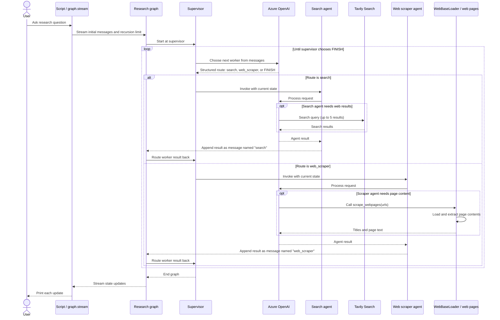

## Hierarchical Agent Teams

```
"""
In our previous example (Agent Supervisor 6.0), introduced the concept of a single supervisor node to route work between different worker nodes.
But what if the job for a single worker becomes too complex? What if the number of workers becomes too large?
For some applications, the system may be more effective if work is distributed hierarchically.
You can do this by composing different subgraphs and creating a top-level supervisor, along with mid-level supervisors.
"""
```

```
"""
This notebook is inspired by the paper [AutoGen: Enabling Next-Gen LLM Applications via Multi-Agent Conversation, by Wu, et. al.](https://arxiv.org/abs/2308.08155). 
In the rest of this notebook, you will:
    1. Define the agents' tools to access the web and write files
    2. Define some utilities to help create the graph and agents
    3. Create and define each team (web research + doc writing)
    4. Compose everything together.
"""

import getpass, os
from dotenv import load_dotenv
from typing import Annotated, List, Dict, Optional, Literal
from langchain_tavily import TavilySearch
from pathlib import Path
from tempfile import TemporaryDirectory
#from langchain_experimental.utilities import PythonREPL
from typing_extensions import TypedDict

from langchain_community.document_loaders import WebBaseLoader
from langchain_core.tools import tool
from langchain_core.language_models.chat_models import BaseChatModel
from langgraph.graph import StateGraph, MessagesState, START, END
from langgraph.types import Command
from langchain_core.messages import HumanMessage, trim_messages

from langchain_openai import ChatOpenAI, AzureChatOpenAI
from langchain.agents import create_agent

load_dotenv()

"""
1.Create Tools - Each team will be composed of one or more agents each with one or more tools.

1.1.ResearchTeam tools - The research team can use a search engine and url scraper to find information on the web. 
"""

tavily_tool = TavilySearch(max_results=5)

@tool
def scrape_webpages(urls: List[str]) -> str:
    """Use requests and bs4 to scrape the provided web pages for detailed information."""
    loader = WebBaseLoader(urls)
    docs = loader.load()
    return "\n\n".join(
        [
            f'<Document name="{doc.metadata.get("title", "")}">\n{doc.page_content}\n</Document>'
            for doc in docs
        ]
    )

"""
2.Helper Utilities - create a few utility functions to make it more concise when we want to:  1. Create a worker agent.  2. Create a supervisor for the sub-graph.
"""

class State(MessagesState):
    next: str

def make_supervisor_node(llm: BaseChatModel, members: list[str]) -> str:
    options = ["FINISH"] + members
    system_prompt = (
        "You are a supervisor tasked with managing a conversation between the"
        f" following workers: {members}. Given the following user request,"
        " respond with the worker to act next. Each worker will perform a"
        " task and respond with their results and status. When finished,"
        " respond with FINISH."
    )

    class Router(TypedDict):
        """Worker to route to next. If no workers needed, route to FINISH."""

        next: Literal[*options]

    def supervisor_node(state: State) -> Command[Literal[*members, "__end__"]]:
        """An LLM-based router."""
        messages = [
            {"role": "system", "content": system_prompt},
        ] + state["messages"]
        response = llm.with_structured_output(Router).invoke(messages)
        goto = response["next"]
        if goto == "FINISH":
            goto = END

        return Command(goto=goto, update={"next": goto})

    return supervisor_node

"""
3.Define Agent Teams - define our hierarchical teams.

3.1.Research Team - The research team will have a search agent and a web scraping "research_agent" as the two worker nodes. Let's create those, as well as the team supervisor.`
"""

#llm = ChatOpenAI(model="gpt-4o")
llm = AzureChatOpenAI(
    azure_deployment=os.environ["AZURE_OPENAI_DEPLOYMENT_NAME_LLM"],
    azure_endpoint=os.environ["AZURE_OPENAI_ENDPOINT_LLM"],
    api_key=os.environ["AZURE_OPENAI_API_KEY"],
    api_version="2025-03-01-preview"
)

search_agent = create_agent(llm, tools=[tavily_tool])

def search_node(state: State) -> Command[Literal["supervisor"]]:
    result = search_agent.invoke(state)
    return Command(
        update={
            "messages": [
                HumanMessage(content=result["messages"][-1].content, name="search")
            ]
        },
        # We want our workers to ALWAYS "report back" to the supervisor when done
        goto="supervisor",
    )

web_scraper_agent = create_agent(llm, tools=[scrape_webpages])

def web_scraper_node(state: State) -> Command[Literal["supervisor"]]:
    result = web_scraper_agent.invoke(state)
    return Command(
        update={
            "messages": [
                HumanMessage(content=result["messages"][-1].content, name="web_scraper")
            ]
        },
        # We want our workers to ALWAYS "report back" to the supervisor when done
        goto="supervisor",
    )

research_supervisor_node = make_supervisor_node(llm, ["search", "web_scraper"])

"""
Created the necessary components, defining their interactions is easy.  
"""

research_builder = StateGraph(State)
research_builder.add_node("supervisor", research_supervisor_node)
research_builder.add_node("search", search_node)
research_builder.add_node("web_scraper", web_scraper_node)

research_builder.add_edge(START, "supervisor")
research_graph = research_builder.compile()

#from IPython.display import Image, display
#display(Image(research_graph.get_graph().draw_mermaid_png()))

for s in research_graph.stream(
    {"messages": [("user", "when is Taylor Swift's next tour?")]},
    {"recursion_limit": 100},
):
    print(s)
    print("---")
    
"""
Code Explanation
    It builds a supervised web-research workflow using LangGraph and LangChain. 
    How it works
        1.Defines shared state. State extends LangGraph’s MessagesState, which holds the conversation messages, and adds a next field for the supervisor’s selected route.
        2.Creates the supervisor. make_supervisor_node builds a routing function for a set of worker names. It asks the LLM to choose one of those workers or FINISH, using structured output to constrain the choice. FINISH is translated to LangGraph’s END.
        3.Builds the research team. The Azure OpenAI model backs two agents:
            1.search_agent, equipped with Tavily search.
            2.web_scraper_agent, equipped with the webpage-scraping tool.
            Each worker node runs its agent, adds the result to the conversation as a named message, and routes back to the supervisor. The supervisor can then choose another worker or finish.
        4.Compiles and runs the graph. research_builder connects the supervisor and workers into research_graph. The final loop runs the graph on the sample question, “when is Taylor Swift’s next tour?”, and prints each state update as it streams.
  Notes
      The supervisor’s decisions determine whether search, scraping, or completion happens next. The sample graph has a recursion limit of 100.
"""
```

#### Research workflow sequence diagram

