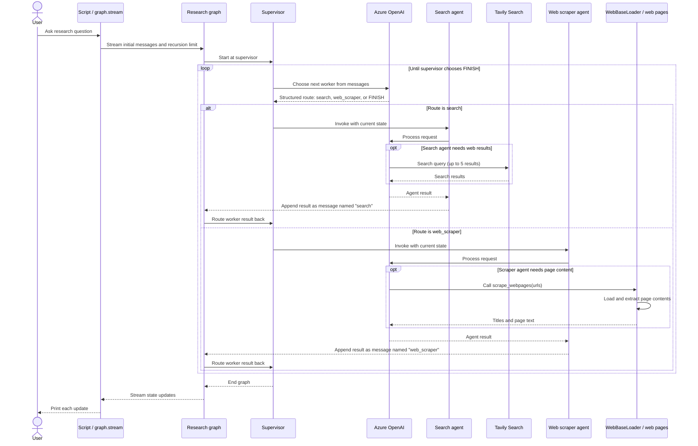
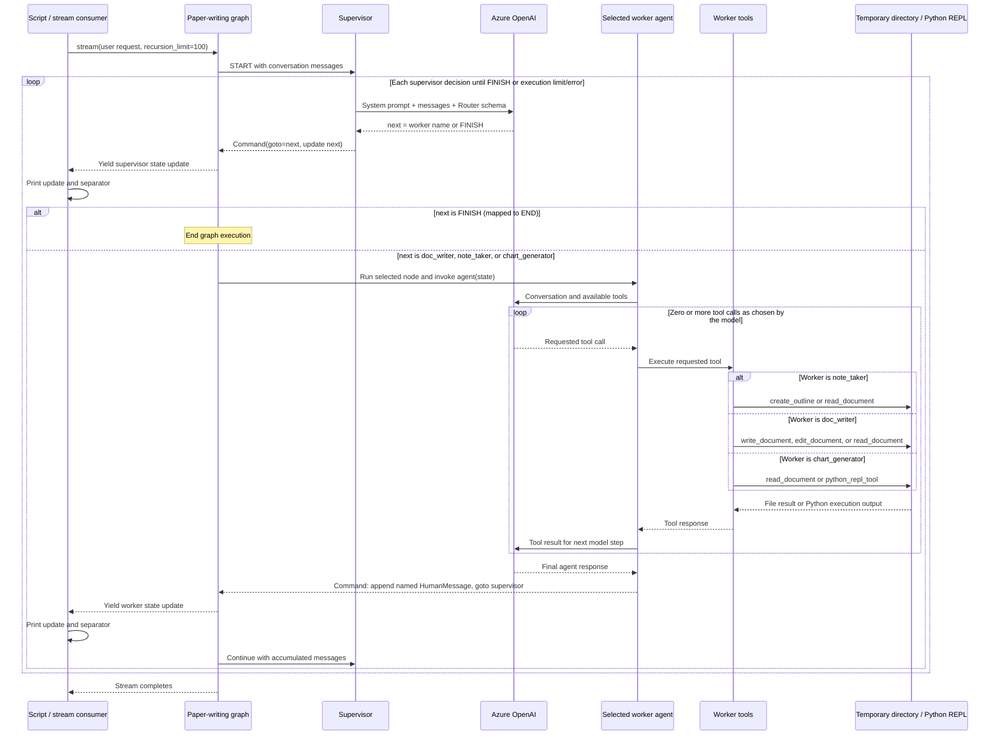
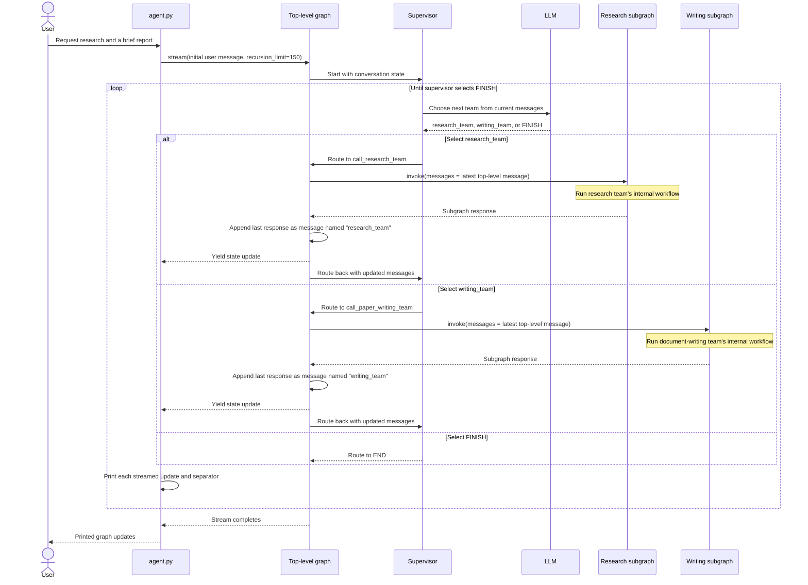

## Hierarchical Agent Teams
* agent_common.py

```
"""
In our previous example (Agent Supervisor 6.0), introduced the concept of a single supervisor node to route work between different worker nodes.
But what if the job for a single worker becomes too complex? What if the number of workers becomes too large?
For some applications, the system may be more effective if work is distributed hierarchically.
You can do this by composing different subgraphs and creating a top-level supervisor, along with mid-level supervisors.
"""
```


```
"""
This notebook is inspired by the paper [AutoGen: Enabling Next-Gen LLM Applications via Multi-Agent Conversation, by Wu, et. al.](https://arxiv.org/abs/2308.08155). 
In the rest of this notebook, you will:
    1. Define the agents' tools to access the web and write files
    2. Define some utilities to help create the graph and agents
    3. Create and define each team (web research + doc writing)
    4. Compose everything together.
"""

import os
from dotenv import load_dotenv
from typing import Annotated, List, Dict, Optional, Literal
from langchain_tavily import TavilySearch
from pathlib import Path
from tempfile import TemporaryDirectory
from langchain_experimental.utilities import PythonREPL
from typing_extensions import TypedDict

from langchain_community.document_loaders import WebBaseLoader
from langchain_core.tools import tool
from langchain_core.language_models.chat_models import BaseChatModel
from langgraph.graph import StateGraph, MessagesState, START, END
from langgraph.types import Command
from langchain_core.messages import HumanMessage, trim_messages

from langchain_openai import ChatOpenAI, AzureChatOpenAI
from langchain.agents import create_agent

load_dotenv()

#llm = ChatOpenAI(model="gpt-4o")
llm = AzureChatOpenAI(
    azure_deployment=os.environ["AZURE_OPENAI_DEPLOYMENT_NAME_LLM"],
    azure_endpoint=os.environ["AZURE_OPENAI_ENDPOINT_LLM"],
    api_key=os.environ["AZURE_OPENAI_API_KEY"],
    api_version="2025-03-01-preview"
)

class State(MessagesState):
    next: str

"""
2.Helper Utilities - create a few utility functions to make it more concise when we want to:
    1. Create a worker agent.
    2. Create a supervisor for the sub-graph.

"""

class State(MessagesState):
    next: str

def make_supervisor_node(llm: BaseChatModel, members: list[str]) -> str:
    options = ["FINISH"] + members
    system_prompt = (
        "You are a supervisor tasked with managing a conversation between the"
        f" following workers: {members}. Given the following user request,"
        " respond with the worker to act next. Each worker will perform a"
        " task and respond with their results and status. When finished,"
        " respond with FINISH."
    )

    class Router(TypedDict):
        """Worker to route to next. If no workers needed, route to FINISH."""

        next: Literal[*options]

    def supervisor_node(state: State) -> Command[Literal[*members, "__end__"]]:
        """An LLM-based router."""
        messages = [
            {"role": "system", "content": system_prompt},
        ] + state["messages"]
        response = llm.with_structured_output(Router).invoke(messages)
        goto = response["next"]
        if goto == "FINISH":
            goto = END

        return Command(goto=goto, update={"next": goto})

    return supervisor_node
```
* agent_search.py

```
"""
Code Explanation
    It builds a supervised web-research workflow using LangGraph and LangChain. 

    How it works
        1.Defines shared state. State extends LangGraph’s MessagesState, which holds the conversation messages, and adds a next field for the supervisor’s selected route.

        2.Creates the supervisor. make_supervisor_node builds a routing function for a set of worker names. It asks the LLM to choose one of those workers or FINISH, using structured output to constrain the choice. FINISH is translated to LangGraph’s END.

        3.Builds the research team. The Azure OpenAI model backs two agents:
            1.search_agent, equipped with Tavily search.
            2.web_scraper_agent, equipped with the webpage-scraping tool.
            Each worker node runs its agent, adds the result to the conversation as a named message, and routes back to the supervisor. The supervisor can then choose another worker or finish.

        4.Compiles and runs the graph. research_builder connects the supervisor and workers into research_graph. The final loop runs the graph on the sample question, “when is Taylor Swift’s next tour?”, and prints each state update as it streams.

Notes
    The supervisor’s decisions determine whether search, scraping, or completion happens next. The sample graph has a recursion limit of 100.
    The annotation on make_supervisor_node says it returns str, but the function actually returns the nested supervisor_node callable. That annotation appears inaccurate.
    The script prints graph events; it doesn’t separately extract or display one final answer.

1.Create Tools
Each team will be composed of one or more agents each with one or more tools.

1.1.ResearchTeam tools - The research team can use a search engine and url scraper to find information on the web. 

"""
from agent_common import *

tavily_tool = TavilySearch(max_results=5)

@tool
def scrape_webpages(urls: List[str]) -> str:
    """Use requests and bs4 to scrape the provided web pages for detailed information."""
    loader = WebBaseLoader(urls)
    docs = loader.load()
    return "\n\n".join(
        [
            f'<Document name="{doc.metadata.get("title", "")}">\n{doc.page_content}\n</Document>'
            for doc in docs
        ]
    )

"""
3.Define Agent Teams - define our hierarchical teams.

3.1.Research Team - The research team will have a search agent and a web scraping "research_agent" as the two worker nodes. Let's create those, as well as the team supervisor.`
"""

search_agent = create_agent(llm, tools=[tavily_tool])

def search_node(state: State) -> Command[Literal["supervisor"]]:
    result = search_agent.invoke(state)
    return Command(
        update={
            "messages": [
                HumanMessage(content=result["messages"][-1].content, name="search")
            ]
        },
        # We want our workers to ALWAYS "report back" to the supervisor when done
        goto="supervisor",
    )

web_scraper_agent = create_agent(llm, tools=[scrape_webpages])

def web_scraper_node(state: State) -> Command[Literal["supervisor"]]:
    result = web_scraper_agent.invoke(state)
    return Command(
        update={
            "messages": [
                HumanMessage(content=result["messages"][-1].content, name="web_scraper")
            ]
        },
        # We want our workers to ALWAYS "report back" to the supervisor when done
        goto="supervisor",
    )

research_supervisor_node = make_supervisor_node(llm, ["search", "web_scraper"])

"""
Created the necessary components, defining their interactions is easy.  
"""

research_builder = StateGraph(State)
research_builder.add_node("supervisor", research_supervisor_node)
research_builder.add_node("search", search_node)
research_builder.add_node("web_scraper", web_scraper_node)

research_builder.add_edge(START, "supervisor")
research_graph = research_builder.compile()

#from IPython.display import Image, display
#display(Image(research_graph.get_graph().draw_mermaid_png()))
```


```
for s in research_graph.stream(
    {"messages": [("user", "when is Taylor Swift's next tour?")]},
    {"recursion_limit": 100},
):
    print(s)
    print("---")
    
```

#### Research workflow sequence diagram


* agent_file.py

"""
Code Explanation
    Defines a document-writing team: a supervisor chooses between an outline writer, a document writer, and a chart generator. 

    Tools and file storage
        A temp dir is created and used. Files created by the tools go & removed when the Python process exits.
        create_outline writes numbered points to a file.
        read_document reads a file and returns the selected lines .
        write_document saves text to a file.
        edit_document inserts text at specified, 1-based line numbers.
        python_repl_tool runs Python code locally and returns its output. 

    Agents and graph
        Document writer: can read, write, and edit documents (agent).
        Note-taker: can read documents and create outlines (agent).
        Chart generator: can read documents and run Python code (agent).
    
    Each agent has a graph node that runs it, adds its result to the conversation under its name, then routes control back to the supervisor (worker nodes, note-taking node, chart node).

    The supervisor can choose any of the three workers or finish (supervisor setup). The graph starts at the supervisor (graph setup), so the LLM—not a fixed edge—decides which worker goes first. The prompt asks for an outline and then a poem, but that order is not enforced by the graph.

    Flow: supervisor → note-taker → supervisor → document writer → supervisor → finish, but the first worker can vary.

"""
from agent_common import *

```
"""
1.2.Document writing team tools - define some file-access tools below. Agents access to your file-system, which can be unsafe. 
"""

_TEMP_DIRECTORY = TemporaryDirectory()
WORKING_DIRECTORY = Path(_TEMP_DIRECTORY.name)

@tool
def create_outline(
    points: Annotated[List[str], "List of main points or sections."],
    file_name: Annotated[str, "File path to save the outline."],
) -> Annotated[str, "Path of the saved outline file."]:
    """Create and save an outline."""
    with (WORKING_DIRECTORY / file_name).open("w") as file:
        for i, point in enumerate(points):
            file.write(f"{i + 1}. {point}\n")
    return f"Outline saved to {file_name}"

@tool
def read_document(
    file_name: Annotated[str, "File path to read the document from."],
    start: Annotated[Optional[int], "The start line. Default is 0"] = None,
    end: Annotated[Optional[int], "The end line. Default is None"] = None,
) -> str:
    """Read the specified document."""
    with (WORKING_DIRECTORY / file_name).open("r") as file:
        lines = file.readlines()
    if start is None:
        start = 0
    return "\n".join(lines[start:end])

@tool
def write_document(
    content: Annotated[str, "Text content to be written into the document."],
    file_name: Annotated[str, "File path to save the document."],
) -> Annotated[str, "Path of the saved document file."]:
    """Create and save a text document."""
    with (WORKING_DIRECTORY / file_name).open("w") as file:
        file.write(content)
    return f"Document saved to {file_name}"

@tool
def edit_document(
    file_name: Annotated[str, "Path of the document to be edited."],
    inserts: Annotated[
        Dict[int, str],
        "Dictionary where key is the line number (1-indexed) and value is the text to be inserted at that line.",
    ],
) -> Annotated[str, "Path of the edited document file."]:
    """Edit a document by inserting text at specific line numbers."""

    with (WORKING_DIRECTORY / file_name).open("r") as file:
        lines = file.readlines()

    sorted_inserts = sorted(inserts.items())

    for line_number, text in sorted_inserts:
        if 1 <= line_number <= len(lines) + 1:
            lines.insert(line_number - 1, text + "\n")
        else:
            return f"Error: Line number {line_number} is out of range."

    with (WORKING_DIRECTORY / file_name).open("w") as file:
        file.writelines(lines)

    return f"Document edited and saved to {file_name}"

# Warning: This executes code locally, which can be unsafe when not sandboxed
repl = PythonREPL()

@tool
def python_repl_tool(
    code: Annotated[str, "The python code to execute to generate your chart."],
):
    """Use this to execute python code. If you want to see the output of a value,
    you should print it out with `print(...)`. This is visible to the user."""
    try:
        result = repl.run(code)
    except BaseException as e:
        return f"Failed to execute. Error: {repr(e)}"
    return f"Successfully executed:\n```python\n{code}\n```\nStdout: {result}"

"""
Document Writing Team - each agent access to different file-writing tools.
"""

doc_writer_agent = create_agent(
    llm,
    tools=[write_document, edit_document, read_document],
    system_prompt=(
        "You can read, write and edit documents based on note-taker's outlines. "
        "Don't ask follow-up questions."
    ),
)

def doc_writing_node(state: State) -> Command[Literal["supervisor"]]:
    result = doc_writer_agent.invoke(state)
    return Command(
        update={
            "messages": [
                HumanMessage(content=result["messages"][-1].content, name="doc_writer")
            ]
        },
        # We want our workers to ALWAYS "report back" to the supervisor when done
        goto="supervisor",
    )

note_taking_agent = create_agent(
    llm,
    tools=[create_outline, read_document],
    system_prompt=(
        "You can read documents and create outlines for the document writer. "
        "Don't ask follow-up questions."
    ),
)

def note_taking_node(state: State) -> Command[Literal["supervisor"]]:
    result = note_taking_agent.invoke(state)
    return Command(
        update={
            "messages": [
                HumanMessage(content=result["messages"][-1].content, name="note_taker")
            ]
        },
        # We want our workers to ALWAYS "report back" to the supervisor when done
        goto="supervisor",
    )

chart_generating_agent = create_agent(
    llm, tools=[read_document, python_repl_tool]
)

def chart_generating_node(state: State) -> Command[Literal["supervisor"]]:
    result = chart_generating_agent.invoke(state)
    return Command(
        update={
            "messages": [
                HumanMessage(
                    content=result["messages"][-1].content, name="chart_generator"
                )
            ]
        },
        # We want our workers to ALWAYS "report back" to the supervisor when done
        goto="supervisor",
    )

doc_writing_supervisor_node = make_supervisor_node(
    llm, ["doc_writer", "note_taker", "chart_generator"]
)

# Create the graph here
paper_writing_builder = StateGraph(State)
paper_writing_builder.add_node("supervisor", doc_writing_supervisor_node)
paper_writing_builder.add_node("doc_writer", doc_writing_node)
paper_writing_builder.add_node("note_taker", note_taking_node)
paper_writing_builder.add_node("chart_generator", chart_generating_node)

paper_writing_builder.add_edge(START, "supervisor")
paper_writing_graph = paper_writing_builder.compile()

#from IPython.display import Image, display
#display(Image(paper_writing_graph.get_graph().draw_mermaid_png()))
```


```
for s in paper_writing_graph.stream(
    {
        "messages": [
            (
                "user",
                "Write an outline for poem about cats and then write the poem to disk.",
            )
        ]
    },
    {"recursion_limit": 100},
):
    print(s)
    print("---")
```

#### Document-writing team sequence diagram


```
"""
Code Explanation
    Creates a top-level graph that delegates work to two existing teams: a research team and a document-writing team.

    Top-level supervisor (teams_supervisor_node) -  This creates a supervisor that asks the LLM which team should act next, or whether the work is finished. The choice is dynamic; it doesn’t guarantee that research runs before writing.

    Calling the teams - call_research_team and call_paper_writing_team each:
        Take the most recent message from the top-level conversation.
        Pass it to the relevant subgraph.
        Take that subgraph’s last message and add it to the top-level conversation under the name research_team or writing_team.
        Route control back to the top-level supervisor.

    For example, the writing team receives the latest message rather than the entire top-level conversation:
        paper_writing_graph.invoke({"messages": state["messages"][-1]})

    START → supervisor → research_team or writing_team
                    ↑                   |
                    └───────────────────┘
    The supervisor may choose a team again after receiving its result, or end the workflow.

Add Layers
In this design, we are enforcing a top-down planning policy. 
We've created two graphs already, but we have to decide how to route work between the two.

We'll create a third graph to orchestrate the previous two, and add some connectors to define how this top-level state is shared between the different graphs.
"""

from agent_common import *
from agent_search import *
from agent_file import *

teams_supervisor_node = make_supervisor_node(llm, ["research_team", "writing_team"])

def call_research_team(state: State) -> Command[Literal["supervisor"]]:
    response = research_graph.invoke({"messages": state["messages"][-1]})
    return Command(
        update={
            "messages": [
                HumanMessage(
                    content=response["messages"][-1].content, name="research_team"
                )
            ]
        },
        goto="supervisor",
    )


def call_paper_writing_team(state: State) -> Command[Literal["supervisor"]]:
    response = paper_writing_graph.invoke({"messages": state["messages"][-1]})
    return Command(
        update={
            "messages": [
                HumanMessage(
                    content=response["messages"][-1].content, name="writing_team"
                )
            ]
        },
        goto="supervisor",
    )


# Define the graph.
super_builder = StateGraph(State)
super_builder.add_node("supervisor", teams_supervisor_node)
super_builder.add_node("research_team", call_research_team)
super_builder.add_node("writing_team", call_paper_writing_team)

super_builder.add_edge(START, "supervisor")
super_graph = super_builder.compile()

#from IPython.display import Image, display
#display(Image(super_graph.get_graph().draw_mermaid_png()))
```


```
for s in super_graph.stream(
    {
        "messages": [
            ("user", "Research AI agents and write a brief report about them.")
        ],
    },
    {"recursion_limit": 150},
):
    print(s)
    print("---")
"""
```

#### Team orchestration sequence diagram


