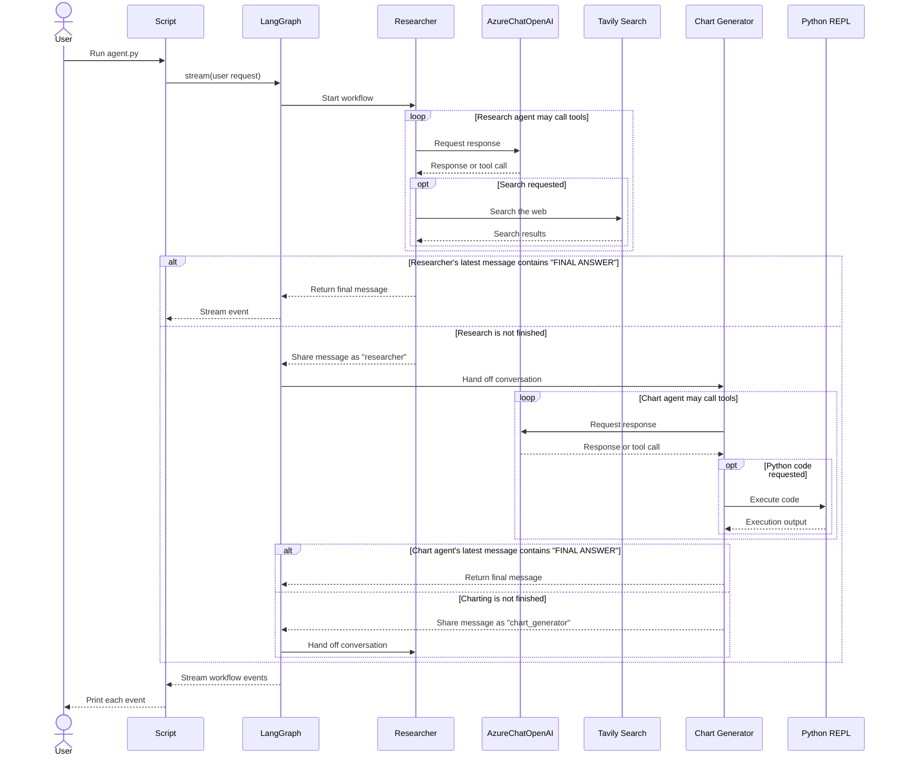

## Multi-agent network

```
"""
Multi-agent network
A single agent can usually operate effectively using a handful of tools within a single domain, but even using powerful models like gpt-4, it can be less effective at using many tools.

One way to approach complicated tasks is through a "divide-and-conquer" approach: create a specialized agent for each task or domain and route tasks to the correct "expert". This is an example of a multi-agent network architecture.

This notebook (inspired by the paper AutoGen: Enabling Next-Gen LLM Applications via Multi-Agent Conversation, by Wu, et. al.) shows one way to do this using LangGraph.
```


```
"""
Before we get started, a quick note: this and other multi-agent notebooks are designed to show how you can implement 
certain design patterns in LangGraph. If the pattern suits your needs, we recommend combining it with some of the 
other fundamental patterns described elsewhere in the docs for best performance.
"""

import os
from dotenv import load_dotenv
from typing import Annotated

from langchain_tavily import TavilySearch
from langchain_core.tools import tool
from langchain_experimental.utilities import PythonREPL

from typing import Literal

from langchain_core.messages import BaseMessage, HumanMessage
from langchain_openai import AzureChatOpenAI
from langchain.agents import create_agent
from langgraph.graph import MessagesState, END
from langgraph.types import Command

load_dotenv()

"""
Define tools
"""

tavily_tool = TavilySearch(max_results=5)

repl = PythonREPL()

@tool
def python_repl_tool(
    code: Annotated[str, "The python code to execute to generate your chart."],
):
    """Use this to execute python code. If you want to see the output of a value,
    you should print it out with `print(...)`. This is visible to the user."""
    try:
        result = repl.run(code)
    except BaseException as e:
        return f"Failed to execute. Error: {repr(e)}"
    result_str = f"Successfully executed:\n```python\n{code}\n```\nStdout: {result}"
    return (
        result_str + "\n\nIf you have completed all tasks, respond with FINAL ANSWER."
    )


"""
Create graph - create the individual agents below and tell them how to talk to each other using LangGraph.

Define Agent Nodes

First, we'll create a utility to create a system prompt for each agent.
"""

def make_system_prompt(suffix: str) -> str:
    return (
        "You are a helpful AI assistant, collaborating with other assistants."
        " Use the provided tools to progress towards answering the question."
        " If you are unable to fully answer, that's OK, another assistant with different tools "
        " will help where you left off. Execute what you can to make progress."
        " If you or any of the other assistants have the final answer or deliverable,"
        " prefix your response with FINAL ANSWER so the team knows to stop."
        f"\n{suffix}"
    )

llm = AzureChatOpenAI(
    azure_deployment=os.environ["AZURE_OPENAI_DEPLOYMENT_NAME_LLM"],
    azure_endpoint=os.environ["AZURE_OPENAI_ENDPOINT_LLM"],
    api_key=os.environ["AZURE_OPENAI_API_KEY"],
    api_version="2025-03-01-preview"
)

def get_next_node(last_message: BaseMessage, goto: str):
    if "FINAL ANSWER" in last_message.content:
        # Any agent decided the work is done
        return END
    return goto

# Research agent and node
research_agent = create_agent(
    llm,
    tools=[tavily_tool],
    system_prompt=make_system_prompt(
        "You can only do research. You are working with a chart generator colleague."
    ),
)

def research_node(
    state: MessagesState,
) -> Command[Literal["chart_generator", END]]:
    result = research_agent.invoke(state)
    goto = get_next_node(result["messages"][-1], "chart_generator")
    # wrap in a human message, as not all providers allow
    # AI message at the last position of the input messages list
    result["messages"][-1] = HumanMessage(
        content=result["messages"][-1].content, name="researcher"
    )
    return Command(
        update={
            # share internal message history of research agent with other agents
            "messages": result["messages"],
        },
        goto=goto,
    )

# Chart generator agent and node
# NOTE: THIS PERFORMS ARBITRARY CODE EXECUTION, WHICH CAN BE UNSAFE WHEN NOT SANDBOXED
chart_agent = create_agent(
    llm,
    [python_repl_tool],
    system_prompt=make_system_prompt(
        "You can only generate charts. You are working with a researcher colleague."
    ),
)


def chart_node(state: MessagesState) -> Command[Literal["researcher", END]]:
    result = chart_agent.invoke(state)
    goto = get_next_node(result["messages"][-1], "researcher")
    # wrap in a human message, as not all providers allow
    # AI message at the last position of the input messages list
    result["messages"][-1] = HumanMessage(
        content=result["messages"][-1].content, name="chart_generator"
    )
    return Command(
        update={
            # share internal message history of chart agent with other agents
            "messages": result["messages"],
        },
        goto=goto,
    )

"""
Define the Graph - put it all together
"""

from langgraph.graph import StateGraph, START

workflow = StateGraph(MessagesState)
workflow.add_node("researcher", research_node)
workflow.add_node("chart_generator", chart_node)

workflow.add_edge(START, "researcher")
graph = workflow.compile()

'''from IPython.display import Image, display
try:
    display(Image(graph.get_graph().draw_mermaid_png()))
except Exception:
    # This requires some extra dependencies and is optional
    pass
'''
```


```
events = graph.stream(
    {
        "messages": [
            (
                "user",
                "First, get the UK's GDP over the past 5 years, then make a line chart of it. "
                "Once you make the chart, finish.",
            )
        ],
    },
    # Maximum number of steps to take in the graph
    {"recursion_limit": 150},
)
for s in events:
    print(s)
    print("----")

"""
Code Explanation

Builds a small 2 agent workflow with LangGraph: one agent researches information, and another can generate a chart using Python.

Main parts
    TavilySearch provides web search, and PythonREPL runs Python code. 
    The python_repl_tool wraps the REPL so the chart agent can call it and return its output.
    make_system_prompt() gives each agent shared collaboration instructions plus its role-specific limits.
    research_agent is given only the web-search tool. 
    research_node() runs it, then routes to the chart agent unless its latest message contains "FINAL ANSWER".
    chart_agent is given only the Python tool. 
    chart_node() runs it and routes back to the researcher unless the latest message says "FINAL ANSWER".
    Each node changes its latest assistant message into a HumanMessage named for that agent before returning it. 
    This lets the next agent see the prior agent’s contribution as part of the shared conversation.
    The graph starts at researcher; the two nodes can hand off to each other. 
    At the end, the script streams the graph’s progress and prints each event.

What happens when run
    The script sends a hard-coded request to find UK GDP data over the past 5 years and make a line chart. 
    The researcher is expected to find the data, the chart agent is expected to create the chart, and either agent can signal completion by including "FINAL ANSWER". 
    The graph has a recursion limit of 150 steps.
"""
```


