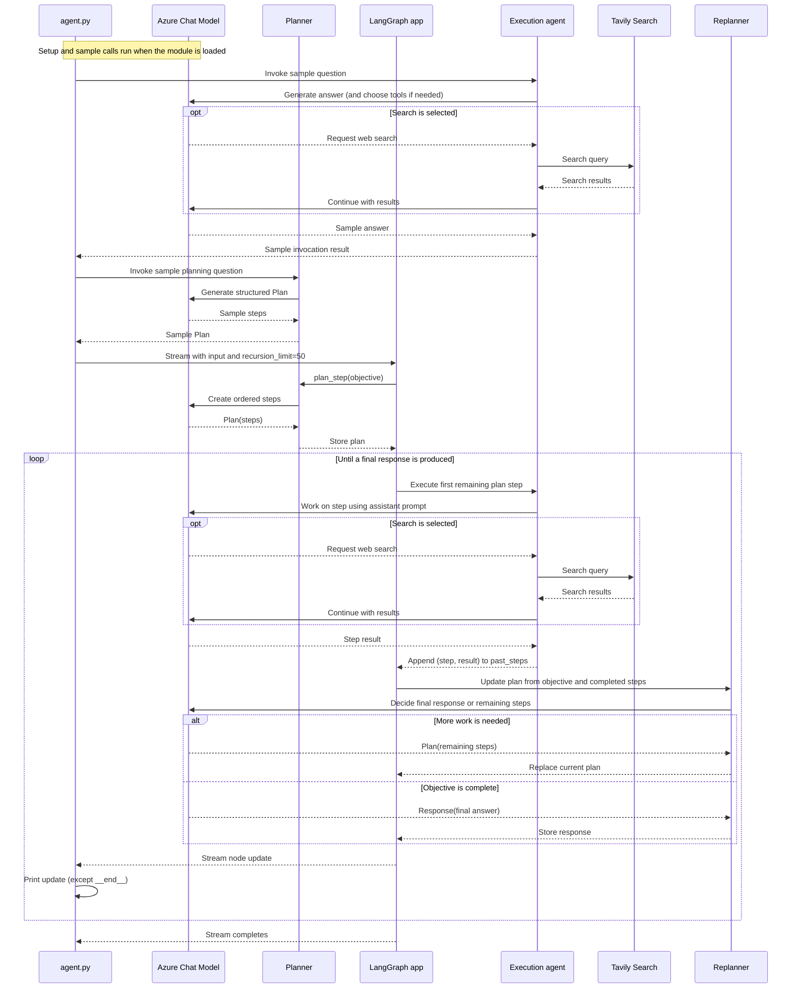

```
'''
Plan-and-Execute

    The core idea is to first come up with a multi-step plan, and then go through that plan one item at a time. 
    After accomplishing a particular task, you can then revisit the plan and modify as appropriate.

    The general computational graph looks like the following:
```


```
This compares to a typical ReAct style agent where you think one step at a time. The advantages of this "plan-and-execute" style agent are:
    Explicit long term planning (which even really strong LLMs can struggle with)
    Ability to use smaller/weaker models for the execution step, only using larger/better models for the planning step
'''

import os, operator
from dotenv import load_dotenv
from langchain_tavily import TavilySearch
from langchain_openai import AzureChatOpenAI
from langchain.agents import create_agent
from langchain_core.prompts import ChatPromptTemplate
from typing import Annotated, List, Tuple, Union
from typing_extensions import TypedDict
from pydantic import BaseModel, Field
from langgraph.graph import END


load_dotenv()

'''
Define Tools
'''

tools = [TavilySearch(max_results=3)]

'''
Define our Execution Agent - use to execute tasks. using the same execution agent for each task
'''

# Choose the LLM that will drive the agent
llm = AzureChatOpenAI(
    azure_deployment=os.environ["AZURE_OPENAI_DEPLOYMENT_NAME_LLM"],
    azure_endpoint=os.environ["AZURE_OPENAI_ENDPOINT_LLM"],
    api_key=os.environ["AZURE_OPENAI_API_KEY"],
    api_version="2025-03-01-preview"
)

prompt = "You are a helpful assistant."
agent_executor = create_agent(llm, tools, system_prompt=prompt)
agent_executor.invoke({"messages": [("user", "who is the winnner of the us open")]})
```


```
'''
Define the State
    Track the current plan - list of strings.
    Track previously executed steps - list of tuples (these tuples will contain the step and then the result)
    Need to have some state to represent the final response as well as the original input.

'''

class PlanExecute(TypedDict):
    input: str
    plan: List[str]
    past_steps: Annotated[List[Tuple], operator.add]
    response: str

'''
Planning Step - this will use function calling to create a plan.

'''

class Plan(BaseModel):
    """Plan to follow in future"""

    steps: List[str] = Field(
        description="different steps to follow, should be in sorted order"
    )

planner_prompt = ChatPromptTemplate.from_messages(
    [
        (
            "system",
            """For the given objective, come up with a simple step by step plan. \
This plan should involve individual tasks, that if executed correctly will yield the correct answer. Do not add any superfluous steps. \
The result of the final step should be the final answer. Make sure that each step has all the information needed - do not skip steps.""",
        ),
        ("placeholder", "{messages}"),
    ]
)
planner = planner_prompt | llm.with_structured_output(Plan)
planner.invoke(
    {
        "messages": [
            ("user", "what is the hometown of the current Australia open winner?")
        ]
    }
)
```


```
'''
Re-Plan Step - create a step that re-does the plan based on the result of the previous step.
'''

class Response(BaseModel):
    """Response to user."""

    response: str

class Act(BaseModel):
    """Action to perform."""

    action: Union[Response, Plan] = Field(
        description="Action to perform. If you want to respond to user, use Response. "
        "If you need to further use tools to get the answer, use Plan."
    )

replanner_prompt = ChatPromptTemplate.from_template(
    """For the given objective, come up with a simple step by step plan. \
This plan should involve individual tasks, that if executed correctly will yield the correct answer. Do not add any superfluous steps. \
The result of the final step should be the final answer. Make sure that each step has all the information needed - do not skip steps.

Your objective was this:
{input}

Your original plan was this:
{plan}

You have currently done the follow steps:
{past_steps}

Update your plan accordingly. If no more steps are needed and you can return to the user, then respond with that. Otherwise, fill out the plan. Only add steps to the plan that still NEED to be done. Do not return previously done steps as part of the plan."""
)

replanner = replanner_prompt | llm.with_structured_output(Act)

'''
Create the Graph
'''

async def execute_step(state: PlanExecute):
    plan = state["plan"]
    plan_str = "\n".join(f"{i + 1}. {step}" for i, step in enumerate(plan))
    task = plan[0]
    task_formatted = f"""For the following plan:
{plan_str}\n\nYou are tasked with executing step {1}, {task}."""
    agent_response = await agent_executor.ainvoke(
        {"messages": [("user", task_formatted)]}
    )
    return {
        "past_steps": [(task, agent_response["messages"][-1].content)],
    }

async def plan_step(state: PlanExecute):
    plan = await planner.ainvoke({"messages": [("user", state["input"])]})
    return {"plan": plan.steps}

async def replan_step(state: PlanExecute):
    output = await replanner.ainvoke(state)
    if isinstance(output.action, Response):
        return {"response": output.action.response}
    else:
        return {"plan": output.action.steps}

def should_end(state: PlanExecute):
    if "response" in state and state["response"]:
        return END
    else:
        return "agent"

from langgraph.graph import StateGraph, START

workflow = StateGraph(PlanExecute)

# Add the plan node
workflow.add_node("planner", plan_step)

# Add the execution step
workflow.add_node("agent", execute_step)

# Add a replan node
workflow.add_node("replan", replan_step)

workflow.add_edge(START, "planner")

# From plan we go to agent
workflow.add_edge("planner", "agent")

# From agent, we replan
workflow.add_edge("agent", "replan")

workflow.add_conditional_edges(
    "replan",
    # Next, we pass in the function that will determine which node is called next.
    should_end,
    ["agent", END],
)

# Finally, we compile it!
# This compiles it into a LangChain Runnable,
# meaning you can use it as you would any other runnable
app = workflow.compile()

#from IPython.display import Image, display
#display(Image(app.get_graph(xray=True).draw_mermaid_png()))
```


```
config = {"recursion_limit": 50}
inputs = {"input": "what is the hometown of the mens 2024 Australia open winner?"}

import asyncio

async def main():
    async for event in app.astream(inputs, config=config):
        for k, v in event.items():
            if k != "__end__":
                print(v)

asyncio.run(main())
```


### Code Explanation
* Code implements a plan-and-execute agent: an LLM first creates a step-by-step plan, another agent performs one step at a time, and the LLM updates the plan until it can provide a final answer.
* Main parts
  * Execution agent: create_agent(...) builds the tool-using assistant that carries out individual tasks.
  * State: PlanExecute describes the information passed through the workflow: the original input, the current plan, completed past_steps, and eventual response.
    * The operator.add annotation tells LangGraph to accumulate completed steps rather than replace them.
  * Planner: The Plan model requires the planner’s output to have a steps list. with_structured_output(Plan) asks the LLM for that structured shape.
  * Replanner: After each task, the Act model lets the LLM either return a final Response or provide an updated Plan.
    * Its prompt includes the objective, original/current plan, and completed steps so it can decide what remains.
  * Graph: The workflow runs planner → agent → replan.
    * If replanning produces a response, should_end stops the graph; otherwise it sends the new plan back to the execution agent.
    * The graph is compiled into app, then run asynchronously with a recursion limit.
* A run, step by step
  * The input asks for the hometown of the men’s 2024 Australian Open winner.
  * The planner breaks that objective into tasks.
  * The execution agent performs the first task—using search if needed—and records the result in past_steps.
  * The replanner then decides whether another task is needed or whether it can answer.
  * This repeats until the graph gets a final response or reaches its recursion limit.

 # Plan-and-execute sequence diagram

This diagram describes the workflow in [agent.py](agent.py). The setup-time
sample calls to the execution agent and planner are shown separately from the
main graph run.



