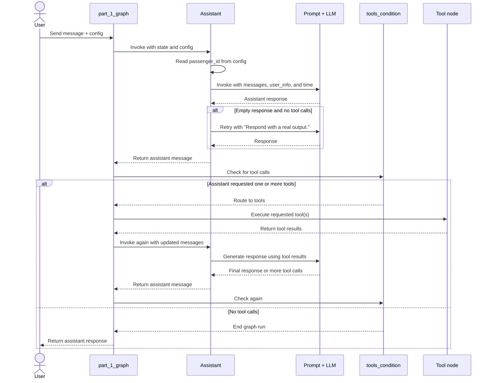
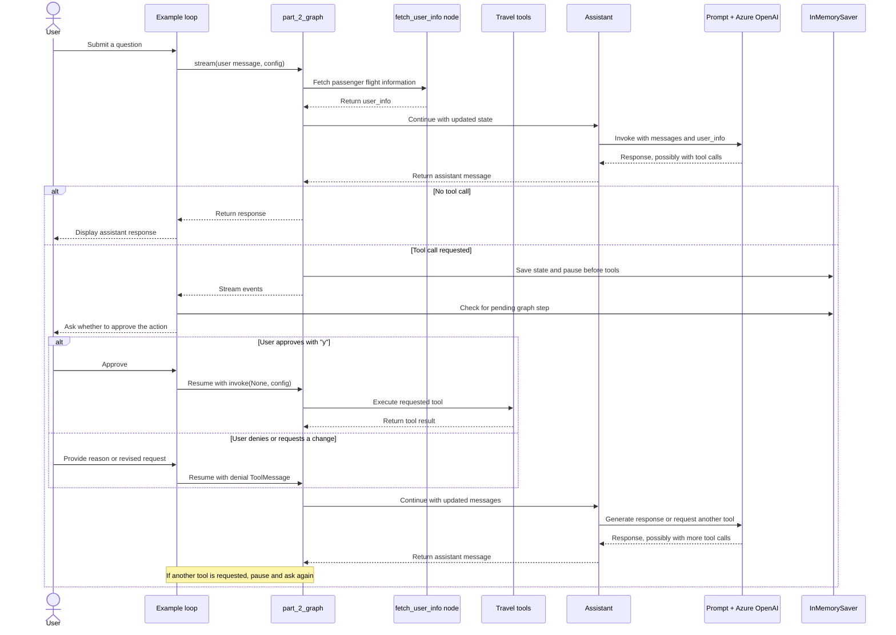

# Customer support Bot

* Customer support bots can free up teams' time by handling routine issues, but it can be hard to build a bot that reliably handles diverse tasks in a way that doesn't leave the user pulling their hair out.
* build a customer support bot for an airline to help users research and make travel arrangements.
* use LangGraph's interrupts and checkpointers and more complex state to organize your assistant's tools and manage a user's flight bookings, hotel reservations, car rentals, and excursions.


* agent_1.py
```
from agent_tools import *
from agent_tools import _print_event

# Part 1: Zero-shot Agent
"""
Part 1: Zero-shot Agent
start with the simplest working implementation and use an evaluation tool like LangSmith to measure its efficacy.
In this case, the single-graph approach has limitations. The bot may take undesired actions without user confirmation, struggle with complex queries, and lack focus in its responses. 
Define a simple Zero-shot agent as the assistant, give the agent all of our tools, and prompt it to use them judiciously to assist the user.

The simple 2-node graph will look like the following:
"""
```


```
"""
Code Explanation
Main loop is: user message → assistant → optional tool calls → assistant response.

1. State and assistant
	State describes the graph’s conversation state: a messages list. The add_messages annotation tells LangGraph how to combine new messages with the existing history.
	Assistant wraps the LLM chain. When called, it:
		1. Reads passenger_id from the graph’s configuration.
		2. Adds it to the state as user_info, so the prompt and tools can use it.
		3. Invokes the LLM.
		4. If the LLM returns an empty response without requesting a tool, asks it to produce a real response and tries again.
		5. Returns the result as a message for the graph.
2. Prompt and tools
	* primary_assistant_prompt gives the model its role and instructions: help with flights, policies .... It also includes the current user’s information and the current time.
	* part_1_tools is the set of actions the model can request: searching information, retrieving flight details, and managing flights, rentals, hotels, and excursions.
	* llm.bind_tools(part_1_tools) makes those tools available to the model. The model can request a tool call; the graph’s tool node executes it.
3. Graph and memory
	The graph has two working nodes:
		START → assistant → (tool call?) → tools → assistant
		                   └ (no tool call) → END
		tools_condition decides whether to route the assistant’s result to the tools node or finish. After tools run, the graph returns to the assistant so it can interpret the results and respond.
		InMemorySaver stores checkpoints in memory, keyed here by thread_id, so messages in this run can share conversation state. It is not persistent storage across process restarts.
4. Example conversation
	The rest of the file runs a sample travel-support conversation:
		* It updates the example database dates with update_dates(db).
		* It creates a unique thread_id and configures a passenger ID.
		* For each question, it streams graph events and passes them to _print_event to display the conversation and tool activity.
The final comments review the demo: the agent can complete travel tasks, but it may take actions the user didn’t intend—for example, booking a car while discussing lodging. That’s a limitation of this simple setup; it doesn’t add a separate confirmation step before bookings.
"""
```

```
"""
State - StateGraph's state as a typed dictionary containing an append-only list of messages. These messages form the chat history, which is all the state our simple assistant needs.
"""
class State(TypedDict):
    messages: Annotated[list[AnyMessage], add_messages]

"""
Agent - Define the assistant function. This function takes the graph state, formats it into a prompt, and then calls an LLM for it to predict the best response.
"""
class Assistant:
    def __init__(self, runnable: Runnable):
        self.runnable = runnable

    def __call__(self, state: State, config: RunnableConfig):
        while True:
            configuration = config.get("configurable", {})
            passenger_id = configuration.get("passenger_id", None)
            state = {**state, "user_info": passenger_id}
            result = self.runnable.invoke(state)
            # If the LLM happens to return an empty response, we will re-prompt it
            # for an actual response.
            if not result.tool_calls and (
                not result.content
                or isinstance(result.content, list)
                and not result.content[0].get("text")
            ):
                messages = state["messages"] + [("user", "Respond with a real output.")]
                state = {**state, "messages": messages}
            else:
                break
        return {"messages": result}

primary_assistant_prompt = ChatPromptTemplate.from_messages(
    [
        (
            "system",
            "You are a helpful customer support assistant for Swiss Airlines. "
            " Use the provided tools to search for flights, company policies, and other information to assist the user's queries. "
            " When searching, be persistent. Expand your query bounds if the first search returns no results. "
            " If a search comes up empty, expand your search before giving up."
            "\n\nCurrent user:\n<User>\n{user_info}\n</User>"
            "\nCurrent time: {time}.",
        ),
        ("placeholder", "{messages}"),
    ]
).partial(time=datetime.now)

part_1_tools = [
    tavilySearch,
    fetch_user_flight_information,
    search_flights,
    lookup_policy,
    update_ticket_to_new_flight,
    cancel_ticket,
    search_car_rentals,
    book_car_rental,
    update_car_rental,
    cancel_car_rental,
    search_hotels,
    book_hotel,
    update_hotel,
    cancel_hotel,
    search_trip_recommendations,
    book_excursion,
    update_excursion,
    cancel_excursion,
]
part_1_assistant_runnable = primary_assistant_prompt | llm.bind_tools(part_1_tools)

"""
Define Graph - create the graph. The graph is the final assistant for this section.
"""
builder = StateGraph(State)

# Define nodes: these do the work
builder.add_node("assistant", Assistant(part_1_assistant_runnable))
builder.add_node("tools", create_tool_node_with_fallback(part_1_tools))
# Define edges: these determine how the control flow moves
builder.add_edge(START, "assistant")
builder.add_conditional_edges(
    "assistant",
    tools_condition,
)
builder.add_edge("tools", "assistant")

# The checkpointer lets the graph persist its state
# this is a complete memory for the entire graph.
memory = InMemorySaver()
part_1_graph = builder.compile(checkpointer=memory)

from IPython.display import Image, display
try:
    display(Image(part_1_graph.get_graph(xray=True).draw_mermaid_png()))
except Exception:
    # This requires some extra dependencies and is optional
    pass
```


```
"""
Example Conversation - If it hits a "RecursionLimit", that means the agent wasn't able to get an answer in the allocated number of steps. 
"""
# Let's create an example conversation a user might have with the assistant
tutorial_questions = [
    "Hi there, what time is my flight?",
    "Am i allowed to update my flight to something sooner? I want to leave later today.",
    "Update my flight to sometime next week then",
    "The next available option is great",
    "what about lodging and transportation?",
    "Yeah i think i'd like an affordable hotel for my week-long stay (7 days). And I'll want to rent a car.",
    "OK could you place a reservation for your recommended hotel? It sounds nice.",
    "yes go ahead and book anything that's moderate expense and has availability.",
    "Now for a car, what are my options?",
    "Awesome let's just get the cheapest option. Go ahead and book for 7 days",
    "Cool so now what recommendations do you have on excursions?",
    "Are they available while I'm there?",
    "interesting - i like the museums, what options are there? ",
    "OK great pick one and book it for my second day there.",
]

# Update with the backup file so we can restart from the original place in each section
db = update_dates(db)
thread_id = str(uuid.uuid4())

config = {
    "configurable": {
        # The passenger_id is used in our flight tools to
        # fetch the user's flight information
        "passenger_id": "3442 587242",
        # Checkpoints are accessed by thread_id
        "thread_id": thread_id,
    }
}

_printed = set()
for question in tutorial_questions:
    events = part_1_graph.stream(
        {"messages": ("user", question)}, config, stream_mode="values"
    )
    for event in events:
        _print_event(event, _printed)
```


```
"""
Part 1 Review
Our simple assistant is not bad! It was able to respond reasonably well for all the questions, quickly respond in-context, and successfully execute all our tasks. 

Since our customer support bot is taking actions on behalf of the user, some of its behavior above is a bit concerning:

    The assistant booked a car when we were focusing on lodging, then had to cancel and rebook later on: oops! The user should have final say before booking to avoid unwanted feeds.
    The assistant struggled to search for recommendations. We could improve this by adding more verbose instructions and examples using the tool, but doing this for every tool can lead to a large prompt and overwhelmed agent.
    The assistant had to do an explicit search just to get the user's relevant information. We can save a lot of time by fetching the user's relevant travel details immediately so the assistant can directly respond.

In the next section, we will address the first two of these issues.
"""
```

* agent_2.py
```
# Part 2: Add Confirmation
from agent_tools import *
from agent_tools import _print_event
"""
Part 2: Add Confirmation
When an assistant takes actions on behalf of the user, the user should (almost) always have the final say on whether to follow through with the actions. 
Otherwise, any small mistake the assistant makes (or any prompt injection it succombs to) can cause real damage to the user.

use interrupt_before to pause the graph and return control to the user before executing any of the tools.

Your graph will look something like the following:
"""
```


```
"""
Code Explanation

State and assistant
	State holds two pieces of graph data:
		messages: the conversation history. add_messages lets LangGraph append messages as the graph runs.
		user_info: flight information that the graph intends to make available to the assistant.
	Assistant calls the prompt-and-LLM chain using the current state. If the model returns neither a tool call nor usable text, it adds “Respond with a real output.” to the messages and tries again. Otherwise it returns the model’s response to the graph.

Graph flow
	The graph has three nodes:
		1. fetch_user_info calls fetch_user_flight_information.invoke({}) and puts the result in user_info.
		2. assistant generates a response, possibly requesting one or more tools.
		2. tools executes requested tools.

	The graph runs in this order:
		START → fetch_user_info → assistant
                           ├─ no tool call → END
                           └─ tool call → pause before tools

	After the pause is resumed and tools run, their results go back to the assistant, which can answer or request more tools.

How approval works
	interrupt_before=["tools"] tells LangGraph to pause immediately before executing the tools node. The example code checks the graph’s saved state; while there is a pending next step, it asks for user input:
		Typing y resumes the graph with invoke(None, config), allowing the pending tool execution to proceed.
		Any other input is sent back as a ToolMessage saying the action was denied and including the user’s explanation. The assistant can then respond or try a different action.
	The checkpointer (InMemorySaver) stores the paused graph state so it can be resumed with the same thread_id.
"""
```

```
"""
State & Assistant

Our graph state and LLM calling is nearly identical to Part 1 except Exception:
    * We've added a user_info field that will be eagerly populated by our graph
    * We can use the state directly in the Assistant object rather than using the configurable params
"""
class State(TypedDict):
    messages: Annotated[list[AnyMessage], add_messages]
    user_info: str

class Assistant:
    def __init__(self, runnable: Runnable):
        self.runnable = runnable

    def __call__(self, state: State, config: RunnableConfig):
        while True:
            result = self.runnable.invoke(state)
            # If the LLM happens to return an empty response, we will re-prompt it
            # for an actual response.
            if not result.tool_calls and (
                not result.content
                or isinstance(result.content, list)
                and not result.content[0].get("text")
            ):
                messages = state["messages"] + [("user", "Respond with a real output.")]
                state = {**state, "messages": messages}
            else:
                break
        return {"messages": result}

llm = AzureChatOpenAI(
    azure_deployment=os.environ["AZURE_OPENAI_DEPLOYMENT_NAME_LLM"],
    azure_endpoint=os.environ["AZURE_OPENAI_ENDPOINT_LLM"],
    api_key=os.environ["AZURE_OPENAI_API_KEY"],
    api_version="2025-03-01-preview",
    temperature=0,
)

assistant_prompt = ChatPromptTemplate.from_messages(
    [
        (
            "system",
            "You are a helpful customer support assistant for Swiss Airlines. "
            " Use the provided tools to search for flights, company policies, and other information to assist the user's queries. "
            " When searching, be persistent. Expand your query bounds if the first search returns no results. "
            " If a search comes up empty, expand your search before giving up."
            "\n\nCurrent user:\n<User>\n{user_info}\n</User>"
            "\nCurrent time: {time}.",
        ),
        ("placeholder", "{messages}"),
    ]
).partial(time=datetime.now)

part_2_tools = [
    TavilySearch(max_results=1),
    fetch_user_flight_information,
    search_flights,
    lookup_policy,
    update_ticket_to_new_flight,
    cancel_ticket,
    search_car_rentals,
    book_car_rental,
    update_car_rental,
    cancel_car_rental,
    search_hotels,
    book_hotel,
    update_hotel,
    cancel_hotel,
    search_trip_recommendations,
    book_excursion,
    update_excursion,
    cancel_excursion,
]
part_2_assistant_runnable = assistant_prompt | llm.bind_tools(part_2_tools)

"""
Define Graph - create the graph. Make 2 changes from part 1 to address our previous concerns.

    1. Add an interrupt before using a tool
    2. Explicitly populate the user state within the first node so the assistant doesn't have to use a tool just to learn about the user.
"""
builder = StateGraph(State)

def user_info(state: State):
    return {"user_info": fetch_user_flight_information.invoke({})}

# NEW: The fetch_user_info node runs first, meaning our assistant can see the user's flight information without
# having to take an action
builder.add_node("fetch_user_info", user_info)
builder.add_edge(START, "fetch_user_info")
builder.add_node("assistant", Assistant(part_2_assistant_runnable))
builder.add_node("tools", create_tool_node_with_fallback(part_2_tools))
builder.add_edge("fetch_user_info", "assistant")
builder.add_conditional_edges(
    "assistant",
    tools_condition,
)
builder.add_edge("tools", "assistant")

memory = InMemorySaver()
part_2_graph = builder.compile(
    checkpointer=memory,
    # NEW: The graph will always halt before executing the "tools" node.
    # The user can approve or reject (or even alter the request) before
    # the assistant continues
    interrupt_before=["tools"],
)
from IPython.display import Image, display

try:
    display(Image(part_2_graph.get_graph(xray=True).draw_mermaid_png()))
except Exception:
    # This requires some extra dependencies and is optional
    pass
```


```
"""
Example Conversation - try out our newly revised chatbot!
"""
tutorial_questions = [
    "Hi there, what time is my flight?",
    "Am i allowed to update my flight to something sooner? I want to leave later today.",
    "Update my flight to sometime next week then",
    "The next available option is great",
    "what about lodging and transportation?",
    "Yeah i think i'd like an affordable hotel for my week-long stay (7 days). And I'll want to rent a car.",
    "OK could you place a reservation for your recommended hotel? It sounds nice.",
    "yes go ahead and book anything that's moderate expense and has availability.",
    "Now for a car, what are my options?",
    "Awesome let's just get the cheapest option. Go ahead and book for 7 days",
    "Cool so now what recommendations do you have on excursions?",
    "Are they available while I'm there?",
    "interesting - i like the museums, what options are there? ",
    "OK great pick one and book it for my second day there.",
]

# Update with the backup file so we can restart from the original place in each section
db = update_dates(db)
thread_id = str(uuid.uuid4())

config = {
    "configurable": {
        # The passenger_id is used in our flight tools to
        # fetch the user's flight information
        "passenger_id": "3442 587242",
        # Checkpoints are accessed by thread_id
        "thread_id": thread_id,
    }
}

_printed = set()
# We can reuse the tutorial questions from part 1 to see how it does.
for question in tutorial_questions:
    events = part_2_graph.stream(
        {"messages": ("user", question)}, config, stream_mode="values"
    )
    for event in events:
        _print_event(event, _printed)
    snapshot = part_2_graph.get_state(config)
    while snapshot.next:
        # We have an interrupt! The agent is trying to use a tool, and the user can approve or deny it
        # Note: This code is all outside of your graph. Typically, you would stream the output to a UI.
        # Then, you would have the frontend trigger a new run via an API call when the user has provided input.
        try:
            user_input = input(
                "Do you approve of the above actions? Type 'y' to continue;"
                " otherwise, explain your requested changed.\n\n"
            )
        except:
            user_input = "y"
        if user_input.strip() == "y":
            # Just continue
            result = part_2_graph.invoke(
                None,
                config,
            )
        else:
            # Satisfy the tool invocation by
            # providing instructions on the requested changes / change of mind
            result = part_2_graph.invoke(
                {
                    "messages": [
                        ToolMessage(
                            tool_call_id=event["messages"][-1].tool_calls[0]["id"],
                            content=f"API call denied by user. Reasoning: '{user_input}'. Continue assisting, accounting for the user's input.",
                        )
                    ]
                },
                config,
            )
        snapshot = part_2_graph.get_state(config)
```


```
"""
Part 2 Review
Completely controlled which actions were performed. This all worked using LangGraph's interrupts and checkpointers. 
The interrupt pauses graph execution, its state safely persisted using your configured checkpointer. 
The user can then start it up at any time by running it with the right config.

In the next section, we will reorganize our graph so that we can interrupt only on the "sensitive" actions that actually write to the database.
"""
```
* agenet_3.py
```
# Part 3: Conditional Interrupt

from agent_tools import *
from agent_tools import _print_event

"""
Part 3: Conditional Interrupt
Refine our interrupt strategy by categorizing tools as safe (read-only) or sensitive (data-modifying). 
We'll apply interrupts to the sensitive tools only, allowing the bot to handle simple queries autonomously.

This balances user control and conversational flow, but as we add more tools, our single graph may grow too complex for this "flat" structure. 

Your graph for Part 3 will look something like the following diagram.
"""
```


```
"""
Code Explanation
Adding conditional approval: read-only tools can run without pausing, while tools that change bookings require user approval.

The tools are divided into two groups:
	part_3_safe_tools: searches and lookups, such as flight information, policies, hotels, and recommendations.
	part_3_sensitive_tools: booking, cancellation, and update actions that modify a reservation.

sensitive_tool_names stores the names of the sensitive tools so the graph can identify them. The LLM gets both groups through bind_tools, so it can request any of them.

Graph flow
	The graph starts by running user_info, which fetches flight information and places it in the state. Then the assistant responds and may request a tool.

	The route_tools function decides what happens next:
		1. It calls tools_condition to check whether the assistant requested a tool or finished responding.
		2. If there are no tool calls, it returns END.
		3. If there is a tool call, it checks the first requested tool’s name:
			Sensitive tool → sensitive_tools
			Otherwise → safe_tools

	Both tool nodes return to the assistant with their results. The graph is compiled with interrupt_before=["sensitive_tools"], so it pauses before running sensitive actions. Safe tools are not interrupted.
		START → fetch_user_info → assistant
	                              ├─ no tool call → END
	                              ├─ safe tool → safe_tools → assistant
	                              └─ sensitive tool → pause for approval
	                                                   └─ approved → sensitive_tools → assistant

Approval in the example loop
	After streaming the graph’s events, the demo checks whether there is a pending graph step:
		If the user types y, it resumes the graph, allowing the sensitive tool to execute.
		Otherwise, it sends a ToolMessage explaining that the action was denied and includes the user’s reason. The assistant can then respond to that feedback.

Important limitation
	route_tools routes based only on the first tool call. The code comment notes that it assumes single tool calls.
	If the model requests multiple tools at once, especially a mix of safe and sensitive tools, routing based on only the first one may not handle the rest as intended.
"""
```

```mermiad
sequenceDiagram
    actor User
    participant Demo as Example loop
    participant Graph as part_3_graph
    participant Info as fetch_user_info
    participant Assistant
    participant LLM as Prompt + Azure OpenAI
    participant Router as route_tools
    participant Safe as safe_tools
    participant Sensitive as sensitive_tools
    participant Memory as InMemorySaver

    User->>Demo: Submit a question
    Demo->>Graph: stream(user message, config)
    Graph->>Info: Fetch passenger flight information
    Info-->>Graph: Return user_info
    Graph->>Assistant: Continue with updated state
    Assistant->>LLM: Invoke with conversation and user_info
    LLM-->>Assistant: Response, possibly with tool calls
    Assistant-->>Graph: Return assistant message
    Graph->>Router: Check for tool calls

    alt No tool call
        Router-->>Graph: END
        Graph-->>Demo: Return response
        Demo-->>User: Display assistant response
    else Tool call requested
        Router->>Router: Inspect the first tool call
        alt Read-only tool
            Router-->>Graph: Route to safe_tools
            Graph->>Safe: Execute requested tool
            Safe-->>Graph: Return tool result
        else Booking, cancellation, or update tool
            Router-->>Graph: Route to sensitive_tools
            Graph->>Memory: Checkpoint state and pause
            Note over Graph,Sensitive: interrupt_before pauses before execution
            Graph-->>Demo: Stream events
            Demo-->>User: Ask for approval

            alt User approves with "y"
                User->>Demo: Approve
                Demo->>Graph: Resume with invoke(None, config)
                Graph->>Sensitive: Execute requested tool
                Sensitive-->>Graph: Return tool result
            else User denies or requests a change
                User->>Demo: Give reason or revised instruction
                Demo->>Graph: Resume with denial ToolMessage
            end
        end

        Graph->>Assistant: Continue with updated messages
        Assistant->>LLM: Generate response or request another tool
        LLM-->>Assistant: Response, possibly with more tool calls
        Assistant-->>Graph: Return assistant message
        Note over Graph,Router: Routing repeats if the assistant requests another tool
    end
```

```
class State(TypedDict):
    messages: Annotated[list[AnyMessage], add_messages]
    user_info: str

class Assistant:
    def __init__(self, runnable: Runnable):
        self.runnable = runnable

    def __call__(self, state: State, config: RunnableConfig):
        while True:
            result = self.runnable.invoke(state)
            # If the LLM happens to return an empty response, we will re-prompt it
            # for an actual response.
            if not result.tool_calls and (
                not result.content
                or isinstance(result.content, list)
                and not result.content[0].get("text")
            ):
                messages = state["messages"] + [("user", "Respond with a real output.")]
                state = {**state, "messages": messages}
            else:
                break
        return {"messages": result}

llm = AzureChatOpenAI(
    azure_deployment=os.environ["AZURE_OPENAI_DEPLOYMENT_NAME_LLM"],
    azure_endpoint=os.environ["AZURE_OPENAI_ENDPOINT_LLM"],
    api_key=os.environ["AZURE_OPENAI_API_KEY"],
    api_version="2025-03-01-preview",
    temperature=0,
)

assistant_prompt = ChatPromptTemplate.from_messages(
    [
        (
            "system",
            "You are a helpful customer support assistant for Swiss Airlines. "
            " Use the provided tools to search for flights, company policies, and other information to assist the user's queries. "
            " When searching, be persistent. Expand your query bounds if the first search returns no results. "
            " If a search comes up empty, expand your search before giving up."
            "\n\nCurrent user:\n<User>\n{user_info}\n</User>"
            "\nCurrent time: {time}.",
        ),
        ("placeholder", "{messages}"),
    ]
).partial(time=datetime.now)

# "Read"-only tools (such as retrievers) don't need a user confirmation to use
part_3_safe_tools = [
    TavilySearch(max_results=1),
    fetch_user_flight_information,
    search_flights,
    lookup_policy,
    search_car_rentals,
    search_hotels,
    search_trip_recommendations,
]

# These tools all change the user's reservations.
# The user has the right to control what decisions are made
part_3_sensitive_tools = [
    update_ticket_to_new_flight,
    cancel_ticket,
    book_car_rental,
    update_car_rental,
    cancel_car_rental,
    book_hotel,
    update_hotel,
    cancel_hotel,
    book_excursion,
    update_excursion,
    cancel_excursion,
]
sensitive_tool_names = {t.name for t in part_3_sensitive_tools}
# Our LLM doesn't have to know which nodes it has to route to. In its 'mind', it's just invoking functions.
part_3_assistant_runnable = assistant_prompt | llm.bind_tools(
    part_3_safe_tools + part_3_sensitive_tools
)

"""
Define Graph - almost identical to part 2 except we split out the tools into 2 separate nodes. 
We only interrupt before the tools that are actually making changes to the user's bookings.
"""

builder = StateGraph(State)

def user_info(state: State):
    return {"user_info": fetch_user_flight_information.invoke({})}

# NEW: The fetch_user_info node runs first, meaning our assistant can see the user's flight information without
# having to take an action
builder.add_node("fetch_user_info", user_info)
builder.add_edge(START, "fetch_user_info")
builder.add_node("assistant", Assistant(part_3_assistant_runnable))
builder.add_node("safe_tools", create_tool_node_with_fallback(part_3_safe_tools))
builder.add_node(
    "sensitive_tools", create_tool_node_with_fallback(part_3_sensitive_tools)
)
# Define logic
builder.add_edge("fetch_user_info", "assistant")

def route_tools(state: State):
    next_node = tools_condition(state)
    # If no tools are invoked, return to the user
    if next_node == END:
        return END
    ai_message = state["messages"][-1]
    # This assumes single tool calls. To handle parallel tool calling, you'd want to
    # use an ANY condition
    first_tool_call = ai_message.tool_calls[0]
    if first_tool_call["name"] in sensitive_tool_names:
        return "sensitive_tools"
    return "safe_tools"


builder.add_conditional_edges(
    "assistant", route_tools, ["safe_tools", "sensitive_tools", END]
)
builder.add_edge("safe_tools", "assistant")
builder.add_edge("sensitive_tools", "assistant")

memory = InMemorySaver()
part_3_graph = builder.compile(
    checkpointer=memory,
    # NEW: The graph will always halt before executing the "tools" node.
    # The user can approve or reject (or even alter the request) before
    # the assistant continues
    interrupt_before=["sensitive_tools"],
)
from IPython.display import Image, display

try:
    display(Image(part_3_graph.get_graph(xray=True).draw_mermaid_png()))
except Exception:
    # This requires some extra dependencies and is optional
    pass
```


```
"""
Example Conversation - try out our newly revised chatbot! This time, we'll have many fewer confirmations.
"""

# Update with the backup file so we can restart from the original place in each section
db = update_dates(db)
thread_id = str(uuid.uuid4())

config = {
    "configurable": {
        # The passenger_id is used in our flight tools to
        # fetch the user's flight information
        "passenger_id": "3442 587242",
        # Checkpoints are accessed by thread_id
        "thread_id": thread_id,
    }
}

tutorial_questions = [
    "Hi there, what time is my flight?",
    "Am i allowed to update my flight to something sooner? I want to leave later today.",
    "Update my flight to sometime next week then",
    "The next available option is great",
    "what about lodging and transportation?",
    "Yeah i think i'd like an affordable hotel for my week-long stay (7 days). And I'll want to rent a car.",
    "OK could you place a reservation for your recommended hotel? It sounds nice.",
    "yes go ahead and book anything that's moderate expense and has availability.",
    "Now for a car, what are my options?",
    "Awesome let's just get the cheapest option. Go ahead and book for 7 days",
    "Cool so now what recommendations do you have on excursions?",
    "Are they available while I'm there?",
    "interesting - i like the museums, what options are there? ",
    "OK great pick one and book it for my second day there.",
]

_printed = set()
# We can reuse the tutorial questions from part 1 to see how it does.
for question in tutorial_questions:
    events = part_3_graph.stream(
        {"messages": ("user", question)}, config, stream_mode="values"
    )
    for event in events:
        _print_event(event, _printed)
    snapshot = part_3_graph.get_state(config)
    while snapshot.next:
        # We have an interrupt! The agent is trying to use a tool, and the user can approve or deny it
        # Note: This code is all outside of your graph. Typically, you would stream the output to a UI.
        # Then, you would have the frontend trigger a new run via an API call when the user has provided input.
        try:
            user_input = input(
                "Do you approve of the above actions? Type 'y' to continue;"
                " otherwise, explain your requested changed.\n\n"
            )
        except:
            user_input = "y"
        if user_input.strip() == "y":
            # Just continue
            result = part_3_graph.invoke(
                None,
                config,
            )
        else:
            # Satisfy the tool invocation by
            # providing instructions on the requested changes / change of mind
            result = part_3_graph.invoke(
                {
                    "messages": [
                        ToolMessage(
                            tool_call_id=event["messages"][-1].tool_calls[0]["id"],
                            content=f"API call denied by user. Reasoning: '{user_input}'. Continue assisting, accounting for the user's input.",
                        )
                    ]
                },
                config,
            )
        snapshot = part_3_graph.get_state(config)
```


```
"""
Part 3 Review
Much better! Our agent is now working well

One problem with this design is that we're putting a lot of pressure on a single prompt. 
If we want to add more tools, or if each tool gets more complicated (more filters, more business logic constraining behavior, etc), 
it's likely the tool usage and overall behavior of the bot will start to suffer.

In the next section, we show how you can take more control over different user experiences by routing to specialist agents
 or sub-graphs based on the user's intent.
"""
```


* agent_tools.py
```
"""
pip install -U langgraph langchain-community tavily-python pandas openai
_set_env("TAVILY_API_KEY")
"""
import os, shutil, sqlite3, requests, pandas as pd, re, numpy as np, openai, pytz, uuid
from contextlib import closing
from pathlib import Path
from tempfile import TemporaryDirectory
from dotenv import load_dotenv
from pydantic import BaseModel, Field
from datetime import date, datetime
from typing import Optional, Union, Annotated, Callable, Literal
from typing_extensions import TypedDict
from langchain_openai import ChatOpenAI, AzureChatOpenAI
from langchain_tavily import TavilySearch
from langchain_core.prompts import ChatPromptTemplate
from langgraph.checkpoint.memory import InMemorySaver
from langchain_core.tools import tool
from langchain_core.runnables import RunnableConfig, RunnableLambda, Runnable
from langchain_core.messages import ToolMessage
from langgraph.prebuilt import ToolNode, tools_condition
from langgraph.graph import END, StateGraph, START
from langgraph.graph.message import AnyMessage, add_messages

# Populate the database
"""
Populate the database
Download missing or empty tutorial databases beside this script, then shift dates
to the present. Set overwrite = True to replace both databases with a fresh download.
"""

load_dotenv()

db_url = "https://storage.googleapis.com/benchmarks-artifacts/travel-db/travel2.sqlite"
data_dir = Path(__file__).resolve().parent
local_file = str(data_dir / "travel2.sqlite")
# The backup lets us restart for each tutorial section
backup_file = str(data_dir / "travel2.backup.sqlite")
overwrite = False

def validate_database(file):
    with closing(
        sqlite3.connect(Path(file).resolve().as_uri() + "?mode=ro", uri=True)
    ) as conn:
        tables = {
            row[0]
            for row in conn.execute("SELECT name FROM sqlite_master WHERE type='table'")
        }
    missing = {"flights", "bookings"} - tables
    if missing:
        raise ValueError(
            f"Database {file!r} is missing required tables: {', '.join(sorted(missing))}. "
            "Set overwrite = True to download a fresh tutorial database."
        )

local_has_data = os.path.exists(local_file) and os.path.getsize(local_file) > 0
backup_has_data = os.path.exists(backup_file) and os.path.getsize(backup_file) > 0

if overwrite or (not local_has_data and not backup_has_data):
    # Validate the download before replacing either database.
    with TemporaryDirectory(dir=data_dir) as temp_dir:
        downloaded_file = Path(temp_dir) / "travel2.sqlite"
        response = requests.get(db_url, timeout=60)
        response.raise_for_status()
        downloaded_file.write_bytes(response.content)
        validate_database(downloaded_file)
        shutil.copyfile(downloaded_file, local_file)
    shutil.copy(local_file, backup_file)
elif not backup_has_data:
    validate_database(local_file)
    shutil.copy(local_file, backup_file)

# Convert the flights to present time for our tutorial
def update_dates(file):
    validate_database(backup_file)
    shutil.copy(backup_file, file)
    conn = sqlite3.connect(file)
    cursor = conn.cursor()

    tables = pd.read_sql(
        "SELECT name FROM sqlite_master WHERE type='table';", conn
    ).name.tolist()
    #print("Tables found in the database:", tables)
    tdf = {}
    for t in tables:
        tdf[t] = pd.read_sql(f"SELECT * from {t}", conn)

    #print("Preview of flights table:", tdf["flights"].head())
    
    example_time = pd.to_datetime(
        tdf["flights"]["actual_departure"].replace("\\N", pd.NaT)
    ).max()
    current_time = pd.to_datetime("now").tz_localize(example_time.tz)
    time_diff = current_time - example_time

    tdf["bookings"]["book_date"] = (
        pd.to_datetime(tdf["bookings"]["book_date"].replace("\\N", pd.NaT), utc=True)
        + time_diff
    )

    datetime_columns = [
        "scheduled_departure",
        "scheduled_arrival",
        "actual_departure",
        "actual_arrival",
    ]
    for column in datetime_columns:
        tdf["flights"][column] = (
            pd.to_datetime(tdf["flights"][column].replace("\\N", pd.NaT)) + time_diff
        )

    for table_name, df in tdf.items():
        df.to_sql(table_name, conn, if_exists="replace", index=False)
    del df
    del tdf
    conn.commit()
    conn.close()

    return file

db = update_dates(local_file)

# Tools
"""
Tools
Define our assistant's tools to search the airline's policy manual and search and manage reservations for flights, hotels, car rentals, and excursions. 
We will reuse these tools throughout the tutorial. 
"""

# Lookup Company Policies
"""
Lookup Company Policies
The assistant retrieve policy information to answer user questions. 
Note that enforcement of these policies still must be done within the tools/APIs themselves, since the LLM can always ignore this.
"""
response = requests.get(
    "https://storage.googleapis.com/benchmarks-artifacts/travel-db/swiss_faq.md"
)
response.raise_for_status()
faq_text = response.text

docs = [{"page_content": txt} for txt in re.split(r"(?=\n##)", faq_text)]

class VectorStoreRetriever:
    def __init__(self, docs: list, vectors: list, oai_client):
        self._arr = np.array(vectors)
        self._docs = docs
        self._client = oai_client

    @classmethod
    def from_docs(cls, docs, oai_client):
        embeddings = oai_client.embeddings.create(
            model=os.environ["AZURE_OPENAI_EMBEDDING_MODEL"],
            input=[doc["page_content"] for doc in docs],
        )
        vectors = [emb.embedding for emb in embeddings.data]
        return cls(docs, vectors, oai_client)

    def query(self, query: str, k: int = 5) -> list[dict]:
        embed = self._client.embeddings.create(
            model=os.environ["AZURE_OPENAI_EMBEDDING_MODEL"], input=[query]
        )
        # "@" is just a matrix multiplication in python
        scores = np.array(embed.data[0].embedding) @ self._arr.T
        top_k_idx = np.argpartition(scores, -k)[-k:]
        top_k_idx_sorted = top_k_idx[np.argsort(-scores[top_k_idx])]
        return [
            {**self._docs[idx], "similarity": scores[idx]} for idx in top_k_idx_sorted
        ]

# Azure embedding requests use the deployment name as the model.
retriever = VectorStoreRetriever.from_docs(
    docs,
    openai.AzureOpenAI(
        azure_endpoint=os.environ["AZURE_OPENAI_ENDPOINT"],
        api_key=os.environ["AZURE_OPENAI_API_KEY"],
        api_version=os.environ["AZURE_OPENAI_EMBEDDING_MODEL_API_VERSION"],
    ),
)

@tool
def lookup_policy(query: str) -> str:
    """Consult the company policies to check whether certain options are permitted.
    Use this before making any flight changes performing other 'write' events."""
    docs = retriever.query(query, k=2)
    return "\n\n".join([doc["page_content"] for doc in docs])

# Flights
"""
Flights
Define the (fetch_user_flight_information) tool to let the agent see the current user's flight information. 
Then define tools to search for flights and manage the passenger's bookings stored in the SQL database.

We then can access the RunnableConfig for a given run to check the passenger_id of the user accessing this application. 
The LLM never has to provide these explicitly, they are provided for a given invocation of the graph so that each user cannot access other passengers' booking information.
"""

@tool
def fetch_user_flight_information(config: RunnableConfig) -> list[dict]:
    """Fetch all tickets for the user along with corresponding flight information and seat assignments.

    Returns:
        A list of dictionaries where each dictionary contains the ticket details,
        associated flight details, and the seat assignments for each ticket belonging to the user.
    """
    configuration = config.get("configurable", {})
    passenger_id = configuration.get("passenger_id", None)
    if not passenger_id:
        raise ValueError("No passenger ID configured.")

    conn = sqlite3.connect(db)
    cursor = conn.cursor()

    query = """
    SELECT 
        t.ticket_no, t.book_ref,
        f.flight_id, f.flight_no, f.departure_airport, f.arrival_airport, f.scheduled_departure, f.scheduled_arrival,
        bp.seat_no, tf.fare_conditions
    FROM 
        tickets t
        JOIN ticket_flights tf ON t.ticket_no = tf.ticket_no
        JOIN flights f ON tf.flight_id = f.flight_id
        JOIN boarding_passes bp ON bp.ticket_no = t.ticket_no AND bp.flight_id = f.flight_id
    WHERE 
        t.passenger_id = ?
    """
    cursor.execute(query, (passenger_id,))
    rows = cursor.fetchall()
    column_names = [column[0] for column in cursor.description]
    results = [dict(zip(column_names, row)) for row in rows]

    cursor.close()
    conn.close()

    return results

@tool
def search_flights(
    departure_airport: Optional[str] = None,
    arrival_airport: Optional[str] = None,
    start_time: Optional[date | datetime] = None,
    end_time: Optional[date | datetime] = None,
    limit: int = 20,
) -> list[dict]:
    """Search for flights based on departure airport, arrival airport, and departure time range."""
    conn = sqlite3.connect(db)
    cursor = conn.cursor()

    query = "SELECT * FROM flights WHERE 1 = 1"
    params = []

    if departure_airport:
        query += " AND departure_airport = ?"
        params.append(departure_airport)

    if arrival_airport:
        query += " AND arrival_airport = ?"
        params.append(arrival_airport)

    if start_time:
        query += " AND scheduled_departure >= ?"
        params.append(start_time)

    if end_time:
        query += " AND scheduled_departure <= ?"
        params.append(end_time)
    query += " LIMIT ?"
    params.append(limit)
    cursor.execute(query, params)
    rows = cursor.fetchall()
    column_names = [column[0] for column in cursor.description]
    results = [dict(zip(column_names, row)) for row in rows]

    cursor.close()
    conn.close()

    return results

@tool
def update_ticket_to_new_flight(
    ticket_no: str, new_flight_id: int, *, config: RunnableConfig
) -> str:
    """Update the user's ticket to a new valid flight."""
    configuration = config.get("configurable", {})
    passenger_id = configuration.get("passenger_id", None)
    if not passenger_id:
        raise ValueError("No passenger ID configured.")

    conn = sqlite3.connect(db)
    cursor = conn.cursor()

    cursor.execute(
        "SELECT departure_airport, arrival_airport, scheduled_departure FROM flights WHERE flight_id = ?",
        (new_flight_id,),
    )
    new_flight = cursor.fetchone()
    if not new_flight:
        cursor.close()
        conn.close()
        return "Invalid new flight ID provided."
    column_names = [column[0] for column in cursor.description]
    new_flight_dict = dict(zip(column_names, new_flight))
    timezone = pytz.timezone("Etc/GMT-3")
    current_time = datetime.now(tz=timezone)
    departure_time = datetime.strptime(
        new_flight_dict["scheduled_departure"], "%Y-%m-%d %H:%M:%S.%f%z"
    )
    time_until = (departure_time - current_time).total_seconds()
    if time_until < (3 * 3600):
        return f"Not permitted to reschedule to a flight that is less than 3 hours from the current time. Selected flight is at {departure_time}."

    cursor.execute(
        "SELECT flight_id FROM ticket_flights WHERE ticket_no = ?", (ticket_no,)
    )
    current_flight = cursor.fetchone()
    if not current_flight:
        cursor.close()
        conn.close()
        return "No existing ticket found for the given ticket number."

    # Check the signed-in user actually has this ticket
    cursor.execute(
        "SELECT * FROM tickets WHERE ticket_no = ? AND passenger_id = ?",
        (ticket_no, passenger_id),
    )
    current_ticket = cursor.fetchone()
    if not current_ticket:
        cursor.close()
        conn.close()
        return f"Current signed-in passenger with ID {passenger_id} not the owner of ticket {ticket_no}"

    # In a real application, you'd likely add additional checks here to enforce business logic,
    # like "does the new departure airport match the current ticket", etc.
    # While it's best to try to be *proactive* in 'type-hinting' policies to the LLM
    # it's inevitably going to get things wrong, so you **also** need to ensure your
    # API enforces valid behavior
    cursor.execute(
        "UPDATE ticket_flights SET flight_id = ? WHERE ticket_no = ?",
        (new_flight_id, ticket_no),
    )
    conn.commit()

    cursor.close()
    conn.close()
    return "Ticket successfully updated to new flight."

@tool
def cancel_ticket(ticket_no: str, *, config: RunnableConfig) -> str:
    """Cancel the user's ticket and remove it from the database."""
    configuration = config.get("configurable", {})
    passenger_id = configuration.get("passenger_id", None)
    if not passenger_id:
        raise ValueError("No passenger ID configured.")
    conn = sqlite3.connect(db)
    cursor = conn.cursor()

    cursor.execute(
        "SELECT flight_id FROM ticket_flights WHERE ticket_no = ?", (ticket_no,)
    )
    existing_ticket = cursor.fetchone()
    if not existing_ticket:
        cursor.close()
        conn.close()
        return "No existing ticket found for the given ticket number."

    # Check the signed-in user actually has this ticket
    cursor.execute(
        "SELECT ticket_no FROM tickets WHERE ticket_no = ? AND passenger_id = ?",
        (ticket_no, passenger_id),
    )
    current_ticket = cursor.fetchone()
    if not current_ticket:
        cursor.close()
        conn.close()
        return f"Current signed-in passenger with ID {passenger_id} not the owner of ticket {ticket_no}"

    cursor.execute("DELETE FROM ticket_flights WHERE ticket_no = ?", (ticket_no,))
    conn.commit()

    cursor.close()
    conn.close()
    return "Ticket successfully cancelled."

# Car Rental Tools
"""
Car Rental Tools
Once a user books a flight, they likely will want to organize transportation. 
Define some "car rental" tools to let the user search for and reserve a car at their destination.
"""

@tool
def search_car_rentals(
    location: Optional[str] = None,
    name: Optional[str] = None,
    price_tier: Optional[str] = None,
    start_date: Optional[Union[datetime, date]] = None,
    end_date: Optional[Union[datetime, date]] = None,
) -> list[dict]:
    """
    Search for car rentals based on location, name, price tier, start date, and end date.

    Args:
        location (Optional[str]): The location of the car rental. Defaults to None.
        name (Optional[str]): The name of the car rental company. Defaults to None.
        price_tier (Optional[str]): The price tier of the car rental. Defaults to None.
        start_date (Optional[Union[datetime, date]]): The start date of the car rental. Defaults to None.
        end_date (Optional[Union[datetime, date]]): The end date of the car rental. Defaults to None.

    Returns:
        list[dict]: A list of car rental dictionaries matching the search criteria.
    """
    conn = sqlite3.connect(db)
    cursor = conn.cursor()

    query = "SELECT * FROM car_rentals WHERE 1=1"
    params = []

    if location:
        query += " AND location LIKE ?"
        params.append(f"%{location}%")
    if name:
        query += " AND name LIKE ?"
        params.append(f"%{name}%")
    # For our tutorial, we will let you match on any dates and price tier.
    # (since our toy dataset doesn't have much data)
    cursor.execute(query, params)
    results = cursor.fetchall()

    conn.close()

    return [
        dict(zip([column[0] for column in cursor.description], row)) for row in results
    ]

@tool
def book_car_rental(rental_id: int) -> str:
    """
    Book a car rental by its ID.

    Args:
        rental_id (int): The ID of the car rental to book.

    Returns:
        str: A message indicating whether the car rental was successfully booked or not.
    """
    conn = sqlite3.connect(db)
    cursor = conn.cursor()

    cursor.execute("UPDATE car_rentals SET booked = 1 WHERE id = ?", (rental_id,))
    conn.commit()

    if cursor.rowcount > 0:
        conn.close()
        return f"Car rental {rental_id} successfully booked."
    else:
        conn.close()
        return f"No car rental found with ID {rental_id}."

@tool
def update_car_rental(
    rental_id: int,
    start_date: Optional[Union[datetime, date]] = None,
    end_date: Optional[Union[datetime, date]] = None,
) -> str:
    """
    Update a car rental's start and end dates by its ID.

    Args:
        rental_id (int): The ID of the car rental to update.
        start_date (Optional[Union[datetime, date]]): The new start date of the car rental. Defaults to None.
        end_date (Optional[Union[datetime, date]]): The new end date of the car rental. Defaults to None.

    Returns:
        str: A message indicating whether the car rental was successfully updated or not.
    """
    conn = sqlite3.connect(db)
    cursor = conn.cursor()

    if start_date:
        cursor.execute(
            "UPDATE car_rentals SET start_date = ? WHERE id = ?",
            (start_date, rental_id),
        )
    if end_date:
        cursor.execute(
            "UPDATE car_rentals SET end_date = ? WHERE id = ?", (end_date, rental_id)
        )

    conn.commit()

    if cursor.rowcount > 0:
        conn.close()
        return f"Car rental {rental_id} successfully updated."
    else:
        conn.close()
        return f"No car rental found with ID {rental_id}."

@tool
def cancel_car_rental(rental_id: int) -> str:
    """
    Cancel a car rental by its ID.

    Args:
        rental_id (int): The ID of the car rental to cancel.

    Returns:
        str: A message indicating whether the car rental was successfully cancelled or not.
    """
    conn = sqlite3.connect(db)
    cursor = conn.cursor()

    cursor.execute("UPDATE car_rentals SET booked = 0 WHERE id = ?", (rental_id,))
    conn.commit()

    if cursor.rowcount > 0:
        conn.close()
        return f"Car rental {rental_id} successfully cancelled."
    else:
        conn.close()
        return f"No car rental found with ID {rental_id}."

# Hotels
"""
Hotels
The user has to sleep! Define some tools to search for and manage hotel reservations.
"""

@tool
def search_hotels(
    location: Optional[str] = None,
    name: Optional[str] = None,
    price_tier: Optional[str] = None,
    checkin_date: Optional[Union[datetime, date]] = None,
    checkout_date: Optional[Union[datetime, date]] = None,
) -> list[dict]:
    """
    Search for hotels based on location, name, price tier, check-in date, and check-out date.

    Args:
        location (Optional[str]): The location of the hotel. Defaults to None.
        name (Optional[str]): The name of the hotel. Defaults to None.
        price_tier (Optional[str]): The price tier of the hotel. Defaults to None. Examples: Midscale, Upper Midscale, Upscale, Luxury
        checkin_date (Optional[Union[datetime, date]]): The check-in date of the hotel. Defaults to None.
        checkout_date (Optional[Union[datetime, date]]): The check-out date of the hotel. Defaults to None.

    Returns:
        list[dict]: A list of hotel dictionaries matching the search criteria.
    """
    conn = sqlite3.connect(db)
    cursor = conn.cursor()

    query = "SELECT * FROM hotels WHERE 1=1"
    params = []

    if location:
        query += " AND location LIKE ?"
        params.append(f"%{location}%")
    if name:
        query += " AND name LIKE ?"
        params.append(f"%{name}%")
    # For the sake of this tutorial, we will let you match on any dates and price tier.
    cursor.execute(query, params)
    results = cursor.fetchall()

    conn.close()

    return [
        dict(zip([column[0] for column in cursor.description], row)) for row in results
    ]

@tool
def book_hotel(hotel_id: int) -> str:
    """
    Book a hotel by its ID.

    Args:
        hotel_id (int): The ID of the hotel to book.

    Returns:
        str: A message indicating whether the hotel was successfully booked or not.
    """
    conn = sqlite3.connect(db)
    cursor = conn.cursor()

    cursor.execute("UPDATE hotels SET booked = 1 WHERE id = ?", (hotel_id,))
    conn.commit()

    if cursor.rowcount > 0:
        conn.close()
        return f"Hotel {hotel_id} successfully booked."
    else:
        conn.close()
        return f"No hotel found with ID {hotel_id}."

@tool
def update_hotel(
    hotel_id: int,
    checkin_date: Optional[Union[datetime, date]] = None,
    checkout_date: Optional[Union[datetime, date]] = None,
) -> str:
    """
    Update a hotel's check-in and check-out dates by its ID.

    Args:
        hotel_id (int): The ID of the hotel to update.
        checkin_date (Optional[Union[datetime, date]]): The new check-in date of the hotel. Defaults to None.
        checkout_date (Optional[Union[datetime, date]]): The new check-out date of the hotel. Defaults to None.

    Returns:
        str: A message indicating whether the hotel was successfully updated or not.
    """
    conn = sqlite3.connect(db)
    cursor = conn.cursor()

    if checkin_date:
        cursor.execute(
            "UPDATE hotels SET checkin_date = ? WHERE id = ?", (checkin_date, hotel_id)
        )
    if checkout_date:
        cursor.execute(
            "UPDATE hotels SET checkout_date = ? WHERE id = ?",
            (checkout_date, hotel_id),
        )

    conn.commit()

    if cursor.rowcount > 0:
        conn.close()
        return f"Hotel {hotel_id} successfully updated."
    else:
        conn.close()
        return f"No hotel found with ID {hotel_id}."

@tool
def cancel_hotel(hotel_id: int) -> str:
    """
    Cancel a hotel by its ID.

    Args:
        hotel_id (int): The ID of the hotel to cancel.

    Returns:
        str: A message indicating whether the hotel was successfully cancelled or not.
    """
    conn = sqlite3.connect(db)
    cursor = conn.cursor()

    cursor.execute("UPDATE hotels SET booked = 0 WHERE id = ?", (hotel_id,))
    conn.commit()

    if cursor.rowcount > 0:
        conn.close()
        return f"Hotel {hotel_id} successfully cancelled."
    else:
        conn.close()
        return f"No hotel found with ID {hotel_id}."

# Excursions
"""
Excursions
Finally, define some tools to let the user search for things to do (and make reservations) once they arrive.
"""
@tool
def search_trip_recommendations(
    location: Optional[str] = None,
    name: Optional[str] = None,
    keywords: Optional[str] = None,
) -> list[dict]:
    """
    Search for trip recommendations based on location, name, and keywords.

    Args:
        location (Optional[str]): The location of the trip recommendation. Defaults to None.
        name (Optional[str]): The name of the trip recommendation. Defaults to None.
        keywords (Optional[str]): The keywords associated with the trip recommendation. Defaults to None.

    Returns:
        list[dict]: A list of trip recommendation dictionaries matching the search criteria.
    """
    conn = sqlite3.connect(db)
    cursor = conn.cursor()

    query = "SELECT * FROM trip_recommendations WHERE 1=1"
    params = []

    if location:
        query += " AND location LIKE ?"
        params.append(f"%{location}%")
    if name:
        query += " AND name LIKE ?"
        params.append(f"%{name}%")
    if keywords:
        keyword_list = keywords.split(",")
        keyword_conditions = " OR ".join(["keywords LIKE ?" for _ in keyword_list])
        query += f" AND ({keyword_conditions})"
        params.extend([f"%{keyword.strip()}%" for keyword in keyword_list])

    cursor.execute(query, params)
    results = cursor.fetchall()

    conn.close()

    return [
        dict(zip([column[0] for column in cursor.description], row)) for row in results
    ]

@tool
def book_excursion(recommendation_id: int) -> str:
    """
    Book an excursion by its recommendation ID.

    Args:
        recommendation_id (int): The ID of the trip recommendation to book.

    Returns:
        str: A message indicating whether the trip recommendation was successfully booked or not.
    """
    conn = sqlite3.connect(db)
    cursor = conn.cursor()

    cursor.execute(
        "UPDATE trip_recommendations SET booked = 1 WHERE id = ?", (recommendation_id,)
    )
    conn.commit()

    if cursor.rowcount > 0:
        conn.close()
        return f"Trip recommendation {recommendation_id} successfully booked."
    else:
        conn.close()
        return f"No trip recommendation found with ID {recommendation_id}."

@tool
def update_excursion(recommendation_id: int, details: str) -> str:
    """
    Update a trip recommendation's details by its ID.

    Args:
        recommendation_id (int): The ID of the trip recommendation to update.
        details (str): The new details of the trip recommendation.

    Returns:
        str: A message indicating whether the trip recommendation was successfully updated or not.
    """
    conn = sqlite3.connect(db)
    cursor = conn.cursor()

    cursor.execute(
        "UPDATE trip_recommendations SET details = ? WHERE id = ?",
        (details, recommendation_id),
    )
    conn.commit()

    if cursor.rowcount > 0:
        conn.close()
        return f"Trip recommendation {recommendation_id} successfully updated."
    else:
        conn.close()
        return f"No trip recommendation found with ID {recommendation_id}."

@tool
def cancel_excursion(recommendation_id: int) -> str:
    """
    Cancel a trip recommendation by its ID.

    Args:
        recommendation_id (int): The ID of the trip recommendation to cancel.

    Returns:
        str: A message indicating whether the trip recommendation was successfully cancelled or not.
    """
    conn = sqlite3.connect(db)
    cursor = conn.cursor()

    cursor.execute(
        "UPDATE trip_recommendations SET booked = 0 WHERE id = ?", (recommendation_id,)
    )
    conn.commit()

    if cursor.rowcount > 0:
        conn.close()
        return f"Trip recommendation {recommendation_id} successfully cancelled."
    else:
        conn.close()
        return f"No trip recommendation found with ID {recommendation_id}."

# Utilities
"""
Utilities
Define helper functions to pretty print the messages in the graph while we debug it and to give our tool node error handling 
(by adding the error to the chat history).
"""
def handle_tool_error(state) -> dict:
    error = state.get("error")
    tool_calls = state["messages"][-1].tool_calls
    return {
        "messages": [
            ToolMessage(
                content=f"Error: {repr(error)}\n please fix your mistakes.",
                tool_call_id=tc["id"],
            )
            for tc in tool_calls
        ]
    }

def create_tool_node_with_fallback(tools: list) -> dict:
    return ToolNode(tools).with_fallbacks(
        [RunnableLambda(handle_tool_error)], exception_key="error"
    )

def _print_event(event: dict, _printed: set, max_length=1500):
    current_state = event.get("dialog_state")
    if current_state:
        print("Currently in: ", current_state[-1])
    message = event.get("messages")
    if message:
        if isinstance(message, list):
            message = message[-1]
        if message.id not in _printed:
            msg_repr = message.pretty_repr(html=True)
            if len(msg_repr) > max_length:
                msg_repr = msg_repr[:max_length] + " ... (truncated)"
            print(msg_repr)
            _printed.add(message.id)

# LLM
# Haiku is faster and cheaper, but less accurate
# llm = ChatAnthropic(model="claude-3-haiku-20240307")
#llm = ChatAnthropic(model="claude-3-sonnet-20240229", temperature=1)
# You could swap LLMs, though you will likely want to update the prompts when doing so!
#llm = ChatOpenAI(model="gpt-4-turbo-preview")

llm = AzureChatOpenAI(
    azure_deployment=os.environ["AZURE_OPENAI_DEPLOYMENT_NAME_LLM"],
    azure_endpoint=os.environ["AZURE_OPENAI_ENDPOINT_LLM"],
    api_key=os.environ["AZURE_OPENAI_API_KEY"],
    api_version="2025-03-01-preview",
    temperature=0,
)

tavilySearch = TavilySearch(max_results=1)
```

## travel database samples


```sql
CREATE TABLE bookings (book_ref TEXT, book_date TIMESTAMP, total_amount INTEGER );

CREATE TABLE tickets (ticket_no TEXT, book_ref TEXT, passenger_id TEXT);

CREATE TABLE ticket_flights (ticket_no TEXT, flight_id INTEGER, fare_conditions TEXT, amount INTEGER);

CREATE TABLE boarding_passes (ticket_no TEXT, flight_id INTEGER, boarding_no INTEGER, seat_no TEXT);

CREATE TABLE flights (flight_id INTEGER, flight_no TEXT, scheduled_departure TIMESTAMP, scheduled_arrival TIMESTAMP, departure_airport TEXT, arrival_airport TEXT, status TEXT, aircraft_code TEXT, actual_departure TIMESTAMP, actual_arrival TIMESTAMP);

CREATE TABLE aircrafts_data (aircraft_code TEXT, model TEXT, range INTEGER);

CREATE TABLE airports_data (airport_code TEXT, airport_name TEXT, city TEXT, coordinates TEXT, timezone TEXT);

CREATE TABLE seats (aircraft_code TEXT, seat_no TEXT, fare_conditions TEXT);

CREATE TABLE car_rentals (id INTEGER, name TEXT, location TEXT, price_tier TEXT, start_date TEXT, end_date TEXT, booked INTEGER);

CREATE TABLE hotels (id INTEGER, name TEXT, location TEXT, price_tier TEXT, checkin_date TEXT, checkout_date TEXT, booked INTEGER);

CREATE TABLE trip_recommendations (id INTEGER, name TEXT, location TEXT, keywords TEXT, details TEXT, booked INTEGER);

--CREATE TEMP TABLE ticket_numbers (ticket_no TEXT);
--INSERT INTO ticket_numbers (ticket_no) VALUES ('0160005433192917'),('0160005433192918'),('0160005433192919'),('0570005433101280'),('9880005432531066'),('9880005432531067');
--CREATE TEMP TABLE flight_ids (flight_id TEXT);
--INSERT INTO flight_ids (flight_id) VALUES ('18545'),('1375'),('7947'),('130'),('7742'),('30635');

bookings - select * from bookings where book_ref in ('000511','0005F4','000859');
|book_ref|book_date                       |total_amount|
|--------|--------------------------------|------------|
|000511  |2026-09-13 12:27:22.374284+00:00|26,700      |
|000859  |2026-09-17 14:59:22.374284+00:00|234,800     |

tickets- select * from tickets where book_ref in ('000511','0005F4','000859') order by ticket_no;
|ticket_no       |book_ref|passenger_id|
|----------------|--------|------------|
|0160005433192917|000859  |1729 880179 |
|0160005433192918|000859  |9221 608063 |
|0160005433192919|000859  |6404 918237 |
|0570005433101280|000511  |6156 354411 |

ticket_flights - select * from ticket_flights where ticket_no IN (SELECT ticket_no FROM ticket_numbers) order BY ticket_no;
|ticket_no       |flight_id|fare_conditions|amount|
|----------------|---------|---------------|------|
|0160005433192917|18,545   |Economy        |23,500|
|0160005433192917|1,375    |Economy        |23,500|
|0160005433192918|18,545   |Economy        |23,500|
|0160005433192918|1,375    |Economy        |23,500|
|0160005433192919|18,545   |Business       |70,400|
|0160005433192919|1,375    |Business       |70,400|
|0570005433101280|7,947    |Economy        |6,700 |
|0570005433101280|130      |Business       |20,000|

boarding_passes - select * from boarding_passes where ticket_no IN (SELECT ticket_no FROM ticket_numbers) order BY ticket_no;
|ticket_no       |flight_id|boarding_no|seat_no|
|----------------|---------|-----------|-------|
|0160005433192917|18,545   |14         |9A     |
|0160005433192917|1,375    |31         |9C     |
|0160005433192918|18,545   |32         |17D    |
|0160005433192918|1,375    |57         |16D    |
|0160005433192919|18,545   |6          |3C     |
|0160005433192919|1,375    |6          |2D     |
|0570005433101280|7,947    |133        |30C    |
|0570005433101280|130      |6          |7D     |

flights - select * from flights where flight_id IN (SELECT flight_id FROM flight_ids) order BY flight_id;
|flight_id|flight_no|scheduled_departure             |scheduled_arrival               |departure_airport|arrival_airport|status   |aircraft_code|actual_departure                |actual_arrival                  |
|---------|---------|--------------------------------|--------------------------------|-----------------|---------------|---------|-------------|--------------------------------|--------------------------------|
|130      |UA0047   |2026-10-06 23:52:22.374284-04:00|2026-10-07 00:47:22.374284-04:00|BSL              |HAM            |Arrived  |321          |2026-10-06 23:52:22.374284-04:00|2026-10-07 00:47:22.374284-04:00|
|1,375    |KL0000   |2026-10-15 20:12:22.374284-04:00|2026-10-15 23:22:22.374284-04:00|BSL              |KWI            |Arrived  |SU9          |2026-10-15 20:13:22.374284-04:00|2026-10-15 23:22:22.374284-04:00|
|7,947    |AF0137   |2026-09-29 16:42:22.374284-04:00|2026-09-29 17:37:22.374284-04:00|HAM              |BSL            |Arrived  |321          |2026-09-29 16:44:22.374284-04:00|2026-09-29 17:39:22.374284-04:00|
|18,545   |UA0073   |2026-10-05 15:22:22.374284-04:00|2026-10-05 18:32:22.374284-04:00|KWI              |BSL            |Arrived  |SU9          |2026-10-05 15:26:22.374284-04:00|2026-10-05 18:35:22.374284-04:00|

aircrafts_data - select * from aircrafts_data where aircraft_code IN ('321','SU9');
|aircraft_code|model              |range |
|-------------|-------------------|------|
|SU9          |Sukhoi Superjet-100|3,000 |
|321          |Airbus A321-200    |5,600 |

seats - select * from seats where aircraft_code IN ('321','SU9','773') and seat_no in ('9A','9C','17D','16D','3C','2D','30C','7D')
|aircraft_code|seat_no|fare_conditions|
|-------------|-------|---------------|
|321          |7D     |Business       |
|321          |30C    |Economy        |
|SU9          |2D     |Business       |
|SU9          |3C     |Business       |
|SU9          |9A     |Economy        |
|SU9          |9C     |Economy        |
|SU9          |16D    |Economy        |
|SU9          |17D    |Economy        |

airports_data - select * from airports_data where airport_code in ('BSL','OSL','HAM','KWI','AMS')
|airport_code|airport_name                       |city       |coordinates       |timezone        |
|------------|-----------------------------------|-----------|------------------|----------------|
|HAM         |Hamburg Airport                    |Hamburg    |[53.6304, 9.9882] |Europe/Berlin   |
|BSL         |EuroAirport Basel-Mulhouse-Freiburg|Basel      |[47.5981, 7.5254] |Europe/Zurich   |
|KWI         |Kuwait International Airport       |Kuwait City|[29.2266, 47.9688]|Asia/Kuwait     |

select  *
from 
	bookings b inner JOIN 
	tickets t on b.book_ref  = t.book_ref inner JOIN 
	ticket_flights tf on tf.ticket_no = t.ticket_no inner JOIN 
	boarding_passes bp on bp.flight_id = tf.flight_id and bp.ticket_no = tf.ticket_no inner join
	flights f on f.flight_id = tf.flight_id and f.flight_id = bp.flight_id inner JOIN 
	aircrafts_data ad on ad.aircraft_code = f.aircraft_code inner JOIN 
	seats s on s.aircraft_code = ad.aircraft_code and s.seat_no = bp.seat_no inner JOIN 
	airports_data ad2 on ad2.airport_code = f.departure_airport --or ad2.airport_code =f.arrival_airport 
where b.book_ref in ('000511','000859') order BY 
	b.book_ref, t.ticket_no;

|book_ref|book_date                       |total_amount|ticket_no       |book_ref|passenger_id|ticket_no       |flight_id|fare_conditions|amount|ticket_no       |flight_id|boarding_no|seat_no|flight_id|flight_no|scheduled_departure             |scheduled_arrival               |departure_airport|arrival_airport|status |aircraft_code|actual_departure                |actual_arrival                  |aircraft_code|model              |range|aircraft_code|seat_no|fare_conditions|airport_code|airport_name                       |city       |coordinates       |timezone     |
|--------|--------------------------------|------------|----------------|--------|------------|----------------|---------|---------------|------|----------------|---------|-----------|-------|---------|---------|--------------------------------|--------------------------------|-----------------|---------------|-------|-------------|--------------------------------|--------------------------------|-------------|-------------------|-----|-------------|-------|---------------|------------|-----------------------------------|-----------|------------------|-------------|
|000511  |2026-09-13 12:27:22.374284+00:00|26,700      |0570005433101280|000511  |6156 354411 |0570005433101280|130      |Business       |20,000|0570005433101280|130      |6          |7D     |130      |UA0047   |2026-10-06 23:52:22.374284-04:00|2026-10-07 00:47:22.374284-04:00|BSL              |HAM            |Arrived|321          |2026-10-06 23:52:22.374284-04:00|2026-10-07 00:47:22.374284-04:00|321          |Airbus A321-200    |5,600|321          |7D     |Business       |BSL         |EuroAirport Basel-Mulhouse-Freiburg|Basel      |[47.5981, 7.5254] |Europe/Zurich|
|000511  |2026-09-13 12:27:22.374284+00:00|26,700      |0570005433101280|000511  |6156 354411 |0570005433101280|7,947    |Economy        |6,700 |0570005433101280|7,947    |133        |30C    |7,947    |AF0137   |2026-09-29 16:42:22.374284-04:00|2026-09-29 17:37:22.374284-04:00|HAM              |BSL            |Arrived|321          |2026-09-29 16:44:22.374284-04:00|2026-09-29 17:39:22.374284-04:00|321          |Airbus A321-200    |5,600|321          |30C    |Economy        |HAM         |Hamburg Airport                    |Hamburg    |[53.6304, 9.9882] |Europe/Berlin|
|000859  |2026-09-17 14:59:22.374284+00:00|234,800     |0160005433192917|000859  |1729 880179 |0160005433192917|1,375    |Economy        |23,500|0160005433192917|1,375    |31         |9C     |1,375    |KL0000   |2026-10-15 20:12:22.374284-04:00|2026-10-15 23:22:22.374284-04:00|BSL              |KWI            |Arrived|SU9          |2026-10-15 20:13:22.374284-04:00|2026-10-15 23:22:22.374284-04:00|SU9          |Sukhoi Superjet-100|3,000|SU9          |9C     |Economy        |BSL         |EuroAirport Basel-Mulhouse-Freiburg|Basel      |[47.5981, 7.5254] |Europe/Zurich|
|000859  |2026-09-17 14:59:22.374284+00:00|234,800     |0160005433192917|000859  |1729 880179 |0160005433192917|18,545   |Economy        |23,500|0160005433192917|18,545   |14         |9A     |18,545   |UA0073   |2026-10-05 15:22:22.374284-04:00|2026-10-05 18:32:22.374284-04:00|KWI              |BSL            |Arrived|SU9          |2026-10-05 15:26:22.374284-04:00|2026-10-05 18:35:22.374284-04:00|SU9          |Sukhoi Superjet-100|3,000|SU9          |9A     |Economy        |KWI         |Kuwait International Airport       |Kuwait City|[29.2266, 47.9688]|Asia/Kuwait  |
|000859  |2026-09-17 14:59:22.374284+00:00|234,800     |0160005433192918|000859  |9221 608063 |0160005433192918|1,375    |Economy        |23,500|0160005433192918|1,375    |57         |16D    |1,375    |KL0000   |2026-10-15 20:12:22.374284-04:00|2026-10-15 23:22:22.374284-04:00|BSL              |KWI            |Arrived|SU9          |2026-10-15 20:13:22.374284-04:00|2026-10-15 23:22:22.374284-04:00|SU9          |Sukhoi Superjet-100|3,000|SU9          |16D    |Economy        |BSL         |EuroAirport Basel-Mulhouse-Freiburg|Basel      |[47.5981, 7.5254] |Europe/Zurich|
|000859  |2026-09-17 14:59:22.374284+00:00|234,800     |0160005433192918|000859  |9221 608063 |0160005433192918|18,545   |Economy        |23,500|0160005433192918|18,545   |32         |17D    |18,545   |UA0073   |2026-10-05 15:22:22.374284-04:00|2026-10-05 18:32:22.374284-04:00|KWI              |BSL            |Arrived|SU9          |2026-10-05 15:26:22.374284-04:00|2026-10-05 18:35:22.374284-04:00|SU9          |Sukhoi Superjet-100|3,000|SU9          |17D    |Economy        |KWI         |Kuwait International Airport       |Kuwait City|[29.2266, 47.9688]|Asia/Kuwait  |
|000859  |2026-09-17 14:59:22.374284+00:00|234,800     |0160005433192919|000859  |6404 918237 |0160005433192919|1,375    |Business       |70,400|0160005433192919|1,375    |6          |2D     |1,375    |KL0000   |2026-10-15 20:12:22.374284-04:00|2026-10-15 23:22:22.374284-04:00|BSL              |KWI            |Arrived|SU9          |2026-10-15 20:13:22.374284-04:00|2026-10-15 23:22:22.374284-04:00|SU9          |Sukhoi Superjet-100|3,000|SU9          |2D     |Business       |BSL         |EuroAirport Basel-Mulhouse-Freiburg|Basel      |[47.5981, 7.5254] |Europe/Zurich|
|000859  |2026-09-17 14:59:22.374284+00:00|234,800     |0160005433192919|000859  |6404 918237 |0160005433192919|18,545   |Business       |70,400|0160005433192919|18,545   |6          |3C     |18,545   |UA0073   |2026-10-05 15:22:22.374284-04:00|2026-10-05 18:32:22.374284-04:00|KWI              |BSL            |Arrived|SU9          |2026-10-05 15:26:22.374284-04:00|2026-10-05 18:35:22.374284-04:00|SU9          |Sukhoi Superjet-100|3,000|SU9          |3C     |Business       |KWI         |Kuwait International Airport       |Kuwait City|[29.2266, 47.9688]|Asia/Kuwait  |

select * from car_rentals;
|id |name      |location|price_tier|start_date|end_date  |booked|
|---|----------|--------|----------|----------|----------|------|
|1  |Europcar  |Basel   |Economy   |2024-04-14|2024-04-11|0     |
|2  |Avis      |Basel   |Luxury    |2024-04-10|2024-04-20|0     |
|3  |Hertz     |Zurich  |Midsize   |2024-04-10|2024-04-07|0     |
|4  |Sixt      |Bern    |SUV       |2024-04-20|2024-04-26|0     |
|5  |Budget    |Lucerne |Compact   |2024-04-01|2024-04-19|0     |
|6  |Alamo     |Geneva  |Full-size |2024-04-27|2024-04-18|0     |
|7  |Enterprise|Basel   |Premium   |2024-04-22|2024-04-20|0     |
|8  |National  |Zurich  |Economy   |2024-04-08|2024-04-21|0     |
|9  |Thrifty   |Basel   |Midsize   |2024-04-17|2024-04-26|0     |
|10 |Dollar    |Bern    |Compact   |2024-04-23|2024-04-03|0     |

select * from hotels;
|id |name                   |location|price_tier    |checkin_date|checkout_date|booked|
|---|-----------------------|--------|--------------|------------|-------------|------|
|1  |Hilton Basel           |Basel   |Luxury        |2024-04-22  |2024-04-20   |0     |
|2  |Marriott Zurich        |Zurich  |Upscale       |2024-04-14  |2024-04-21   |0     |
|3  |Hyatt Regency Basel    |Basel   |Upper Upscale |2024-04-02  |2024-04-20   |0     |
|4  |Radisson Blu Lucerne   |Lucerne |Midscale      |2024-04-24  |2024-04-05   |0     |
|5  |Best Western Bern      |Bern    |Upper Midscale|2024-04-23  |2024-04-01   |0     |
|6  |InterContinental Geneva|Geneva  |Luxury        |2024-04-23  |2024-04-28   |0     |
|7  |Sheraton Zurich        |Zurich  |Upper Upscale |2024-04-27  |2024-04-02   |0     |
|8  |Holiday Inn Basel      |Basel   |Upper Midscale|2024-04-24  |2024-04-09   |0     |
|9  |Courtyard Zurich       |Zurich  |Upscale       |2024-04-03  |2024-04-13   |0     |
|10 |Comfort Inn Bern       |Bern    |Midscale      |2024-04-04  |2024-04-16   |0     |

select * from trip_recommendations;
|id |name                 |location|keywords             |details                                                                        |booked|
|---|---------------------|--------|---------------------|-------------------------------------------------------------------------------|------|
|1  |Basel Minster        |Basel   |landmark, history    |Visit the historic Basel Minster, a beautiful Gothic cathedral.                |0     |
|2  |Kunstmuseum Basel    |Basel   |art, museum          |Explore the extensive art collection at the Kunstmuseum Basel.                 |0     |
|3  |Zurich Old Town      |Zurich  |history, architecture|Take a stroll through the charming streets of Zurich's Old Town.               |0     |
|4  |Lucerne Chapel Bridge|Lucerne |landmark, history    |Walk across the iconic Chapel Bridge in Lucerne.                               |0     |
|5  |Bern Bear Park       |Bern    |wildlife, park       |Visit the Bern Bear Park and see the city's famous bears.                      |0     |
|6  |Lake Geneva          |Geneva  |nature, lake         |Enjoy stunning views of Lake Geneva and the surrounding mountains.             |0     |
|7  |Swiss National Museum|Zurich  |history, museum      |Learn about Swiss history and culture at the Swiss National Museum.            |0     |
|8  |Basel Zoo            |Basel   |wildlife, zoo        |Spend a day exploring the diverse animal exhibits at Basel Zoo.                |0     |
|9  |Mount Pilatus        |Lucerne |nature, mountain     |Take a cable car ride to the top of Mount Pilatus for breathtaking views.      |0     |
|10 |Bern Cathedral       |Bern    |landmark, history    |Visit the impressive Bern Cathedral, a stunning example of Gothic architecture.|0     |
```

